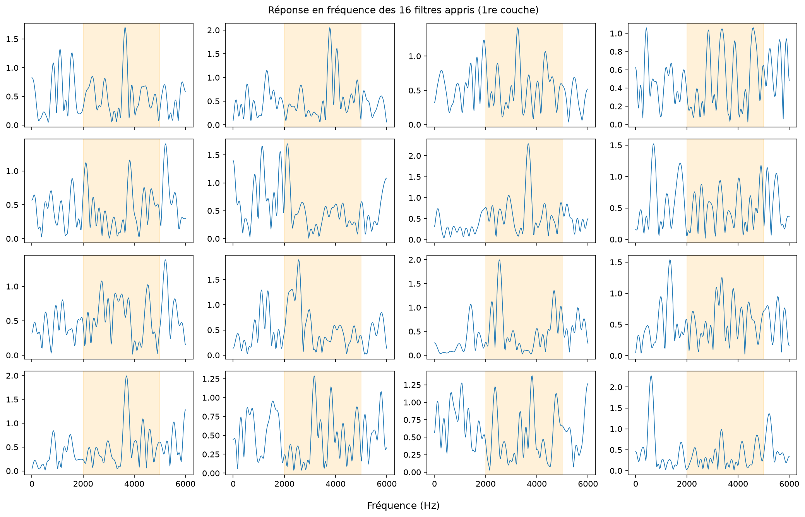
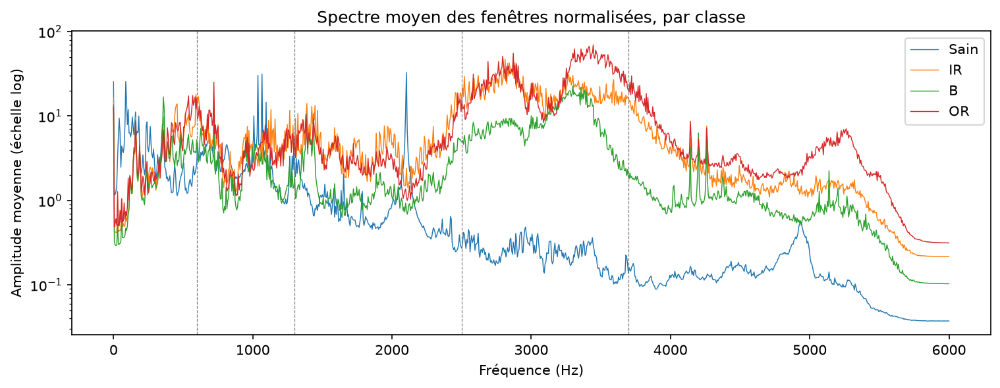
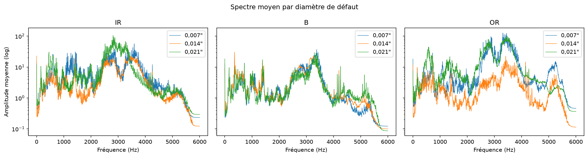
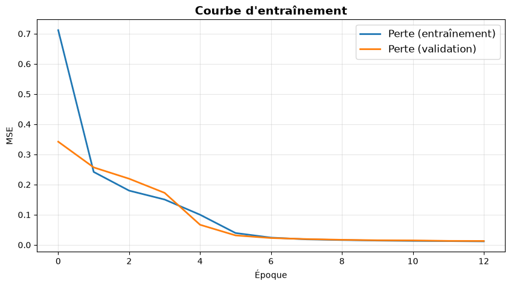
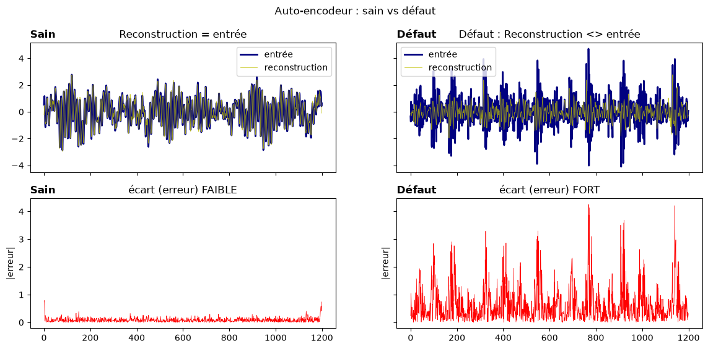
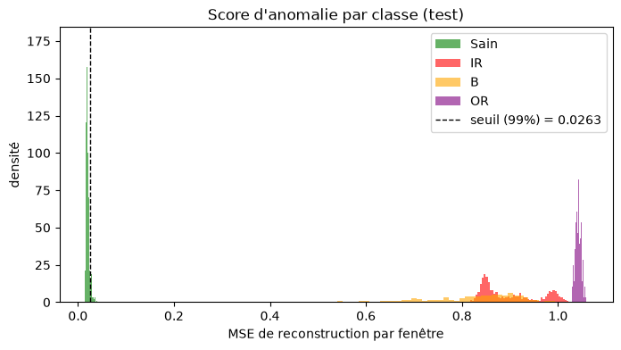
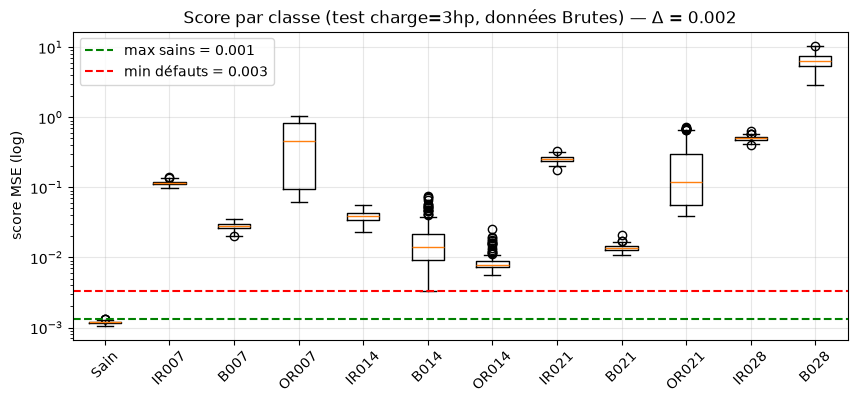
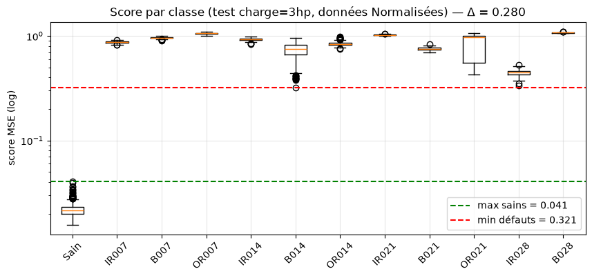

# Modèles machine learning

## Objectif

Ce rapport présente les modèles de classification construits à partir des
indicateurs vibratoires, et évalue leur capacité à reconnaître un défaut sur
des roulements déjà vus et sur des roulements nouveaux. Les données, la
sélection des 40 fichiers et le calcul des indicateurs temporels et
fréquentiels sont décrits dans le rapport d'analyse exploratoire
(`01_analyse_exploratoire`) ; ils sont recalculés ici sans être réaffichés.

## Préparation des données
Les 40 fichiers sont téléchargés depuis le site CWRU, découpés en fenêtres de 0,2 s, et décrits par huit indicateurs temporels et fréquentiels.
```{python}
#| include: false
#Bloc 1 : remplace les deux anciens blocs de chargement
#Ce que fait chaque partie
#1.1 recopie les tableaux des quatre pages du site. Les numéros ont été vérifiés aujourd’hui sur les pages elles-mêmes, et None correspond aux astérisques (données non disponibles).
#1.2 transforme ces tableaux en une table, le catalogue, avec une ligne par fichier et un nom qui résume tout. Par exemple, 12kDE_OR021at3_L2 se lit : 12 kHz, défaut côté entraînement, bague extérieure, 0,021", position 3 h, charge 2 HP.
#1.3 définit charger(nom). Elle télécharge le fichier la première fois, puis le relit en local. Elle choisit la bonne variable quand un fichier en contient deux, et prend la vitesse nominale si la vitesse mesurée manque. Ce sont les deux défauts du code précédent.

#Résultat attendu : 161 fichiers au catalogue, puis un tableau de synthèse :
import io
import urllib.request
from pathlib import Path

import numpy as np
import pandas as pd
import matplotlib.pyplot as plt
import scipy.signal as sci
from scipy.io import loadmat
from scipy.signal import hilbert
from scipy.stats import kurtosis
from scipy.fftpack import fft, fftfreq

# ------------------------------------------------------------------
# 1.1 Les numéros de fichiers du site, page par page
#     clé = (défaut, diamètre en millièmes de pouce)
#     valeur = numéros pour les charges 0, 1, 2, 3 HP (None = absent)
# ------------------------------------------------------------------
NORMAL = [97, 98, 99, 100]

PAGES = {
    "12kDE": (12000, {
        ("IR", 7): [105, 106, 107, 108],      ("B", 7): [118, 119, 120, 121],
        ("OR@6", 7): [130, 131, 132, 133],    ("OR@3", 7): [144, 145, 146, 147],
        ("OR@12", 7): [156, 158, 159, 160],
        ("IR", 14): [169, 170, 171, 172],     ("B", 14): [185, 186, 187, 188],
        ("OR@6", 14): [197, 198, 199, 200],
        ("IR", 21): [209, 210, 211, 212],     ("B", 21): [222, 223, 224, 225],
        ("OR@6", 21): [234, 235, 236, 237],   ("OR@3", 21): [246, 247, 248, 249],
        ("OR@12", 21): [258, 259, 260, 261],
        ("IR", 28): [3001, 3002, 3003, 3004], ("B", 28): [3005, 3006, 3007, 3008],
    }),
    "48kDE": (48000, {
        ("IR", 7): [109, 110, 111, 112],      ("B", 7): [122, 123, 124, 125],
        ("OR@6", 7): [135, 136, 137, 138],    ("OR@3", 7): [148, 149, 150, 151],
        ("OR@12", 7): [161, 162, 163, 164],
        ("IR", 14): [174, 175, 176, 177],     ("B", 14): [189, 190, 191, 192],
        ("OR@6", 14): [201, 202, 203, 204],
        ("IR", 21): [213, 214, 215, 217],     ("B", 21): [226, 227, 228, 229],
        ("OR@6", 21): [238, 239, 240, 241],   ("OR@3", 21): [250, 251, 252, 253],
        ("OR@12", 21): [262, 263, 264, 265],
    }),
    "12kFE": (12000, {
        ("IR", 7): [278, 279, 280, 281],      ("B", 7): [282, 283, 284, 285],
        ("OR@6", 7): [294, 295, 296, 297],    ("OR@3", 7): [298, 299, 300, 301],
        ("OR@12", 7): [302, 305, 306, 307],
        ("IR", 14): [274, 275, 276, 277],     ("B", 14): [286, 287, 288, 289],
        ("OR@6", 14): [313, None, None, None], ("OR@3", 14): [310, 309, 311, 312],
        ("IR", 21): [270, 271, 272, 273],     ("B", 21): [290, 291, 292, 293],
        ("OR@6", 21): [315, None, None, None], ("OR@3", 21): [None, 316, 317, 318],
    }),
}

RPM_NOMINAL = {0: 1797, 1: 1772, 2: 1750, 3: 1730}

# ------------------------------------------------------------------
# 1.2 Le catalogue : une ligne par fichier, avec un nom lisible
#     ex. 'Normal_L0', '12kDE_IR007_L0', '12kDE_OR021at3_L2', '48kDE_B014_L1'
# ------------------------------------------------------------------
lignes = []
for charge, num in enumerate(NORMAL):
    lignes.append({"nom": f"Normal_L{charge}", "numero": num, "source": "Normal",
                   "fs": 12000, "defaut": "Sain", "position_OR": None,
                   "diametre_mils": 0, "charge_hp": charge})

for source, (fs, table) in PAGES.items():
    for (defaut, diametre), numeros in table.items():
        localisation, _, position = defaut.partition("@")
        for charge, num in enumerate(numeros):
            if num is None:
                continue
            nom = f"{source}_{localisation}{diametre:03d}" + (f"at{position}" if position else "") + f"_L{charge}"
            lignes.append({"nom": nom, "numero": num, "source": source, "fs": fs,
                           "defaut": localisation, "position_OR": position or None,
                           "diametre_mils": diametre, "charge_hp": charge})

catalogue = pd.DataFrame(lignes).set_index("nom")
catalogue["rpm_nominal"] = catalogue["charge_hp"].map(RPM_NOMINAL)

# ------------------------------------------------------------------
# 1.3 Lecture d'un fichier depuis le site (copie locale sous un nom lisible)
# ------------------------------------------------------------------
URL_CWRU = "https://engineering.case.edu/sites/default/files/"
CACHE = Path("../data/cwru_cache")

def charger(nom):
    """Renvoie {'DE', 'FE', 'BA', 'fs', 'rpm'} pour un fichier du catalogue
    (ex. '12kDE_IR007_L0')."""
    info = catalogue.loc[nom]
    numero = int(info["numero"])
    chemin = CACHE / f"{nom}__{numero}.mat"            # ex. 12kDE_IR007_L0__105.mat

    if not chemin.exists():                            # 1re fois : téléchargement depuis le site
        CACHE.mkdir(parents=True, exist_ok=True)
        with urllib.request.urlopen(URL_CWRU + f"{numero}.mat") as reponse:
            chemin.write_bytes(reponse.read())
    mat = loadmat(chemin)

    def choisir(suffixe):                              # privilégie la variable du bon numéro
        cles = [k for k in mat if k.endswith(suffixe)]
        bonne = [k for k in cles if k.startswith(f"X{numero:03d}")]
        return (bonne or cles or [None])[0]

    signaux = {"fs": int(info["fs"])}
    for canal in ["DE", "FE", "BA"]:
        cle = choisir(f"_{canal}_time")
        signaux[canal] = None if cle is None else np.ravel(mat[cle])
    cle_rpm = choisir("RPM")
    signaux["rpm"] = float(np.squeeze(mat[cle_rpm])) if cle_rpm else float(info["rpm_nominal"])
    return signaux

from IPython.display import Markdown

tab = catalogue.groupby(["source", "defaut"]).size().unstack(fill_value=0)
tab = tab[["Sain", "IR", "B", "OR"]].reindex(["Normal", "12kDE", "48kDE", "12kFE"])
tab = tab.reset_index().rename(columns={"source": "Source", "IR": "Bague int. (IR)",
                                        "B": "Bille (B)", "OR": "Bague ext. (OR)"})
Markdown(tab.to_markdown(index=False))
```

```{python}
#| include: false
est_sain   = catalogue["source"] == "Normal"
est_12kDE  = catalogue["source"] == "12kDE"
bon_defaut = catalogue["defaut"].isin(["IR", "B"]) | (catalogue["position_OR"] == "6")
bon_diam   = catalogue["diametre_mils"].isin([7, 14, 21])

selection = catalogue[est_sain | (est_12kDE & bon_defaut & bon_diam)]
selection.groupby(["defaut", "diametre_mils"]).size().unstack(fill_value=0)
```

```{python}
#| include: false
def indicateurs(x):
    rms = np.sqrt(np.mean(x**2))
    pic = np.max(np.abs(x))
    return {"RMS": rms, "Pic": pic, "Crete": pic / rms,
            "Kurtosis": kurtosis(x, fisher=False)}

DUREE_FENETRE = 0.2      # secondes

lignes = []
for nom, info in selection.iterrows():
    s = charger(nom)                                   # téléchargement la 1re fois
    x, fs = s["DE"], s["fs"]
    taille = int(DUREE_FENETRE * fs)
    for i in range(len(x) // taille):
        res = {"fichier": nom, "fenetre": i, "rpm": s["rpm"], **info.to_dict()}
        res.update(indicateurs(x[i*taille:(i+1)*taille]))
        lignes.append(res)

table = pd.DataFrame(lignes)
table["classe"] = np.where(table["defaut"] == "Sain", "Sain",
                           table["defaut"] + table["diametre_mils"].astype(str).str.zfill(3))

Path("../data/features").mkdir(parents=True, exist_ok=True)
table.to_csv("../data/features/table_indicateurs.csv", index=False)

#print(f"{len(table)} fenêtres issues de {table['fichier'].nunique()} fichiers")
table.groupby(["classe", "charge_hp"]).size().unstack()
```

```{python}
#| include: false
INDICATEURS = ["RMS", "Pic", "Crete", "Kurtosis"]
ORDRE = ["Sain", "IR007", "IR014", "IR021", "B007", "B014", "B021",
         "OR007", "OR014", "OR021"]
```

```{python}
#| include: false
from scipy.signal import butter, sosfiltfilt, hilbert

COEF_DE = {"BPFI": 5.4152, "BPFO": 3.5848, "BSF": 4.7135}   # roulement SKF 6205
BANDE = (2000, 5000)                                         # bande de résonance (Hz)

def enveloppe(x, fs, bande=BANDE):
    """Filtre passe-bande, puis enveloppe (module du signal analytique)."""
    sos = butter(4, bande, btype="bandpass", fs=fs, output="sos")
    x_filt = sosfiltfilt(sos, x)
    env = np.abs(hilbert(x_filt))
    return x_filt, env

def indicateurs_spectraux(x_filt, env, fs, rpm, coefs=COEF_DE):
    """Indicateurs d'une fenêtre : énergie de la bande et rapports signal/bruit
    du spectre d'enveloppe aux fréquences BPFI, BPFO et BSF."""
    n = len(env)
    amp = np.abs(np.fft.rfft(env - env.mean())) * 2 / n
    freqs = np.fft.rfftfreq(n, d=1 / fs)
    fond = np.median(amp[(freqs >= 10) & (freqs <= 1000)])   # niveau de bruit
    f_rot = rpm / 60
    res = {"RMS_bande": np.sqrt(np.mean(x_filt ** 2))}
    for nom, coef in coefs.items():
        total = 0.0
        for k in (1, 2, 3):                                   # 3 premières harmoniques
            f = k * coef * f_rot
            tol = max(0.02 * f, 1.5 * freqs[1])               # tolérance de ±2 %
            total += amp[(freqs >= f - tol) & (freqs <= f + tol)].max()
        res[f"Env_{nom}"] = total / fond
    return res
```

```{python}
#| include: false
lignes = []
for nom in selection.index:
    s = charger(nom)
    x, fs, rpm = s["DE"], s["fs"], s["rpm"]
    x_filt, env = enveloppe(x, fs)                     # une fois par fichier
    taille = int(DUREE_FENETRE * fs)
    for i in range(len(x) // taille):
        sl = slice(i * taille, (i + 1) * taille)
        res = {"fichier": nom, "fenetre": i}
        res.update(indicateurs_spectraux(x_filt[sl], env[sl], fs, rpm))
        lignes.append(res)

spectre = pd.DataFrame(lignes)
table = table.merge(spectre, on=["fichier", "fenetre"], how="left",
                    validate="one_to_one")
table.to_csv("../data/features/table_indicateurs.csv", index=False)
```

## Premier modèle de classification

### Méthode

On cherche à prédire la **localisation du défaut** (Sain, IR, B, OR) à partir
des huit indicateurs temporels et fréquentiels. Le modèle est une forêt
aléatoire, avec des poids de classes équilibrés pour compenser le nombre plus
élevé de fenêtres saines.

Pour éviter que le modèle reconnaisse simplement les enregistrements, la
validation se fait **par charge** : le modèle est entraîné sur trois charges
et évalué sur la quatrième, qu'il n'a jamais vue. L'opération est répétée
pour chacune des quatre charges.


```{python}
#| label: tbl-validation-charge
#| tbl-cap: "Exactitude du modèle pour chaque charge laissée de côté."
from sklearn.ensemble import RandomForestClassifier
from sklearn.metrics import accuracy_score, confusion_matrix

VARIABLES = ["RMS", "Pic", "Crete", "Kurtosis",
             "RMS_bande", "Env_BPFI", "Env_BPFO", "Env_BSF"]
CIBLE = "defaut"
ORDRE_LOC = ["Sain", "IR", "B", "OR"]

scores, predictions = [], []
for charge_test in range(4):
    app  = table[table["charge_hp"] != charge_test]     # apprentissage : 3 charges
    test = table[table["charge_hp"] == charge_test]     # test : la 4e charge
    modele = RandomForestClassifier(n_estimators=300, class_weight="balanced",
                                    random_state=0)
    modele.fit(app[VARIABLES], app[CIBLE])
    pred = modele.predict(test[VARIABLES])
    scores.append({"Charge testée (HP)": charge_test,
                   "Fenêtres testées": len(test),
                   "Exactitude (%)": round(100 * accuracy_score(test[CIBLE], pred), 1)})
    predictions.append(test.assign(prediction=pred))

predictions = pd.concat(predictions)
Markdown(pd.DataFrame(scores).to_markdown(index=False))
```

Le modèle classe correctement 97 à 99,8 % des fenêtres de la charge laissée
de côté. Il est donc robuste à la charge, ce qui est cohérent avec le faible
effet de la charge observé sur les indicateurs. Ce résultat doit cependant
être interprété avec prudence : pour une classe donnée, les quatre charges
ont été enregistrées sur le même roulement. Le modèle est donc testé sur un
roulement qu'il a déjà vu, dans des conditions légèrement différentes, et
non sur un roulement nouveau.

```{python}
#| label: tbl-confusion
#| tbl-cap: "Matrice de confusion, toutes charges de test confondues (nombre de fenêtres)."
mc = pd.DataFrame(confusion_matrix(predictions[CIBLE], predictions["prediction"],
                                   labels=ORDRE_LOC),
                  index=ORDRE_LOC, columns=ORDRE_LOC)
mc.index.name = "Réel \\ Prédit"
Markdown(mc.reset_index().to_markdown(index=False))
```


Le roulement sain est parfaitement reconnu (aucune fausse alarme ni aucun
défaut manqué), de même que les défauts de bague intérieure (99,7 %). Les
erreurs se concentrent sur la confusion entre défauts de bille et de bague
extérieure (42 des 45 fenêtres mal classées), cohérente avec les
observations précédentes : le fichier B021 présente une signature BPFO, et
le défaut OR014, sans signature ni énergie marquée, ressemble aux défauts
de bille.

## Prédiction de la dimension du défaut

### Méthode

On cherche à prédire le diamètre du défaut (0,007", 0,014" ou 0,021") à partir
des huit indicateurs, sur les seules fenêtres défectueuses. Chaque diamètre
correspondant, pour une localisation donnée, à un seul roulement, deux
validations sont comparées :

- **par charge** : le modèle est testé sur une charge qu'il n'a pas vue, mais
  sur des roulements déjà vus à d'autres charges ;
- **par localisation** : le modèle apprend les tailles sur deux localisations
  et les prédit sur la troisième, c'est-à-dire sur des roulements qu'il n'a
  jamais vus. Seule une signature de la taille commune aux différents types de
  défaut permet de réussir ce test.


```{python}
#| label: fonction-diametre
defauts = table[table["defaut"] != "Sain"]
CIBLE_D = "diametre_mils"
ORDRE_D = [7, 14, 21]

def evaluer_diametre(groupe_test, nom_groupe):
    """Validation croisée : chaque valeur de `groupe_test` est mise de côté à tour de rôle."""
    scores, preds = [], []
    for g in sorted(defauts[groupe_test].unique(), key=str):
        app  = defauts[defauts[groupe_test] != g]
        test = defauts[defauts[groupe_test] == g]
        modele = RandomForestClassifier(n_estimators=300, random_state=0)
        modele.fit(app[VARIABLES], app[CIBLE_D])
        test = test.assign(prediction=modele.predict(test[VARIABLES]))
        juste = test[CIBLE_D] == test["prediction"]
        rappel = 100 * juste.groupby(test[CIBLE_D]).mean()
        ligne = {nom_groupe: g, "Exactitude (%)": round(100 * juste.mean(), 1)}
        ligne.update({f'0,{d:03d}"': round(rappel[d], 1) for d in ORDRE_D})
        scores.append(ligne)
        preds.append(test)
    return pd.DataFrame(scores), pd.concat(preds)
```

### Résultats

```{python}
#| label: tbl-diametre-charge
#| tbl-cap: "Prédiction du diamètre, validation par charge : exactitude globale et, pour chaque diamètre réel, pourcentage de fenêtres correctement reconnues."
scores_dc, _ = evaluer_diametre("charge_hp", "Charge (HP)")
Markdown(scores_dc.to_markdown(index=False))
```

En validation par charge, le diamètre est correctement prédit pour 96 à
98,5 % des fenêtres. Les colonnes par diamètre donnent, pour chaque taille
réelle, le pourcentage de fenêtres correctement reconnues : le diamètre de
0,007" l'est presque systématiquement (98,7 à 100 %), et les rares erreurs
portent sur les diamètres de 0,014" et 0,021" (au minimum 92 %). Ce test
porte cependant sur des roulements déjà vus à d'autres charges : chaque
diamètre correspondant à un seul roulement par localisation, le modèle
peut identifier le roulement plutôt que la taille du défaut.

```{python}
#| label: tbl-diametre-localisation
#| tbl-cap: "Prédiction du diamètre, validation par localisation (roulements jamais vus) : exactitude globale et par diamètre (%)."
scores_dl, preds_dl = evaluer_diametre("defaut", "Localisation")
Markdown(scores_dl.to_markdown(index=False))
```

Sur des roulements jamais vus, l'exactitude chute à 33 % pour les défauts
de bille (niveau du hasard : toutes les fenêtres sont prédites 0,014"),
59 % pour la bague intérieure et 50 % pour la bague extérieure. Le diamètre
de 0,007" n'est jamais reconnu, alors qu'il l'était dans 98,7 à 100 % des
cas en validation par charge : le modèle identifiait les roulements, et non
la taille de leur défaut. Les quelques réussites s'expliquent par une
coïncidence de niveaux d'énergie (défauts de 0,021" très énergétiques et de
0,014" très faibles pour les bagues), qui ne constitue pas une signature
physique de la taille.

Avec un seul roulement par combinaison de localisation et de taille, les
données CWRU ne permettent pas d'apprendre une relation généralisable entre
le signal vibratoire et la dimension du défaut.

```{python}
#| label: tbl-diametre-confusion
#| tbl-cap: "Matrice de confusion du diamètre, validation par localisation (nombre de fenêtres)."
noms_d = [f'0,{d:03d}"' for d in ORDRE_D]
mc_dl = pd.DataFrame(confusion_matrix(preds_dl[CIBLE_D], preds_dl["prediction"],
                                      labels=ORDRE_D),
                     index=noms_d, columns=noms_d)
mc_dl.index.name = "Réel \\ Prédit"
Markdown(mc_dl.reset_index().to_markdown(index=False))
```

La matrice de confusion confirme l'absence de signature de la taille.
Aucune fenêtre de 0,007" n'est correctement classée : les deux tiers sont
prédites 0,021" (défauts de bague, très énergétiques), le tiers restant
0,014" (défauts de bille). Le modèle ne prédit d'ailleurs presque jamais
0,007". Les bons classements apparents de 0,014" et 0,021" résultent de deux
règles propres aux roulements de ce banc (forte énergie associée à 0,021",
faible énergie ou défaut de bille associés à 0,014"), et non d'une relation
physique entre le signal et la dimension du défaut.

### Conclusion sur la dimension du défaut

La dimension du défaut est prédite avec 96 à 98,5 % d'exactitude lorsque le
modèle est évalué sur des roulements déjà vus, mais avec 47,5 % seulement sur
des roulements nouveaux, pour un niveau de hasard de 33 %, et sans qu'aucune
fenêtre de 0,007" ne soit reconnue. L'écart entre ces deux résultats mesure
ce que le modèle avait appris par cœur.

Dans le jeu CWRU, chaque combinaison de localisation et de diamètre
correspond à un seul roulement : l'effet de la taille est confondu avec
celui du roulement et de son montage. Ces données ne permettent donc pas
d'estimer la dimension d'un défaut sur un roulement inconnu. Les modèles
développés dans la suite du projet se limiteront à la détection et à la
localisation du défaut ; l'estimation de la sévérité nécessitera des
données comportant plusieurs roulements par taille, ou des essais de
dégradation progressive.


## Prédiction du diamètre sur un second roulement

### Principe

Les défauts ont aussi été créés sur le roulement côté ventilateur, un SKF 6203,
avec les mêmes localisations et les mêmes diamètres. On dispose ainsi de deux
roulements par combinaison de localisation et de diamètre. Le modèle apprend
les diamètres sur le roulement côté entraînement, puis doit les retrouver sur
le roulement côté ventilateur, qu'il n'a jamais vu, pour un même type de défaut.
Chaque défaut est mesuré par l'accéléromètre le plus proche. L'analyse porte sur
les défauts de bague intérieure et de bille, le plan étant incomplet pour la
bague extérieure côté ventilateur.

```{python}
#| label: tables-de-fe
COEF_FE = {"BPFI": 4.9469, "BPFO": 3.0530, "BSF": 3.9874}   # roulement SKF 6203

def construire_table(sel, canal, coefs):
    """Indicateurs temporels et fréquentiels par fenêtre, pour un canal donné."""
    lignes = []
    for nom, info in sel.iterrows():
        s = charger(nom)
        x, fs, rpm = s[canal], s["fs"], s["rpm"]
        x_filt, env = enveloppe(x, fs)
        taille = int(DUREE_FENETRE * fs)
        for i in range(len(x) // taille):
            sl = slice(i * taille, (i + 1) * taille)
            res = {"fichier": nom, "fenetre": i, "canal": canal, **info.to_dict()}
            res.update(indicateurs(x[sl]))
            res.update(indicateurs_spectraux(x_filt[sl], env[sl], fs, rpm, coefs))
            lignes.append(res)
    return pd.DataFrame(lignes)

base = catalogue["defaut"].isin(["IR", "B"]) & catalogue["diametre_mils"].isin([7, 14, 21])
table_de = construire_table(catalogue[base & (catalogue["source"] == "12kDE")], "DE", COEF_DE)
table_fe = construire_table(catalogue[base & (catalogue["source"] == "12kFE")], "FE", COEF_FE)
```


### Résultats

```{python}
#| label: tbl-diametre-fe
#| tbl-cap: "Diamètre appris sur le roulement côté entraînement et prédit sur le roulement côté ventilateur : exactitude globale et, pour chaque diamètre réel, % de fenêtres bien reconnues."
JEUX = {"Tous": ["RMS", "Pic", "Crete", "Kurtosis",
                 "RMS_bande", "Env_BPFI", "Env_BPFO", "Env_BSF"],
        "Sans unité": ["Crete", "Kurtosis", "Env_BPFI", "Env_BPFO", "Env_BSF"]}

lignes = []
for nom_jeu, var in JEUX.items():
    for loc in ["IR", "B"]:
        app  = table_de[table_de["defaut"] == loc]      # roulement côté entraînement
        test = table_fe[table_fe["defaut"] == loc]      # roulement côté ventilateur
        modele = RandomForestClassifier(n_estimators=300, random_state=0)
        modele.fit(app[var], app["diametre_mils"])
        test = test.assign(prediction=modele.predict(test[var]))
        juste = test["diametre_mils"] == test["prediction"]
        rappel = 100 * juste.groupby(test["diametre_mils"]).mean()
        ligne = {"Indicateurs": nom_jeu, "Localisation": loc,
                 "Exactitude (%)": round(100 * juste.mean(), 1)}
        ligne.update({f'0,{d:03d}"': round(rappel[d], 1) for d in ORDRE_D})
        lignes.append(ligne)

Markdown(pd.DataFrame(lignes).to_markdown(index=False))
```

### Conclusion générale

Sur les données CWRU, les indicateurs vibratoires distinguent sans erreur
un roulement défectueux d'un roulement sain, grâce à l'énergie des chocs
dans la bande de résonance de la structure. Ce résultat repose cependant
sur un seul roulement sain : le principe de détection est établi, mais les
seuils de décision sont propres à ce banc d'essai.

La dimension du défaut, en revanche, ne peut pas être estimée sur un
roulement inconnu : chaque taille correspondant à un seul roulement par
localisation, son effet est confondu avec celui du roulement. Il s'agit
d'une limite du plan d'expérience, et non d'une impossibilité physique.

En pratique, ces résultats orientent vers une surveillance fondée sur
l'évolution de chaque roulement par rapport à son propre état initial
(détection d'écart à une ligne de base, à la manière d'une carte de
contrôle), qui ne nécessite pas d'exemples de défauts. L'estimation de la
sévérité ou de la durée de vie résiduelle nécessitera en revanche des
essais de dégradation progressive sur plusieurs roulements, dans des
conditions variées, afin d'apprendre une loi de dégradation commune que
l'on ajustera ensuite à chaque nouveau roulement.


# Modèles deep learning

## Réseau de neurones convolutif (CNN 1D)

<!-- Résultats issus du notebook Codes/07_cnn1d.ipynb (novembre 2026). À mettre à jour si le notebook est relancé. -->

Les modèles précédents utilisent des indicateurs choisis à la main (RMS, kurtosis, enveloppe…). Un réseau de neurones convolutif part au contraire du **signal brut** et apprend lui-même les filtres utiles. La question posée est la même que pour la forêt aléatoire : **où se trouve le défaut ?** (Sain, IR, B ou OR), avec une validation par diamètre, c'est-à-dire sur des roulements que le modèle n'a jamais vus.

Les calculs sont réalisés dans le notebook `Codes/07_cnn1d.ipynb`, car l'apprentissage prend plusieurs minutes et nécessite la bibliothèque PyTorch. Ce rapport en reprend les résultats.

### Données et architecture

Chaque enregistrement est découpé en fenêtres de 2 048 points consécutifs, soit 0,17 s ou environ 5 tours d'arbre à 1 797 tr/min. Les 40 enregistrements donnent 2 953 fenêtres. Chaque fenêtre est centrée et réduite : le réseau voit la **forme** du signal, pas son niveau. Chaque fenêtre reçoit l'étiquette de son enregistrement.

::: {#tbl-cnn-architecture}

| Étape | Opération | Sortie | Paramètres |
|---|---|---|---:|
| Bloc 1 | 16 filtres de 64 points, pas de 8 | 16 × 128 | 1 072 |
| Bloc 2 | 32 filtres de 3 points | 32 × 64 | 1 632 |
| Bloc 3 | 64 filtres de 3 points | 64 × 32 | 6 336 |
| Bloc 4 | 64 filtres de 3 points | 64 × 16 | 12 480 |
| Moyenne | moyenne sur le temps | 64 | 0 |
| Décision | couche linéaire | 4 | 260 |
| **Total** | | | **21 780** |

Architecture du réseau. Chaque bloc enchaîne convolution, normalisation, ReLU et réduction de moitié (MaxPool).

:::

Le premier filtre est long (64 points, soit 5,3 ms), de l'ordre de l'intervalle entre deux chocs d'un défaut de bague intérieure. Chaque valeur du dernier bloc couvre environ 34 ms de signal, soit un tour d'arbre. La moyenne sur le temps rend la décision indépendante de la position des chocs dans la fenêtre. La dernière couche est une régression logistique multinomiale sur les 64 caractéristiques apprises par le réseau.

L'apprentissage minimise l'entropie croisée pondérée par classe (même pondération que `class_weight="balanced"` pour la forêt aléatoire), avec l'optimiseur Adam (taux d'apprentissage 10⁻³), par lots de 64 fenêtres, pendant 8 époques. Les poids initiaux et l'ordre des lots sont tirés au hasard : l'apprentissage est donc répété avec 3 graines aléatoires.

### Résultats en validation par diamètre

::: {#tbl-cnn-rappel}

| Classe | Rappel moyen (%) | Écart-type (%) |
|---|---:|---:|
| Global | 72,0 | 3,6 |
| Sain | 100,0 | 0,0 |
| IR | 43,3 | 8,4 |
| B | 99,5 | 0,4 |
| OR | 49,9 | 20,9 |

Rappel du CNN par classe, en validation par diamètre. Moyenne et écart-type entre 3 graines.

:::

Le roulement sain est toujours reconnu. B l'est presque toujours, mais ce chiffre est trompeur : B sert de classe par défaut (voir plus bas). IR et OR sont reconnus environ une fois sur deux. Pour OR, le résultat varie fortement d'une graine à l'autre : relancer l'apprentissage suffit à faire passer la reconnaissance d'environ 30 % à 70 %. La forêt aléatoire n'a pas été évaluée sur les mêmes fenêtres, la comparaison directe reste donc à faire.

### Ce que le réseau a appris

{#fig-cnn-filtres width=100%}

Plusieurs filtres ont un pic net vers 3,7 kHz et d'autres vers 2,5 kHz (@fig-cnn-filtres). Sans aucune indication sur les fréquences, le réseau a retrouvé la zone de résonance excitée par les chocs, à l'intérieur de la bande retenue pour l'analyse d'enveloppe. D'autres filtres écoutent des bandes plus basses (600 Hz et 1,3 kHz), probablement des modes de vibration du banc d'essai. Quelques-uns n'ont pas de pic dominant.

{#fig-cnn-spectre-classes width=100%}

Le spectre moyen par classe explique ces choix (@fig-cnn-spectre-classes). Au-dessus de 2 kHz, les défauts dépassent le roulement sain d'un facteur 10 à 100. IR culmine vers 2,8–3,3 kHz, OR vers 3,4–3,5 kHz avec une seconde bosse propre vers 5,2 kHz, et B a la même forme que les deux autres, à un niveau 3 à 5 fois plus bas. Ce qui distingue physiquement IR et OR, le rythme des chocs (BPFI ≈ 162 Hz, BPFO ≈ 107 Hz), n'apparaît pas dans ce spectre : il n'est visible que dans le spectre de l'enveloppe.

### Pourquoi le réseau ne généralise pas

{#fig-cnn-spectre-diametres width=100%}

Le spectre change d'un diamètre à l'autre de façon irrégulière (@fig-cnn-spectre-diametres). B est très homogène, mais OR 0,014" est environ dix fois plus faible que OR 0,007" et 0,021" dans la zone de résonance. La taille du défaut n'est pas une échelle de gravité régulière : chaque diamètre correspond à un autre roulement, monté séparément.

Pour comprendre l'échec, un réseau a été entraîné sans les roulements de 0,014" (graine 0), puis appliqué à ces roulements. En apprentissage, il classe correctement les 2 245 fenêtres, soit 100 %. En test, il classe **toutes** les fenêtres de 0,014" en B, y compris les IR et les OR, et avec une forte assurance (@tbl-cnn-probas).

::: {#tbl-cnn-probas}

| Enregistrement | Sain | IR | B | OR |
|---|---:|---:|---:|---:|
| B014, 0 HP | 0,00 | 0,01 | 0,99 | 0,00 |
| B014, 1 HP | 0,00 | 0,00 | 0,99 | 0,00 |
| B014, 2 HP | 0,00 | 0,01 | 0,99 | 0,00 |
| B014, 3 HP | 0,00 | 0,01 | 0,98 | 0,01 |
| IR014, 0 HP | 0,03 | 0,24 | 0,69 | 0,03 |
| IR014, 1 HP | 0,01 | 0,04 | 0,93 | 0,02 |
| IR014, 2 HP | 0,01 | 0,02 | 0,96 | 0,01 |
| IR014, 3 HP | 0,00 | 0,01 | 0,98 | 0,01 |
| OR014, 0 HP | 0,00 | 0,00 | 0,99 | 0,00 |
| OR014, 1 HP | 0,00 | 0,00 | 0,99 | 0,00 |
| OR014, 2 HP | 0,00 | 0,00 | 0,99 | 0,00 |
| OR014, 3 HP | 0,00 | 0,01 | 0,98 | 0,01 |

Probabilités moyennes prédites pour les roulements de 0,014", avec un réseau entraîné sur les diamètres 0,007" et 0,021".

:::

L'explication tient au plan d'expérience. Chaque combinaison localisation × diamètre correspond à **un seul roulement**, mesuré à 4 charges. Pour apprendre ce qu'est un défaut de bague intérieure, le réseau ne dispose ici que de deux roulements (IR007 et IR021). Avec environ 21 800 paramètres, il apprend les particularités de ces roulements plutôt que ce qu'ils ont en commun avec un roulement nouveau. Les quelque 470 fenêtres par classe donnent une illusion de taille d'échantillon : c'est la pseudo-réplication déjà mesurée dans l'analyse exploratoire, où 98,9 % de la variance du RMS se situe entre enregistrements.

Une probabilité de 0,99 ne signifie pas une certitude. La sortie du réseau mesure la distance aux frontières apprises, et un signal inconnu peut tomber loin à l'intérieur d'une région. On ne peut donc pas utiliser la confiance du réseau pour signaler un cas douteux : un seuil à 0,8 n'aurait signalé qu'un enregistrement sur douze.

### Conclusion

1. Le CNN apprend parfaitement les roulements qu'il voit (100 % en apprentissage).
2. Ses filtres retrouvent des bandes physiquement pertinentes, en particulier la résonance vers 3,7 kHz.
3. Il ne généralise pas à un roulement nouveau. La limite vient du plan d'expérience (deux roulements par classe), et non de l'architecture : aucun réglage ne peut la lever.
4. Quand il se trompe, il le fait avec une confiance proche de 1, sans aucun signal d'alerte.

Trois pistes en découlent : comparer avec la forêt aléatoire sur les mêmes fenêtres ; ajouter un contrôle de nouveauté (T² de Hotelling, autoencodeur) qui signale un signal ne ressemblant à aucun roulement connu ; travailler sur un jeu comprenant davantage de roulements par classe, comme celui de l'université de Paderborn (32 roulements, dont 14 à défauts réels).


## Auto-encodeur : détection d'anomalie

<!-- Résultats issus des notebooks Codes/Robin/3.DL/1.AutoEncoder.ipynb et
     Codes/Robin/3.DL/2.AE_Tests_Robustesse.ipynb. À mettre à jour si les notebooks sont relancés. -->

### Principes

Un AE est un réseau de neurone composé d'un **encodeur**, qui compresse le signal en un vecteur réduit (le *bottleneck*), et d'un **décodeur**, qui reconstruit le signal à partir de ce vecteur. Entraîné à minimiser l'erreur de reconstruction (MSE), il apprend à ne retenir que l'essentiel d'un signal.

Pour la détection de défaut, on entraine le modèle **uniquement sur des signaux sains**. Il apprend alors "à quoi ressemble un roulement sain". Un signal défectueux (chocs jamais vus à l'entraînement) sera mal reconstruit : **l'erreur de reconstruction (MSE) par fenêtre sert de score d'anomalie**. C'est une approche non supervisée : aucun défaut n'est nécessaire pour apprendre, ce qui correspond davantage à la réalité industrielle, car il est facile d'enregistré le signal sain d'un roulement après son changement.

### Préparation des données

1. Fenêtrage par recouvrement
On créer des fenêtres dans le signal pour avoir d'avantage de données d'entrainement (comme précédement).
On veille à avoir des fenêtres assez longue pour ne pas perdre d'informations

2. Le recouvrement sert à mieux capter les chocs :
Sans recouvrement, un choc de défaut qui tomberait à cheval sur le partage de deux fenêtres est vue "à moitié" dans chaque fenêtre, le modèle verrait donc moins bien l'événement "choc". Avec du recouvrement, chaque événement apparaît complet dans au moins une fenêtre, on ne perd pas d'information.

3. Normalisation
On normalise le signal brut car l'amplitude peut varier (notamment avec la charge) et on cherche à capter les variations des signaux (les chocs), pas les valeurs absolues du signal.
Si la charge augmente, l'amplitude du signal (de la fenêtre) augmente, et le modèle va détecter une variation et donc un défaut, hors l'augmentation de charge n'est pas un défaut !

4. Split train test
On split par fichier (comme précédement), mais cette fois on ne garde que les signaux sains dans le train, c'est le principe de l'auto-encodeur.

### Le modèle Conv1D-AE

::: {#tbl-ae-architecture}

| Couche | Type | Sortie | Paramètres |
|---|---|---|---:|
| Entrée | InputLayer | (None, 1200, 1) | 0 |
| conv1d | Conv1D, 32 filtres, noyau 7 | (None, 1200, 32) | 256 |
| max_pooling1d | ÷2 | (None, 600, 32) | 0 |
| conv1d_1 | Conv1D, 16 filtres, noyau 5 | (None, 600, 16) | 2 576 |
| max_pooling1d_1 | ÷2 | (None, 300, 16) | 0 |
| conv1d_2 | Conv1D, 8 filtres, noyau 3 — **bottleneck** | (None, 300, 8) | 392 |
| conv1d_3 | Conv1D, 16 filtres, noyau 5 | (None, 300, 16) | 656 |
| up_sampling1d | ×2 | (None, 600, 16) | 0 |
| conv1d_4 | Conv1D, 32 filtres, noyau 7 | (None, 600, 32) | 3 616 |
| up_sampling1d_1 | ×2 | (None, 1200, 32) | 0 |
| conv1d_5 (sortie) | Conv1D, 1 filtre, noyau 7 | (None, 1200, 1) | 225 |
| **Total** | | | **7 721** |

Architecture du Conv1D-AE (`modele.summary()` du notebook `1.AutoEncoder.ipynb`) : 7 721 paramètres au total (30,16 Ko), tous entraînables. Le `None` en première position de chaque sortie est la dimension *batch*, laissée libre (le modèle accepte n'importe quel nombre de fenêtres d'un coup).

:::

**Pourquoi cette architecture ?**

- Le signal vibratoire est une **série 1D** : à chaque instant, une seule valeur (l'amplitude). Une convolution 1D fait glisser un petit filtre le long de cet unique axe (le temps) — c'est exactement la bonne opération, contrairement à une couche dense qui traiterait chaque échantillon indépendamment.
- La signature d'un défaut n'est pas le niveau du signal, mais des **chocs qui se répètent** à chaque passage sur le défaut (rythme BPFI/BPFO/BSF). Ce sont des motifs *locaux* et *répétés* : un filtre de convolution les détecte naturellement, car **le même kernel est appliqué à toutes les positions** (weight sharing) — un choc est reconnu partout pareil, et cela ne coûte que quelques paramètres.
- Les **noyaux impairs (7, 5, 3)** avec `padding="same"` ont un centre bien défini : l'alignement temporel entre l'entrée et la sortie est parfait. C'est indispensable ici, car la MSE se calcule **point à point** entre signal d'entrée et reconstruction.
- Le **bottleneck** (2 poolings = résolution temporelle ÷ 4, puis 8 filtres) est le goulot d'étranglement : toute l'information de la fenêtre doit tenir dans un résumé 4 fois plus grossier. Seules les structures **régulières** du signal sain y passent ; un choc isolé, trop bref pour ce résumé, est « oublié » — d'où la forte erreur de reconstruction sur les défauts.

Pour l'entrainement, on ajoute un EarlyStopping : 
`EarlyStopping(monitor="val_loss", patience=5, min_delta=0.01, restore_best_weights=True)` 
Il arrête l'entraînement si `val_loss` n'améliore plus d'au moins 0,01 pendant 5 époques (les progrès sont minces après ~10 époques) et restaure les meilleurs paramètres.

### Résultats

**Split par fichier** (notebook `1.AutoEncoder.ipynb`) :

| AUC | FPR (fausses alarmes) | FNR (défauts manqués) |
|----:|----------------------:|----------------------:|
| 1.000 | 6.45 % | 0.00 % |

La séparation sains/défauts est parfaite : AUC = 1,000 .
Le seuil est définit à 99 percentiles du train (p99), c'est à dire à la limite hautes d'erreur, avec une marge de 1%.
Aucun défaut n'est manqué (FNR=0%), par contre le taux de faux positif (FPR) observé à 6,45% est important mais reste de l'ordre du 1% théorique (le p99 garantit 1 % sur le *train*, pas sur le test).

Courbe d'apprentissage : `loss` (train) et `val_loss` (validation) descendent ensemble, donc pas d(overfiting) (ce serait `val_loss` qui remonte) ; l'arrêt précoce intervient quand les progrès deviennent faibles :

{#fig-ae-loss width=80% fig-align="center"}

Entrée vs reconstruction : à gauche une fenêtre **saine** (reconstruction fidèle, erreur faible), à droite une fenêtre **défaut** (les chocs ne sont pas reconstruits, erreur forte) :

{#fig-ae-reconstruction width=100% fig-align="center"}

Distribution du score d'anomalie (MSE par fenêtre) par classe sur le test : les défauts (IR, B, OR) ont des scores nettement plus hauts que le sain, et le seuil p99 (pointillé) les sépare :

{#fig-ae-densite width=80% fig-align="center"}

### Test de robustesse à la charge

Protocole inter-conditions (notebook `2.AE_Tests_Robustesse.ipynb`) : entraînement sur les charges 0, 1, 2 HP, test sur la charge 3 HP **jamais vue**, toutes sévérités (7/14/21/28 mils), comparaison brutes vs normalisées :

| variante | seuil (p99) | AUC | FPR | FNR |
|---|---:|---:|---:|---:|
| Normalisé | 0.0297 | 1.0 | 1.49 % | 0.0 % |
| Brut | 0.0011 | 1.0 | 97.90 % | 0.0 % |

En brut, l'amplitude absolue (qui croît avec la charge) brouille la détection sur la charge 3 HP : le seuil n'est plus cohérent, et la FPR explose : 97,9%. 
En normalisé, l'amplitude est gommée : FPR = 1,5 %. **La normalisation est donc essentielle dès que la charge varie.**

Scores par classe sur le test (charge 3 HP), échelle logarithme. 
Les pointillés marquent le **max des sains** (vert) et le **min des défauts** (rouge) 
La marge 'Δ = min défauts − max sains' mesure la séparation (Δ > 0 = séparation parfaite). 
Données **brutes** d'abord : les distributions se chevauchent, Δ est faible :

{#fig-ae-box-brut width=100% fig-align="center"}

Puis données **normalisées** : la marge Δ est nettement plus grande, le seuil sépare sains et défauts :

{#fig-ae-box-norm width=100% fig-align="center"}


### **Conclusion :**
- La charge a une influence pour ce type de modèle. Il sera donc important de l'entrainer sur des données saines sous différentes charges pour avoir une bonne détection.
- La normalisation des données permet de gommer l'effet charge, ce qui était un des aspects que nous voulions vérifier.
- Aucun faux négatif : impératif pour de la détection d'anomalie : mieux vaut trop d'alertes qu'un casse.
- Avec les données normalisées, le modèles identifie bien les défauts, même avec une faible sévérité.


### **Limites :**

Les données testées sont dans des conditions optimales : pas de bruit, défaut clairement marqué (même à faible sévérité), etc...
En situation réelle, les conditions seront beaucoup plus difficiles, les résultats seront probablement moins bon.

### **Suites possibles :**

- Tester sur des données issues du milieu industriel
- Améliorer l'étape de traitement de signal dans le préprocessing pour filtrer les parasites et le bruit
- Améliorer la définition des paramètres notamment :
    - Le seuil d'identification : joue sur le ratio **nombre alerte vs risque**
    - La taille des fenêtres et le callback: joue sur le ratio **performance vs coût (de calcul)**