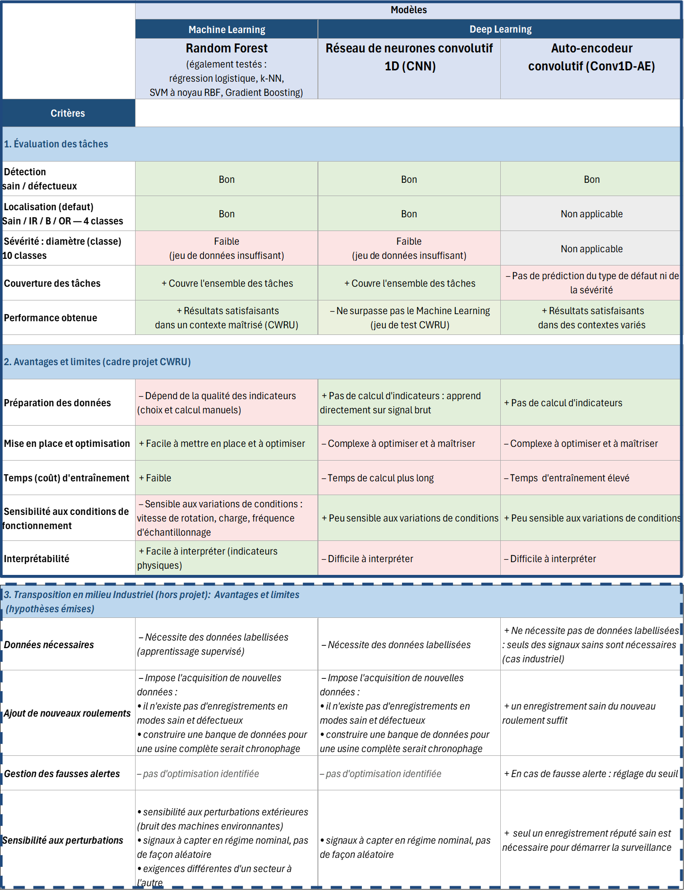



# La question posée
Ce rapport fait la synthèse des analyses du projet, présentées en détail dans le rapport d'analyse exploratoire (rapport 1) et le rapport sur les modèles de prédiction (rapport 2). Il propose un modèle final et porte un regard critique sur le travail réalisé.

Le projet pose trois questions, de difficulté croissante :

::: {#tbl-questions}

| Tâche | Question | Intérêt industriel |
|---|---|---|
| Détection | Le roulement est-il défectueux ? | Déclencher une intervention |
| Localisation | Où est le défaut : IR, B ou OR ? | Orienter le diagnostic |
| Taille | Quelle est la taille du défaut ? | Estimer la gravité |

Les trois questions posées aux données.

:::

Une réponse n'a de valeur que si elle reste juste sur un roulement **que le modèle n'a jamais vu** : c'est la situation d'une machine surveillée en usine. Chaque résultat est donc rapporté à l'un des trois niveaux de validation suivants, du plus facile au plus exigeant :

::: {#tbl-niveaux}

| Niveau | Ce qui est testé |
|---|---|
| Roulement déjà vu | Même roulement, à une charge non vue |
| Roulement nouveau | Autre roulement du même banc |
| Second roulement | Roulement côté ventilateur (FE) |

Les trois niveaux de validation utilisés dans ce rapport.

:::

Seuls les deux derniers niveaux renseignent sur la capacité d'un modèle à fonctionner sur une machine réelle. Le premier mesure surtout sa capacité à reconnaître des roulements qu'il connaît déjà.



# Les données et leur limite principale

Les données proviennent du banc d'essai du Case Western Reserve University (CWRU) Bearing Data Center. L'analyse porte sur 40 enregistrements échantillonnés à 12 kHz par l'accéléromètre côté entraînement (DE) : le roulement sain et les défauts de bague intérieure (IR), de bille (B) et de bague extérieure à 6 h (OR), de diamètres 0,007", 0,014" et 0,021", chacun mesuré à 4 charges (0 à 3 HP). Les défauts créés sur le roulement côté ventilateur (FE) servent de test externe.

**Quarante enregistrements, mais dix roulements.** Les défauts ont été usinés par électroérosion, un roulement par combinaison de localisation et de diamètre. Les 4 charges sont des mesures répétées **du même roulement** :

::: {#tbl-plan}

| Localisation | 0,007" | 0,014" | 0,021" |
|---|:-:|:-:|:-:|
| IR | 1 | 1 | 1 |
| B | 1 | 1 | 1 |
| OR (6 h) | 1 | 1 | 1 |

Nombre de roulements défectueux par case, côté entraînement. S'y ajoute un seul roulement sain. Chaque roulement est mesuré à 4 charges.

:::

Chaque enregistrement est découpé en fenêtres de quelques dixièmes de seconde, ce qui donne plusieurs milliers d'exemples. Mais ces fenêtres sont presque identiques au sein d'un même enregistrement : **98,9 % de la variabilité du RMS se situe entre enregistrements**. Ce sont des pseudo-réplicats. La taille d'échantillon réelle n'est pas le nombre de fenêtres, mais le nombre de roulements.

Trois conséquences pèsent sur toute la suite :

1. **La taille du défaut est confondue avec le roulement.** Chaque taille n'existe qu'une fois par localisation : on ne peut pas séparer l'effet de la taille de celui du roulement et de son montage.
2. **Deux roulements seulement par localisation** sont disponibles pour apprendre, quand le troisième sert au test. C'est trop peu pour apprendre ce qui est commun à tous les défauts d'un même type.
3. **Un seul roulement sain.** Les taux de fausses alertes sont tous mesurés sur ce roulement, à des charges différentes.

Ce sont des limites du **plan d'expérience**, et non des méthodes. Elles expliquent l'essentiel des résultats qui suivent.



# Tableau comparatif des modèles testés

{#fig-ml-p3 width=85% fig-align="center"}

# Le modèle proposé : la forêt aléatoire

## Principe

Le modèle proposé est la forêt aléatoire retenue dans le rapport 2. Elle prédit, pour chaque fenêtre de 0,2 s, l'état du roulement parmi quatre classes : sain, défaut de bague intérieure (IR), de bille (B) ou de bague extérieure (OR). Elle répond donc en une seule fois aux deux premières questions : détecter un défaut et le localiser.

Elle utilise les 9 indicateurs calculés sur chaque fenêtre : quatre indicateurs temporels (RMS, pic, facteur de crête, kurtosis) et cinq indicateurs spectraux (RMS_bande et l'amplitude de l'enveloppe aux fréquences BPFI, BPFO, BSF et FTF). Ses hyperparamètres ont été choisis par validation croisée imbriquée, en laissant de côté une charge à chaque pli.

## Pourquoi la forêt aléatoire

- **Elle est la meilleure sur les critères industriels.** Parmi les cinq familles de modèles comparées, elle est la seule à n'avoir ni défaut manqué ni fausse alerte, que l'on teste un enregistrement ou une charge non vus.
- **Elle s'appuie sur des indicateurs physiques.** Les indicateurs d'enveloppe sont liés aux fréquences de passage des billes sur le défaut : ils rendent le modèle moins dépendant du niveau d'énergie. Avec eux, les fausses alertes sur le second roulement sont divisées par deux.
- **Elle est interprétable.** L'importance de chaque indicateur se lit directement, et chaque indicateur a un sens pour un expert en vibrations.
- **Elle est simple à mettre en œuvre.** Elle ne demande ni mise à l'échelle des variables ni calcul lourd, et se réentraîne en quelques secondes.

## Ses limites

- **Elle a besoin d'exemples de défauts étiquetés**, rares et coûteux à obtenir en usine.
- **Sa localisation se dégrade sur un roulement nouveau.** Sur le roulement côté ventilateur, la plupart des défauts de bague intérieure sont classés comme défauts de bille. La localisation reste une piste pour l'expert, à confirmer par le spectre d'enveloppe.
- **Ses seuils sont propres au banc d'essai.** Appliquée au roulement côté ventilateur, plus énergétique, elle déclenche environ 11 % de fausses alertes.
- **Elle n'estime pas la taille du défaut** : les données ne le permettent pas.

# Le modèle proposé face à des détecteurs plus simples

La forêt aléatoire demande des défauts étiquetés et une quarantaine de modèles comparés pour être choisie. Pour la seule détection, fait-elle mieux que deux alternatives plus simples ?

- **un seuil sur le RMS**, fixé sur les fenêtres saines : c'est la référence métier, à la manière d'une carte de contrôle ;
- **un autoencodeur**, entraîné uniquement sur des signaux sains, qui apprend la forme du signal sain et signale ce qu'il reconstruit mal.

Ces deux détecteurs n'ont besoin d'aucun exemple de défaut. Les seuils sont fixés au percentile 99 des fenêtres saines d'apprentissage. Deux situations sont testées : une charge jamais vue (3 HP) et un roulement jamais vu (côté ventilateur).

## Autoencodeur et seuil sur le RMS

Sur le roulement d'apprentissage, les deux détecteurs ne manquent aucun défaut à une charge non vue. Le seuil sur le RMS ne commet aucune fausse alerte, mais de justesse : la fenêtre la plus faible du défaut de bille de 0,014" ne dépasse le seuil que d'environ 5 %. L'énergie dans la bande de résonance (RMS_bande) sépare mieux, mais le niveau du roulement sain y double presque entre 0 et 3 HP : le seuil déclenche alors 100 % de fausses alertes. L'autoencodeur, qui travaille sur le signal normalisé, reste à 1 à 2 % de fausses alertes sans connaître la charge.

Sur un roulement jamais vu, l'écart est net. Entraîné sur les seuls sains du roulement côté entraînement, l'autoencodeur sépare parfaitement sains et défauts du roulement côté ventilateur (AUC = 1 sur trois apprentissages), sans défaut manqué, avec 5,5 à 10,5 % de fausses alertes à 3 HP selon l'apprentissage. Le seuil sur le RMS, appris dans les mêmes conditions, déclenche 98 % de fausses alertes : il doit être réappris pour chaque roulement.

## Forêt aléatoire et seuil sur le RMS

Sur le roulement d'apprentissage, la forêt aléatoire et le seuil sur le RMS font tous deux un sans-faute à une charge non vue. La forêt n'apporte donc rien pour la détection, mais elle localise le défaut, ce que le RMS ne sait pas faire.

Sur le roulement côté ventilateur, avec un apprentissage sur toutes les charges du roulement côté entraînement, la forêt aléatoire manque 1 fenêtre défectueuse sur 1 500 et déclenche 10,9 % de fausses alertes. Avec les mêmes fenêtres saines d'apprentissage, le seuil sur le RMS ne manque aucun défaut mais déclenche 48 % de fausses alertes, et le seuil sur RMS_bande 29 %. Le roulement sain côté ventilateur est plus énergétique, si bien que sur ce roulement, le sain le plus fort dépasse même le défaut le plus faible : aucun seuil sur le RMS ne peut les séparer parfaitement. En combinant plusieurs indicateurs, dont ceux de l'enveloppe, moins liés au niveau d'énergie, la forêt aléatoire divise les fausses alertes par quatre.

## Synthèse

::: {#tbl-detecteurs}

| Détecteur | Charge non vue | Second roulement | Sans défauts étiquetés | Localise |
|---|:-:|:-:|:-:|:-:|
| Seuil sur le RMS | 0 % | 48 % | oui | non |
| Forêt aléatoire | 0 % | 10,9 % | non | oui |
| Autoencodeur | 1 à 2 % | 3 à 7 % | oui | non |

Taux de fausses alertes des trois détecteurs. Aucun défaut n'est manqué, à une fenêtre près sur 1 500 pour la forêt aléatoire sur le second roulement. Les protocoles diffèrent légèrement : l'autoencodeur est appris sur les charges 0 à 2 HP et travaille sur des fenêtres de 0,1 s.

:::

La forêt aléatoire est retenue parce qu'elle est la seule à **localiser** le défaut, et qu'elle égale le seuil sur le RMS pour la détection sur le roulement d'apprentissage. Pour la seule détection sur un roulement nouveau, l'autoencodeur se transpose mieux que les deux autres, sans avoir besoin de défauts étiquetés. Les deux approches sont donc complémentaires (voir les perspectives).



# Analyse et difficultés rencontrées durant le projet {#sec-difficultes}

## Le projet data science, découverte d'un nouvel univers {#sec-diff-univers}

### Des principes physiques hors du programme de la formation

Aucun membre du groupe n'avait d'expérience en analyse vibratoire. Exploiter les signaux vibratoires a exigé des notions de traitement du signal non abordées en formation : **transformée de Fourier**, filtrage dans une bande de fréquences, **extraction d'enveloppe** (transformée de Hilbert) et fréquences caractéristiques des roulements (BPFI, BPFO, BSF). Ces notions avaient été abordées lors de notre cursus scolaire, plus ou moins lointain…

### Un type de données inhabituel : des calculs supplémentaires, et un risque associé

Avant toute modélisation, il a fallu construire la table d'apprentissage :

- **découper** chaque enregistrement en fenêtres de courte durée
- **calculer des indicateurs** sur chaque fenêtre (RMS, kurtosis, indicateurs spectraux…)

Même si l'on trouve des fonctions Python « prêtes à l'emploi », ces notions ont rendu l'analyse exploratoire plus longue et plus complexe : chaque calcul ajouté peut introduire une erreur ou une perte d'information, et donc déformer les données.

::: {.callout-tip title="À retenir"}
Cette expérience met en évidence que la data science peut s'appliquer à des domaines très variés.

Par ailleurs, il faut veiller à ce que chaque calcul ou transformation de données soit validé par les connaissances métier.
:::

## Prévisionnel : l'incertitude sur les données du projet {#sec-diff-previsionnel}

Notre objectif initial était de travailler sur des données d'entreprise (I-Care), auxquelles nous n'avons finalement pas eu accès. Le sujet restait proche, mais la nature et le volume de ces données auraient été très différents, et ils conditionnaient directement l'approche du projet.

Cette situation a créé une forte incertitude sur l'organisation du travail :

- des hésitations sur les tâches à réaliser, dues à l'absence de positionnement « métier »
- un démarrage plus lent, faute de savoir sur quelles données le projet porterait

::: {.callout-tip title="À retenir"}
Avant de lancer un projet, il faut parfois investir du temps pour s'assurer que les données seront disponibles à temps et avec une qualité suffisante, afin de ne pas engager un projet qui ne pourrait pas aboutir.
:::

## Les connaissances métier {#sec-diff-metier}

Le groupe disposait de bases en maintenance industrielle, mais ne connaissait pas la place de l'analyse vibratoire dans les stratégies de maintenance.

Les modèles ont été orientés vers trois objectifs : détecter tôt sans multiplier les fausses alertes, localiser le défaut, puis estimer sa gravité. Ces objectifs ont guidé nos choix de métriques (taux de défauts manqués, puis taux de fausses alertes, puis F1 macro), mais ils se sont construits progressivement, au fil du projet.

L'absence d'accompagnement de la part d'I-Care a freiné l'acquisition de l'expertise métier. Un échange avec des spécialistes nous aurait peut-être conduits à choisir d'autres objectifs, et par conséquent d'autres métriques d'évaluation.

::: {.callout-tip title="À retenir"}
Un des moyens de lever ce risque est de désigner un « sponsor » de projet : il garantit l'alignement stratégique avec la direction, l'allocation des ressources et la levée des blocages, et peut ouvrir l'accès aux experts métier.
:::

## Jeux de données : acquisition et compréhension {#sec-diff-donnees}

### Comprendre le montage d'essai

Le banc CWRU comporte deux roulements montés sur le même arbre, chacun surveillé par un accéléromètre (côté entraînement « DE » et côté ventilateur « FE »). Le défaut d'un roulement est aussi capté, de façon atténuée, par le capteur de l'autre. Il a donc fallu comprendre précisément quel roulement porte le défaut et quel capteur le mesure, avant de pouvoir constituer des jeux de données cohérents.

### Une documentation incomplète

L'acquisition des données a pris du temps, car leur description n'était pas toujours claire : plan d'expérience incomplet pour le roulement côté ventilateur (positions et charges manquantes), fréquence d'échantillonnage et vitesse de rotation parfois différentes entre le site et les fichiers, unité des signaux non précisée.

::: {.callout-tip title="À retenir"}
Dans un projet en entreprise, il est essentiel d'identifier dès le départ un interlocuteur capable de présenter les données brutes.

Comme pour beaucoup de sujets, une documentation adaptée reste essentielle pour assurer la continuité et la cohérence d'un projet au fil du temps.
:::

## Compétences techniques et théoriques {#sec-diff-competences}

Plusieurs compétences nécessaires au projet n'étaient pas totalement acquises, ou ne faisaient pas partie de la formation, au moment où nous en avions besoin :

- le traitement du signal (Fourier, enveloppe, filtrage), indispensable dès l'analyse exploratoire
- les protocoles de validation adaptés à des données groupées (validation croisée par fichier, par charge, validation imbriquée)
- le Deep Learning (CNN, auto-encodeur), abordé en formation alors que le projet était déjà avancé
- les outils de travail collaboratif (Git, GitHub) et de rédaction (Quarto), nouveaux pour une partie du groupe

## Pertinence de l'approche et des modèles : tous les objectifs initiaux ne sont pas atteints {#sec-diff-pertinence}

### Une exploration des modèles plutôt séquentielle

Les modèles de Machine Learning ont été testés les uns après les autres.

Leurs hyperparamètres ont bien été optimisés (recherche par grille en validation croisée).

Cependant, dans une démarche d'amélioration continue, il aurait été intéressant d'approfondir, dans une étape suivante, les deux meilleurs modèles pour tenter d'obtenir de meilleurs résultats.

### Sévérité et durée de vie résiduelle

Les résultats sur la sévérité des défauts, et donc sur l'estimation d'une durée de vie résiduelle, restent insuffisants en l'état. Les données CWRU ne comportent qu'un seul roulement par type et taille de défaut, ce qui ne permet pas d'apprendre une relation généralisable entre le signal et la taille du défaut.

Au-delà de la première mission (détecter un roulement défectueux), c'est pourtant un axe important pour l'industrie : il permet de planifier les interventions et de surveiller de près les éléments qui présentent les premiers signes de défaillance. Davantage de temps aurait permis de rechercher d'autres jeux de données, avec des essais de dégradation progressive.

::: {.callout-tip title="À retenir"}
Dans un projet, l'objectif final n'est pas toujours atteint : il faut savoir capitaliser sur les résultats obtenus et sur les échecs (« lessons learned ») afin de préparer les éventuelles phases suivantes.
:::

## Organisation et travail en équipe {#sec-diff-equipe}

Le projet a réuni une équipe nouvelle, dont les membres ne se connaissaient pas. La constitution du groupe et la coordination ont demandé du temps.

- Des routines d'échanges ont été mises en place deux fois par semaine, puis ajustées selon les périodes.
- Le travail a davantage été mené en silos que comme un projet commun : chacun a développé une partie de l'analyse ou des modèles.
- Il a été difficile de capitaliser les travaux de chacun : codes, choix de données et résultats n'étaient pas toujours harmonisés, ce qui a compliqué la fusion des rapports.

::: {.callout-tip title="À retenir"}
Le manque de coordination dans une équipe peut rapidement conduire à réaliser deux fois les mêmes tâches, de manières différentes, ce qui représente une perte de temps importante.

La structuration du projet en étapes intermédiaires est donc essentielle à sa réussite.
:::

## Les tâches les plus chronophages {#sec-diff-chronophages}

| Tâche | Pourquoi elle a pris du temps |
|---|---|
| Compréhension globale du sujet | Montage à deux roulements, influence de la vitesse de rotation et de la charge, lecture d'une documentation incomplète |
| Création des indicateurs spectraux | Notions de traitement du signal à acquérir (Fourier, enveloppe, fréquences caractéristiques) avant de pouvoir les calculer |
| Définition des plans de test | Éviter la fuite de données entre fenêtres d'un même fichier, choisir des protocoles réalistes (charge non vue, roulement non vu) |

: Tâches les plus chronophages du projet. {#tbl-diff-chronophages}

## Conclusion {#sec-diff-conclusion}

Ce projet nous a permis de mettre en application, sur un cas concret, les connaissances apprises ou en cours d'acquisition durant la formation.

Au-delà de la data science, la plupart des difficultés rencontrées relèvent de la conduite de projet et sont communes à de nombreux projets :

- l'accès aux données et à l'expertise métier
- l'anticipation des compétences nécessaires
- la définition d'objectifs réalistes et la capitalisation des résultats
- la coordination d'une équipe nouvelle

Malgré ces difficultés, l'objectif principal du projet, **détecter un roulement défectueux**, est atteint, et les limites du jeu de données (sévérité, durée de vie résiduelle) sont identifiées et expliquées.

Nous retenons surtout qu'un projet de data science réussit autant par sa préparation (données, interlocuteurs métier, organisation de l'équipe) que par le choix des modèles.

# Perspectives

## Combiner l'autoencodeur et la forêt aléatoire

Les deux approches sont complémentaires. L'autoencodeur détecte sans exemple de défaut et se transpose mieux à un roulement nouveau ; la forêt aléatoire est la seule à localiser le défaut. Un système en deux temps tirerait parti des deux : l'autoencodeur, entraîné sur les signaux sains de chaque machine, donne l'alarme ; la forêt aléatoire, appelée seulement après l'alarme, propose une localisation que l'expert confirme par le spectre d'enveloppe.

## Une carte de contrôle ajustée sur les conditions de fonctionnement

Le seuil sur le RMS échoue lorsque les conditions changent, parce que le niveau du signal sain varie avec la charge. Une carte de contrôle de régression, qui modélise la ligne de base en fonction de la charge et surveille les écarts à ce modèle, pourrait lever cette limite lorsque la charge est mesurée. Simple et explicable, elle servirait aussi de garde-fou en parallèle d'un modèle plus complexe.

## Décider par roulement, et non par fenêtre

Tous les résultats sont exprimés en fenêtres de quelques dixièmes de seconde, alors que la décision porte sur un roulement. Regrouper les prédictions des fenêtres d'un même enregistrement, par exemple par vote majoritaire, réduirait les fausses alertes isolées et donnerait des résultats dans la bonne unité statistique.

## Fiabiliser le seuil d'alarme

Le seuil de l'autoencodeur, calculé sur les données d'apprentissage, varie d'un apprentissage à l'autre et sous-estime la dispersion des signaux sains nouveaux. Le calibrer sur des signaux sains mis de côté, ou moyenner plusieurs modèles, le rendrait plus stable.

## Tester sur d'autres données

Les limites principales du projet viennent du plan d'expérience du CWRU. D'autres jeux de données permettraient de les dépasser :

- **plus de roulements par classe, avec des défauts réels** : le jeu de l'université de Paderborn (32 roulements, dont 14 avec des défauts apparus en fonctionnement) permettrait de tester la localisation sur des roulements réellement nouveaux, et d'aborder l'estimation de la taille ;
- **des essais de dégradation progressive** (IMS, PRONOSTIA) : ils permettraient de comparer les détecteurs sur un défaut naissant (lequel donne l'alarme le premier, sans fausse alerte auparavant ?) et d'aborder l'estimation de la durée de vie résiduelle ;
- **des données industrielles**, avec du bruit réel, une vitesse variable et d'autres machines.

## Vers une application

Le but final du projet est une application de surveillance. Elle reprendrait la chaîne retenue : calcul des indicateurs ou fenêtrage du signal, détection, diagnostic indicatif et décision par roulement, avec une interface qui affiche l'évolution du score d'anomalie comme une carte de contrôle.