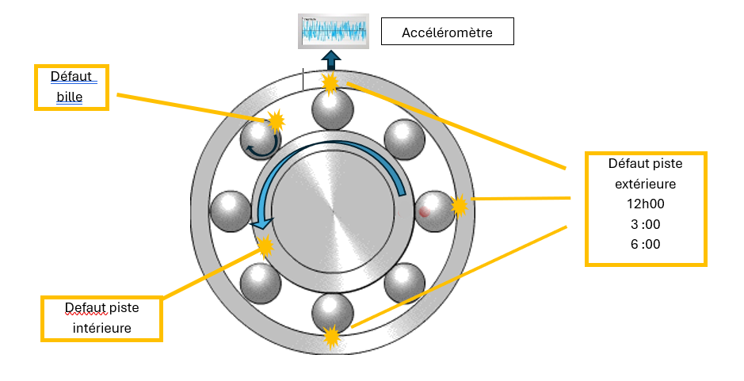
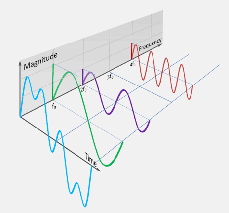

# Présentation du projet

## Le projet :

Sur les lignes de production, les machines tournantes (moteurs, pompes, ventilateurs, broyeurs) sont équipées d'accéléromètres qui enregistrent leurs vibrations. Un défaut de roulement (bague intérieure, bague extérieure, élément roulant) ou un déséquilibre mécanique laisse une signature caractéristique dans ce signal, souvent bien avant la panne.

Le but du projet est de construire une chaîne complète d'analyse capable de détecter l'apparition d'un défaut.

Selon les résultats obtenus, le modèle pourra éventuellement classer la sévérité du défaut et estimer la durée de vie résiduelle (RUL – Remaining Useful Life) des roulements.

## Contexte et Enjeux :

En milieu industriel, la maintenance des équipements est un enjeu fort à cause des coûts d’intervention et  des temps d’indisponibilité des machines (pertes de CA).

### Aspect Financier

La règle courante de dépenses en maintenance est de 2 à 4 % par an de la valeur de remplacement des équipements.

Par exemple, pour un équipement de  1 000 000 € (valeur à neuf) : le budget annuel de maintenance est de 20 000 à 40 000 €.

« Trop d’opérations de maintenance préventives » réduit le risque de casses imprévues mais maximise les coûts de maintenance »

« Pas assez de maintenance préventive augmente le risque de casses imprévues et génère des pertes de production, voir des urgences avec des pièces à livrer en express »

### Planification des opérations de maintenance.

Les arrêts d’équipements pour maintenance, ne sont pas toujours compatibles avec les délais de clients.

La possibilité d’estimer si une maintenance préventive peut être reportée par l’absence de détection de signaux d’usures éviterait des prises de risque de la part des entreprises.

## Les signaux de dégradations d’éléments de machines

La dégradation d’équipements peut s’identifier généralement par :

·       des bruits « anormaux »

·       des températures qui augmentent

·       des vibrations des équipements

Dans ce projet, nous étudions les signaux vibratoires.

Les datas utilisées sont issues d’une étude menée en 2000 par la CWRU ([Case Western Reserve University](https://case.edu/)) ,  Cleveland, Ohio, USA

### Présentation du banc de test (CWRU)

**Schémas de principe banc de test :**

{fig-align="center"}

**Photo banc de test :**

{fig-align="center"}

Le banc d'essai est composé d'un moteur de 2 chevaux, d'un capteur de couple et d'un dynamomètre imposant une **charge réglable**. La charge, exprimée en **HP (horsepower, cheval-vapeur)**, correspond au couple de freinage imposé à l'arbre : 0 HP = arbre quasi libre, 3 HP = arbre fortement freiné. Elle modifie progressivement la vitesse réelle de l'axe (1797 tr/min à 0 HP, 1730 tr/min à 3 HP) et influence ainsi les vibrations captées.

### Les défauts sur les roulements (banc de test)

Les défauts de surface ont étés par électro érosion en différents points des roulements :

·       Bague intérieure

·       Bille

·       Bague extérieure « fixe » en trois positions ( 12 :00, 3 :00 et 6 :00)
et avec des profondeurs différentes :

    ·   0,007''   (= ≈0, 178 mm)   (1''  équivalent ≈25,4 mm)
    ·   0,014''   (= ≈0, 356 mm)
    ·   0,021''   (= ≈0, 533 mm)
    ·   0,028''   (= ≈0, 711 mm)

Représentation des 5 points de défauts :

{fig-align="center"}

::: {.content-hidden when-format="pdf"}
Exemple de décomposition d’un signal vibratoire en plusieurs signaux simples

{fig-align="center"}
:::

### Données :

Données publiques issues de CWRU

[Download a Data File \| Case School of Engineering](https://engineering.case.edu/bearingdatacenter/download-data-file)

Les données proviennent des quatre pages de téléchargement du *Bearing Data
Center* de la Case Western Reserve University : enregistrements de référence
sur roulement sain, défauts sur le roulement côté entraînement échantillonnés
à 12 kHz et à 48 kHz, et défauts sur le roulement côté ventilateur à 12 kHz.
L'ensemble de ces fichiers a été rassemblé dans un catalogue unique, où chaque
enregistrement reçoit un nom lisible résumant ses caractéristiques : source,
localisation et diamètre du défaut, position éventuelle sur la bague
extérieure et charge du moteur (par exemple `12kDE_IR007_L0` pour un défaut de
bague intérieure de 0,007", enregistré à 12 kHz côté entraînement à 0 HP).

Le catalogue compte 161 fichiers, répartis comme indiqué
dans le @tbl-catalogue. Les défauts de bague extérieure sont plus nombreux,
car ils ont été étudiés à trois positions par rapport à la zone de charge
(3 h, 6 h et 12 h). Le plan n'est cependant pas complet : certaines
combinaisons de diamètre, de position et de charge n'ont pas été enregistrées,
en particulier pour le roulement côté ventilateur, et le diamètre de 0,028"
n'existe qu'à 12 kHz côté entraînement, pour la bague intérieure et la bille.

```{python}
#| tbl-cap: "Nombre de fichiers du catalogue CWRU par source et type de défaut."
#| label: tbl-catalogue
# Bloc 1 : chargement du catalogue et des signaux via le package Sources/
# 1.1 le catalogue des 161 fichiers est construit par Sources.data (tableaux
#     des quatre pages du site CWRU ; None = données non disponibles).
# 1.2 chaque fichier reçoit un nom lisible résumant ses caractéristiques.
#     Par exemple, 12kDE_OR021at3_L2 se lit : 12 kHz, défaut côté entrainement,
#     bague extérieure, 0,021", position 3 h, charge 2 HP.
# 1.3 charger(nom) (Sources.data.charger) télécharge le fichier la première
#     fois, puis le relit en local (cache). Elle choisit la bonne variable
#     quand un fichier en contient deux, et prend la vitesse nominale si la
#     vitesse mesurée manque.
# Résultat attendu : 161 fichiers au catalogue, puis un tableau de synthèse :
import sys
from pathlib import Path

import numpy as np
import pandas as pd
import matplotlib.pyplot as plt
import scipy.signal as sci
from scipy.signal import hilbert
from scipy.stats import kurtosis
from scipy.fftpack import fft, fftfreq

sys.path.insert(0, str(Path.cwd().parent))   # racine du dépôt (dossier contenant Sources/)

from Sources import data as src_data                     # catalogue + charger()
from Sources.config import (BANDE_RESONANCE, COEFF_FREQ, DUREE_FENETRE,
                            N_FFT, STYLES_CANAL, STYLES_CONDITION, STYLES_RAIES)
from Sources.signaux import (extraire_enveloppe, filtrer_passe_bande,
                             freqs_caracteristiques, spectre_enveloppe,
                             spectre_fft)
from Sources.indicateurs import (COLONNES_SPECTRAUX, COLONNES_TEMPORELS,
                                 TOUTES_COLONNES, indicateurs_spectraux,
                                 indicateurs_temporels)
from Sources.features import (construire_table, fenetrer,
                              preparer_modeling, sauvegarder_table)

catalogue = src_data.catalogue          # DataFrame indexé par nom lisible
charger   = src_data.charger            # chargement (cache local) d'un fichier

from IPython.display import Markdown

tab = catalogue.groupby(["source", "defaut"]).size().unstack(fill_value=0)
tab = tab[["Sain", "IR", "B", "OR"]].reindex(["Normal", "12kDE", "48kDE", "12kFE"])
tab = tab.reset_index().rename(columns={"source": "Source", "IR": "Bague int. (IR)",
                                        "B": "Bille (B)", "OR": "Bague ext. (OR)"})
Markdown(tab.to_markdown(index=False))
```

Chaque fichier `.mat` contient plusieurs canaux : `*_DE_time` (accéléromètre côté moteur, *Drive End*), `*_FE_time` (côté ventilateur, *Fan End*), `*_BA_time` (base) et `*RPM` (vitesse mesurée au démarrage). Un même défaut est vu différemment par chaque accéléromètre selon son chemin de mesure (distance, contacts mécaniques), d'où l'intérêt de les comparer.

```{python}
#| include: false
#| label: tbl-controle
#| tbl-cap: "Contrôle de la lecture sur deux fichiers de référence (capteur DE, 12 kHz)."
#| tbl-colwidths: [30, 17, 15, 13, 25]
# Bloc 2 : contrôle de la lecture sur deux fichiers
lignes = []
for nom in ["Normal_L0", "12kDE_IR007_L0"]:
    s = charger(nom)
    canaux = [c for c in ["DE", "FE", "BA"] if s[c] is not None]
    lignes.append({"Fichier": nom,
                   "Points": f"{len(s['DE']):,}".replace(",", " "),
                   "Durée (s)": f"{len(s['DE']) / s['fs']:.1f}".replace(".", ","),
                   "tr/min": round(s["rpm"]),
                   "Canaux": ", ".join(canaux)})

Markdown(pd.DataFrame(lignes).to_markdown(
    index=False, colalign=("left", "right", "right", "right", "left")))
```

**Unité d'amplitudes des signaux** : 
Le site CWRU ne mentionne pas l'unité de mesure des signaux.
Nous utiliserons l'unité g (accélération de la pesanteur) pour les signaux, car c'est l'unité usuelle en surveillance vibratoire (normes ISO 20816). Ce choix de g repose sur l'ordre de grandeur des signaux (cf indicateurs RMS) et sur la convention de la littérature utilisant ce jeu de données.

# Analyse exploratoire : indicateurs

## Objectif

Cette section décrit le comportement de quatre indicateurs statistiques
(RMS, valeur crête, facteur de crête, kurtosis) selon l'état du roulement,
afin de :

- repérer les indicateurs qui distinguent un roulement sain d'un roulement défectueux ;
- voir s'ils distinguent aussi les types de défauts entre eux ;
- évaluer l'influence de la charge du moteur.

## Sélection des fichiers

L'analyse porte sur la configuration de référence de la littérature :
**40 fichiers** échantillonnés à 12 kHz côté entraînement, formant un plan
factoriel complet et équilibré :

- **localisation du défaut** : bague intérieure (IR), bille (B), bague extérieure à 6 h (OR) ;
- **diamètre** : 0,007", 0,014", 0,021" ;
- **charge** : 0, 1, 2, 3 HP ;
- plus les 4 enregistrements sains, soit **10 classes**.

Sont écartés : le diamètre 0,028" (pas de défaut de bague extérieure, autre
fabricant), les positions 3 h et 12 h (incomplètes), les données à 48 kHz et
côté ventilateur (autres conditions d'acquisition).

```{python}
#| label: selection
#| code-summary: "Sélection des 40 fichiers"
#| tbl-cap: "Nombre de fichiers sélectionnés par localisation et diamètre du défaut."
selection = src_data.selectionner()
selection.groupby(["defaut", "diametre_mils"]).size().unstack(fill_value=0)
```

## Construction de la table des indicateurs

Chaque signal (capteur côté entraînement) est découpé en **fenêtres de 0,2 s**
sans recouvrement, soit environ 6 tours d'arbre par fenêtre. Chaque fenêtre
devient une observation, sur laquelle on calcule les quatre indicateurs :

 | Indicateur | Définition | Ce qu'il mesure |
 |---|---|---|
 | RMS | $\sqrt{\frac{1}{n}\sum x_i^2}$ | Niveau d'énergie global de la vibration |
 | Pic | $\max \lvert x_i \rvert$ | Amplitude maximale atteinte |
 | Facteur de crête | Pic / RMS | Importance des chocs par rapport au niveau moyen |
 | Kurtosis | $\frac{1}{n}\sum (x_i-\bar{x})^4 / \sigma^4$ | Présence de valeurs extrêmes (3 pour une loi normale) |

Les indicateurs temporels classiques en surveillance vibratoire sont :

- **RMS** : niveau global d'énergie vibratoire ;
- **Pic** : amplitude maximale atteinte ;
- **Crête** (= Pic / RMS) : caractère impulsif du signal ;
- **Kurtosis** : queues de distribution — proche de **3** pour un bruit normal, il dépasse 3 en présence de chocs.

```{python}
#| label: table-indicateurs
#| code-summary: "Calcul des indicateurs par fenêtre"
#| tbl-cap: "Nombre de fenêtres de 0.2s après découpage du signal"
# La table est construite par Sources.features.construire_table : pour chaque
# fichier de la sélection, le signal est découpé en fenêtres de 0,2 s, et
# chaque fenêtre reçoit les 4 indicateurs temporels (Sources.indicateurs)
# + les 17 indicateurs spectraux (amplitudes et ratios des raies BPFI, BPFO,
# BSF, FTF et de leurs harmoniques, extraits du spectre d'enveloppe).
table = construire_table(selection, charger)
sauvegarder_table(table)                # écrit data/features/table_indicateurs.csv

table.groupby(["classe", "charge_hp"]).size().unstack()
```

### Structure de la table des indicateurs

La table obtenue compte `{python} len(table)` lignes et
`{python} table.shape[1]` colonnes. Chaque **ligne** correspond à une
**fenêtre de 0,2 s** d'un enregistrement : un même fichier fournit donc
plusieurs dizaines de lignes (environ 50 pour un fichier de défaut,
100 à 200 pour un fichier sain, plus long).

Les **colonnes** se répartissent en quatre groupes, décrits dans le
@tbl-dictionnaire.

 | Groupe | Colonne | Contenu |
 |:--|:--|:--|
 | Identification | `fichier` | Nom lisible du fichier (ex. `12kDE_IR007_L0`) |
 | | `numero` | Numéro du fichier sur le site CWRU |
 | | `fenetre` | Rang de la fenêtre dans le fichier (0, 1, 2…) |
 | Conditions d'essai | `source` | Page d'origine (`Normal` ou `12kDE`) |
 | | `fs` | Fréquence d'échantillonnage (Hz) |
 | | `charge_hp` | Charge du moteur (0 à 3 HP) |
 | | `rpm_nominal` | Vitesse annoncée par le site (tr/min) |
 | | `rpm` | Vitesse mesurée dans le fichier (tr/min) |
 | Étiquettes | `defaut` | Localisation : Sain, IR, B ou OR |
 | | `diametre_mils` | Diamètre du défaut, en millièmes de pouce |
 | | `position_OR` | Position du défaut de bague extérieure (6 h) |
 | | `classe` | Étiquette des 10 classes (ex. `IR007`, `Sain`) |
| Indicateurs | `RMS` | Valeur efficace : énergie de la vibration |
 | | `Pic` | Amplitude maximale en valeur absolue |
 | | `Crete` | Facteur de crête : Pic / RMS |
 | | `Kurtosis` | Aplatissement (3 pour une loi normale) |

: Description des colonnes de la table des indicateurs. {#tbl-dictionnaire}

Les colonnes d'identification et de conditions d'essai sont recopiées du
catalogue pour chaque fenêtre : la table est ainsi autonome, et chaque
observation peut être regroupée par fichier, par charge ou par classe sans
recourir à une autre source. La colonne `classe` constitue la variable
à prédire pour la classification ; les quatre indicateurs en sont les
variables explicatives. La colonne `fichier` servira à séparer les données
d'apprentissage et de test, afin que les fenêtres d'un même enregistrement
ne se retrouvent pas des deux côtés.

Le @tbl-extrait en donne un extrait.

```{python}
#| label: tbl-extrait
#| tbl-cap: "Extrait de la table des indicateurs (trois premières fenêtres de deux fichiers)."
extrait = (table[table["fichier"].isin(["Normal_L0", "12kDE_IR007_L0"])]
           .groupby("fichier").head(3)
           [["fichier", "fenetre", "charge_hp", "classe",
             "RMS", "Pic", "Crete", "Kurtosis"]]
           .round(3))
Markdown(extrait.to_markdown(index=False))
```
<!--
Ce que fait ce bloc
La boucle parcourt les 40 fichiers de selection. Pour chacun, elle lit le signal avec charger, puis le découpe en fenêtres de 0,2 s.
haque ligne de la table contient le nom du fichier, le numéro de la fenêtre, la vitesse, toutes les informations du catalogue (grâce à info.to_dict()) et les 4 indicateurs.
La colonne classe crée l’étiquette des 10 classes : Sain, IR007, B014, OR021…
Le CSV garde la table pour la réutiliser ailleurs, par exemple pour les modèles, sans tout recalculer.

La table compte environ 2 500 fenêtres. Chaque fichier de défaut fournit
50 à 51 fenêtres (enregistrements d'environ 10 s). Les fichiers sains sont
plus longs (environ 20 s à 0 HP et 40 s aux autres charges) et fournissent
101 à 202 fenêtres. Le plan est donc équilibré en fichiers (4 par classe),
mais pas en fenêtres : la classe « Sain » représente environ 28 % des
observations. Ce déséquilibre est sans effet sur l'exploration (médianes,
boxplots), mais devra être pris en compte lors de la modélisation.
-->

## Statistiques descriptives

```{python}
#| label: parametres-explo
#| include: false
INDICATEURS = COLONNES_TEMPORELS   # 4 indicateurs temporels (partie exploratoire)
ORDRE = ["Sain", "IR007", "IR014", "IR021", "B007", "B014", "B021",
         "OR007", "OR014", "OR021"]
```

```{python}
#| label: tbl-descriptives
#| tbl-cap: "Moyenne et écart-type des indicateurs par classe (toutes charges confondues)."
table.groupby("classe")[INDICATEURS].agg(["mean", "std"]).round(3).reindex(ORDRE)
```

Le RMS distingue en moyenne toutes les classes de défaut du roulement sain
(0,067) ; les écarts les plus faibles concernent OR014 (0,096) et B021 (0,120).
Le kurtosis, en revanche, ne détecte pas certains défauts : B007 (2,91) est
indiscernable du sain (2,90), et OR014 (3,11) et B021 (3,73) restent proches
de la valeur gaussienne de 3. Les défauts les plus impulsifs sont IR014 et
OR021 (kurtosis supérieur à 20).

La sévérité ne suit pas le diamètre du défaut : les défauts de 0,014" sont
souvent moins énergétiques que ceux de 0,007". Chaque diamètre correspondant
à un roulement et à un essai différents, l'effet du diamètre est confondu avec
celui de l'essai. L'amplitude vibratoire ne permet donc pas d'estimer la taille
du défaut.

Enfin, la variabilité est très différente selon les classes : faible pour
Sain, IR007 et OR007, très élevée pour les défauts de bille de 0,014" et
0,021", dont le comportement varie fortement d'une charge à l'autre.

## Distribution par classe

```{python}
#| label: fig-boxplots
#| fig-cap: "Distribution des indicateurs par classe (fenêtres de 0,2 s, toutes charges)."
fig, axes = plt.subplots(2, 2, figsize=(14, 9))
for ax, ind in zip(axes.ravel(), INDICATEURS):
    donnees = [table.loc[table["classe"] == c, ind] for c in ORDRE]
    ax.boxplot(donnees, tick_labels=ORDRE, showfliers=False)
    ax.set_title(ind)
    ax.tick_params(axis="x", rotation=45)
plt.tight_layout()
plt.show()
```

Le RMS isole complètement le roulement sain : sa
distribution ne recouvre celle d'aucune classe de défaut, y compris les plus
discrètes (OR014, B021). En revanche, aucun indicateur ne sépare à lui seul
les dix classes. Sur le RMS, plusieurs défauts se recouvrent (B007, B014, B021,
IR014 ; OR007 et OR021). Le kurtosis ne distingue pas B007 et OR014 du roulement
sain, et confond IR014 et OR021. Le facteur de crête est l'indicateur le moins
discriminant.

Les indicateurs apparaissent complémentaires : des classes confondues sur l'un
sont séparées sur l'autre (B007 et OR014, confondus sur le kurtosis, sont
distincts sur le RMS). Le défaut B014 présente une dispersion particulièrement
forte sur tous les indicateurs.

Ces séparations sont observées entre fenêtres issues des mêmes enregistrements
et ne préjugent pas de la capacité à classer un nouveau roulement.

## Effet de la charge

```{python}
#| label: fig-charge
#| fig-cap: "Médiane du RMS et du kurtosis selon la charge, pour chaque classe."
fig, axes = plt.subplots(1, 2, figsize=(14, 4.5))
for ax, ind in zip(axes, ["RMS", "Kurtosis"]):
    med = table.groupby(["charge_hp", "classe"])[ind].median().unstack()[ORDRE]
    med.plot(ax=ax, marker="o", legend=False)
    ax.set_title(f"{ind} médian selon la charge")
    ax.set_xlabel("Charge (HP)")
    ax.set_xticks(range(4))
axes[1].legend(bbox_to_anchor=(1.02, 1), loc="upper left", fontsize=8)
plt.tight_layout()
plt.show()
```

L'effet de la charge est faible au regard des différences entre classes : les
profils sont globalement plats et parallèles, et le roulement sain reste le
moins énergétique à toutes les charges. Quelques croisements apparaissent entre
classes proches (B007 et B014 sur le RMS ; IR021, OR007 et B014 sur le
kurtosis), sans modifier la structure générale des groupes. Le kurtosis est
l'indicateur le plus stable ; seul IR014 diminue nettement à 3 HP.

La forte dispersion du défaut B014 observée précédemment ne provient pas d'une
charge particulière, ses médianes étant stables : elle traduit une variabilité
importante à l'intérieur de chaque enregistrement, cohérente avec le caractère
intermittent des chocs d'un défaut de bille.

Ces conclusions valent pour la plage de vitesse étudiée (1730 à 1797 tr/min).

## Combinaison de deux indicateurs

```{python}
#| label: fig-nuage
#| fig-cap: "RMS et kurtosis de chaque fenêtre, par classe."
fig, ax = plt.subplots(figsize=(10, 7))
for c in ORDRE:
g = table[table["classe"] == c]
ax.scatter(g["RMS"], g["Kurtosis"], s=8, alpha=0.5, label=c)
ax.set_xscale("log")
ax.set_yscale("log")
ax.set_xlabel("RMS (échelle log)")
ax.set_ylabel("Kurtosis (échelle log)")
ax.legend(bbox_to_anchor=(1.02, 1), loc="upper left", markerscale=2)
plt.tight_layout()
plt.show()
```

La combinaison du RMS et du kurtosis sépare la quasi-totalité des classes.
Les classes confondues sur le kurtosis (Sain, B007, OR014, B021) sont
distinguées par le RMS, et inversement IR014 et OR021, de kurtosis comparable,
diffèrent nettement par leur RMS. Seul le défaut B014 forme un nuage diffus
qui recouvre plusieurs autres classes.

On observe que certaines classes (Sain, OR007) se divisent en sous-groupes
correspondant aux différentes charges : chaque enregistrement forme un amas
compact. La séparation observée reflète donc en partie l'identité des
enregistrements, et pas seulement la nature du défaut, ce qui devra être pris
en compte dans la validation des modèles.

## Variabilité entre fichiers

Les fenêtres d'un même fichier proviennent du même enregistrement : elles ne
sont pas indépendantes. On décompose la variabilité de chaque indicateur comme
dans une analyse de variance à un facteur (le fichier) : la part expliquée par
les différences entre fichiers correspond au rapport $\eta^2$ entre la somme des
carrés inter-fichiers et la somme des carrés totale.

```{python}
#| label: tbl-variance
#| tbl-cap: 'Part de la variabilité expliquée par les différences entre fichiers ($\eta^2$).'
var = []
for ind in INDICATEURS:
    x = table[ind]
    moyenne_fichier = table.groupby("fichier")[ind].transform("mean")
    sc_totale = ((x - x.mean()) ** 2).sum()
    sc_intra  = ((x - moyenne_fichier) ** 2).sum()
    var.append({"Indicateur": ind,
                "Part entre fichiers (%)": round(100 * (1 - sc_intra / sc_totale), 1)})
pd.DataFrame(var)
```

La quasi-totalité de la variabilité des indicateurs s'explique par les
différences entre fichiers : 98,9 % pour le RMS, 96,4 % pour la valeur crête,
et environ 90 % pour le kurtosis et le facteur de crête, plus sensibles au
caractère intermittent des chocs. Les fenêtres d'un même enregistrement sont
donc très semblables et ne constituent pas des observations indépendantes :
la taille d'échantillon effective est proche du nombre de fichiers (40)
plutôt que du nombre de fenêtres (environ 2 500).

Une validation qui répartirait aléatoirement les fenêtres entre apprentissage
et test surestimerait fortement les performances. La validation des modèles
devra séparer les données par fichier ou par charge.

## Conclusion

### Principaux enseignements

- **Détection d'un défaut.** Le RMS isole complètement le
  roulement sain de toutes les classes de défaut, à toutes les charges. Un
  indicateur d'énergie suffit, sur ces données, à distinguer un roulement sain
  d'un roulement défectueux.

- **Identification du type de défaut.** Aucun indicateur ne sépare à lui seul
  les dix classes. Le kurtosis ne détecte pas certains défauts (B007, OR014),
  et plusieurs défauts se recouvrent sur le RMS. La combinaison du RMS et du
  kurtosis sépare en revanche la quasi-totalité des classes.

- **Défauts de bille.** Ce sont les plus difficiles : B007 a un kurtosis
  identique au sain, et B014 présente une forte variabilité au sein de chaque
  enregistrement, qui le fait recouvrir plusieurs autres classes.

- **Sévérité.** L'amplitude vibratoire n'augmente pas avec le diamètre du
  défaut. Chaque diamètre correspondant à un roulement et à un essai
  différents, ces données ne permettent pas d'estimer la taille d'un défaut.

- **Charge.** Son effet est faible au regard des différences entre classes,
  dans la plage de vitesse étudiée (1730 à 1797 tr/min).

### Limites

- Une seule expérience par combinaison de facteurs : les fenêtres d'un fichier
  sont des pseudo-réplicats (plus de 90 % de la variabilité est inter-fichiers).
- Défauts artificiels (électro-érosion), réalisés sur un seul banc d'essai.
- Déséquilibre en nombre de fenêtres : la classe « Sain » représente environ
  28 % des observations.
- Seuls des indicateurs temporels ont été étudiés.


# Analyse exploratoire : spectres de fréquences

## Objectif

Créer de indicateurs fréquentiels pour distinguer les défauts de roulement, et comparer leur pertinence par rapport à celle des indicateurs temporels étudiés précédemment.

## La transformée de Fourier

Avant toute analyse, commençons par comprendre le fonctionnement de la **transformée de Fourier** et ses limites, car elle sera notre outil principal pour l'analyse fréquentielle.

> La **transformée de Fourier** décompose un signal en sinusoïdes pures : elle transforme la description *temporelle* (amplitude en fonction du temps) en description *fréquentielle* (amplitude en fonction de la fréquence). Le **spectre** obtenu montre, pour chaque fréquence, si elle est présente dans le signal et avec quelle intensité — une composante périodique devient une **raie** nette.

$$
X(f) = \int_{-\infty}^{+\infty} x(t)\, e^{-i\, 2\pi f t}\, dt
$$ {#eq-fourier}

- $X(f)$ est un nombre **complexe** : son module $\lvert X(f) \rvert$
  donne l'**amplitude** de la fréquence $f$ dans le signal, son
  argument la **phase** ;
- la transformée inverse
  $x(t) = \int_{-\infty}^{+\infty} X(f)\, e^{+i\, 2\pi f t}\, df$
  reconstruit le signal : aucune information n'est perdue.

Exemple :

```{python}
#| label: fig-spectre
#| fig-cap: "Décomposition d'un signal synthétique : composantes temporelles (gauche) et spectrales (droite)."
# spectre_fft vient de Sources.signaux (version pédagogique conservée ici
# pour l'illustration : signal entier, sans fenêtre)
def spectre_fft(x, fs):
    """Spectre d'amplitude : renvoie (fréquences, amplitudes)."""
    n = len(x)
    freqs = fftfreq(n, d=1 / fs)[: n // 2]
    amp = np.abs(fft(x - np.mean(x)))[: n // 2] * 2 / n # ajout de "- np.mean(x)" pour supprimer la composante continue du signal
    return freqs, amp

fs = 12_000
t = np.arange(0, 1, 1 / fs)
x30hz = 1.0 * np.sin(2 * np.pi * 30 * t)      # "rotation" à 30 Hz
x162hz = 0.5 * np.sin(2 * np.pi * 162 * t)    # "défaut" à 162 Hz
xbruit = 0.3 * np.random.randn(len(t))        # bruit
xtot = x30hz + x162hz + xbruit

# --- Calcul des spectres (une seule fois par composante) ---
f_30hz, a30 = spectre_fft(x30hz, fs)
f_162hz, a162 = spectre_fft(x162hz, fs)
f_bruit, a_bruit = spectre_fft(xbruit, fs)
f_tot, a_tot = spectre_fft(xtot, fs)

fig, axes = plt.subplots(4, 2, figsize=(14, 10), sharex="col")

# Colonne 0 : signaux temporels — Colonne 1 : spectres
signaux = [
    (x30hz,  f_30hz,  a30,     "30 Hz (rotation)"),
    (x162hz, f_162hz, a162,    "162 Hz (défaut)"),
    (xbruit, f_bruit, a_bruit, "Bruit"),
    (xtot,   f_tot,   a_tot,   "Signal complet"),
]
n = int(0.1 * fs)   # 0,1 seconde

for ligne, (x, freqs, amp, titre) in enumerate(signaux):
    # --- Colonne 0 : temporel ---
    axes[ligne, 0].plot(t[:n], x[:n], color="steelblue", lw=0.8)
    axes[ligne, 0].set_title(f"{titre} — signal temporel", loc="left")
    axes[ligne, 0].set_ylabel("Amplitude")
    axes[ligne, 0].grid(alpha=0.3)

    # --- Colonne 1 : spectre, zoomé sur 0–300 Hz ---
    axes[ligne, 1].plot(freqs, amp, color="crimson", lw=0.8)
    axes[ligne, 1].set_xlim(0, 300)
    axes[ligne, 1].set_title(f"{titre} — spectre", loc="left")
    axes[ligne, 1].grid(alpha=0.3)

axes[-1, 0].set_xlabel("Temps (s)")
axes[-1, 1].set_xlabel("Fréquence (Hz)")
plt.tight_layout(); plt.show()

```

> L'algorithme **FFT** (Fast Fourier Transform) calcule la version numérique du signal échantillonné, cependant il comporte **deux contraintes** :

- **Limite haute (théorème de Nyquist-Shannon)** : un signal échantillonné à fs ne peut représenter que des fréquences jusqu'à fs/2. Toute composante au-dessus de cette limite subit le repliement de spectre (aliasing). Pour un signal échantillonné à 12 kHz, toute fréquence au-dessus de 6 kHz :
    - N'existe pas dans le spectre : l'information est perdue ;
    - Elle apparaît repliée, à une fausse fréquence, plus basse.
Conclusion : **le repliement masque les hautes fréquences et pollue les basses fréquences** (de fausses raies se mélangent aux vraies).
Illustration du repliement de spectre :

```{python}
#| fig-cap: "Le repliement (aliasing) à 12 kHz."

# Cas du projet : fs = 12 kHz -> Nyquist = 6 kHz
FS_DEMO = 12_000
F_VRAIE = 11_600                 # résonance réelle, au-dessus de Nyquist
F_ALIAS = FS_DEMO - F_VRAIE     # 400 Hz : là où elle se replie

# Temporel : 10 ms (indices entiers, pas d'erreur flottante)
n_ech = np.arange(int(0.01 * FS_DEMO))
points = np.sin(2 * np.pi * F_VRAIE * n_ech / FS_DEMO)

# FFT : la même sinusoïde observée 2 s (raie fine)
n_fft = np.arange(int(2.0 * FS_DEMO))
f_fft, a_fft = spectre_fft(np.sin(2 * np.pi * F_VRAIE * n_fft / FS_DEMO), FS_DEMO)

t_cont = np.arange(0, 0.01, 1 / 1_000_000)    # courbe continue (dense)

fig, axes = plt.subplots(4, 1, figsize=(12, 12.5))

# 1. Le signal réel (continu) avec les points échantillonnés transparents
axes[0].plot(t_cont * 1000, np.sin(2 * np.pi * F_VRAIE * t_cont),
             color="crimson", lw=0.8, label="Signal réel (continu)")
axes[0].plot(n_ech / FS_DEMO * 1000, points, "o", ms=4, color="black",
             alpha=0.35, label="Points échantillonnés (fs = 12 kHz)")
axes[0].set_title(f"1. Le signal réel : une résonance à {F_VRAIE/1000:.1f} kHz", loc="left")
axes[0].set_ylabel("Amplitude")
axes[0].set_xlabel("Temps (ms)")
axes[0].legend(fontsize=9, loc="upper right")

# 2. Ce qu'on mesure : les points échantillonnés, seuls
axes[1].plot(n_ech / FS_DEMO * 1000, points, "o", ms=4, color="crimson")
axes[1].set_title("2. Ce qu'on mesure : fs = 12 kHz "
                  "(Nyquist = 6 kHz < 11,6 kHz : trop lent !)", loc="left")
axes[1].set_ylabel("Amplitude")
axes[1].set_xlabel("Temps (ms)")

# 3. Ce que croit l'analyste : l'alias. Attention : une fréquence entre
#    fs/2 et fs se replie AVEC INVERSION DE PHASE -> on trace -sin.
#    (Vérifié : écart points/courbe ~1e-13)
axes[2].plot(n_ech / FS_DEMO * 1000, points, "o", ms=5, color="crimson",
             label="Points mesurés")
axes[2].plot(t_cont * 1000, -np.sin(2 * np.pi * F_ALIAS * t_cont),
             color="steelblue", lw=2,
             label=f"Sinusoïde perçue : {F_ALIAS:.0f} Hz (repliée, phase inversée)")
axes[2].set_title(f"3. Ce que croit l'analyste : une sinusoïde de {F_ALIAS:.0f} Hz "
                  "(repliement : fs − f = 12 000 − 11 600)", loc="left")
axes[2].set_ylabel("Amplitude")
axes[2].set_xlabel("Temps (ms)")
axes[2].legend(fontsize=9, loc="upper right")

# 4. La même illusion dans le spectre : la fausse raie, dans la bande observable
ax = axes[3]
ax.plot(f_fft / 1000, a_fft, lw=1.2, color="steelblue", label="FFT du signal mesuré")
ax.axvspan(0, FS_DEMO / 2000, color="lightgreen", alpha=0.25,
           label="Bande observable (0 – Nyquist = 6 kHz)")
ax.axvline(F_ALIAS / 1000, color="steelblue", ls="--", lw=1.8,
           label=f"Raie PERÇUE : {F_ALIAS/1000:.1f} kHz (fausse)")
ax.axvline(F_VRAIE / 1000, color="crimson", ls="--", lw=1.8,
           label=f"Vraie raie : {F_VRAIE/1000:.1f} kHz (hors bande)")
ax.annotate("le repliement déplace\nla vraie raie ICI",
            xy=(F_ALIAS / 1000, a_fft.max() * 0.75),
            xytext=(2.5, a_fft.max() * 0.9), fontsize=10, ha="left",
            arrowprops=dict(arrowstyle="->", color="black"),
            bbox=dict(boxstyle="round", fc="lightyellow", ec="orange"))
ax.annotate("vraie fréquence : invisible\n(hors de la bande observable)",
            xy=(F_VRAIE / 1000, a_fft.max() * 0.5),
            xytext=(6.5, a_fft.max() * 0.75), fontsize=10, ha="left",
            arrowprops=dict(arrowstyle="->", color="black"),
            bbox=dict(boxstyle="round", fc="mistyrose", ec="crimson"))
ax.set_xlim(0, 12)
ax.set_title("4. FFT vue par l'analyste : une raie à 0,4 kHz — "
             "la vraie (11,6 kHz) est hors bande", loc="left")
ax.set_xlabel("Fréquence (kHz)")
ax.set_ylabel("Amplitude")
ax.legend(fontsize=8, loc="upper right")

for ax in axes:
    ax.grid(alpha=0.3)
plt.tight_layout(); plt.show()
```


- **Limite basse (résolution)** : la FFT découpe le spectre en cases espacées de 1/T, T étant la durée analysée. Avec 1 seconde d'observation, la résolution est de 1 Hz : c'est la largeur d'une raie. Deux fréquences plus proches tombent dans la même case : indiscernables, même si elles existent bel et bien dans le signal.
illustration de la résolution spectrale :

```{python}
#| fig-cap: "La résolution spectrale 1/T"

FS_DEMO = 12_000
F1, F2 = 30, 33          # deux raies séparées de seulement 3 Hz

t_court = np.arange(0, 0.1, 1 / FS_DEMO)    # observation de 0,1 s
t_long  = np.arange(0, 1.0, 1 / FS_DEMO)    # observation de 1 s
x_court = np.sin(2 * np.pi * F1 * t_court) + 0.8 * np.sin(2 * np.pi * F2 * t_court)
x_long  = np.sin(2 * np.pi * F1 * t_long)  + 0.8 * np.sin(2 * np.pi * F2 * t_long)

f_c, a_c = spectre_fft(x_court, FS_DEMO)
f_l, a_l = spectre_fft(x_long, FS_DEMO)

def tracer_resolution(ax, amp, resolution):
    """Flèche de largeur EXACTEMENT égale à la résolution (1/T Hz),
    calée sur la raie 30 Hz (de F1 à F1 + résolution), texte centré."""
    y = amp.max() * 0.55
    ax.annotate("", xy=(F1 + resolution, y), xytext=(F1, y),
                arrowprops=dict(arrowstyle="<->", color="darkgreen",
                                lw=2.5, mutation_scale=14))
    ax.text(F1 + resolution / 2, y * 1.08,
            f"résolution = {resolution:.0f} Hz",
            ha="center", va="bottom", fontsize=11, color="darkgreen",
            fontweight="bold")

fig, axes = plt.subplots(3, 1, figsize=(12, 9))

# 1. Le signal temporel : les deux sinusoïdes, indiscernables à l'œil
axes[0].plot(t_court * 1000, x_court, lw=0.8, color="crimson")
axes[0].set_title("1. Le signal : deux sinusoïdes (30 + 33 Hz) "
                  "— indiscernables dans le temporel", loc="left")
axes[0].set_xlabel("Temps (ms)")
axes[0].set_ylabel("Amplitude")
axes[0].grid(alpha=0.3)

# 2. Observation courte (T = 0,1 s) : résolution 10 Hz -> raies confondues
axes[1].plot(f_c, a_c, lw=1.2, color="crimson", label="Spectre observé sur 0,1 s")
axes[1].axvline(F1, color="purple", ls="--", lw=1, label="vraie raie 30 Hz")
axes[1].axvline(F2, color="blue",   ls="--", lw=1, label="vraie raie 33 Hz")
axes[1].set_xlim(18, 46)               # marge gauche : pic visible en entier
axes[1].set_ylim(0, a_c.max() * 1.2)
axes[1].set_xticks(np.arange(18, 47, 2))
tracer_resolution(axes[1], a_c, resolution=10)   # flèche : 30 -> 40 Hz
axes[1].set_title("2. Observé 0,1 s : résolution 1/T = 10 Hz "
                  "→ UNE seule raie : les deux se confondent", loc="left")
axes[1].set_xlabel("Fréquence (Hz)")
axes[1].set_ylabel("Amplitude")
axes[1].legend(fontsize=9, loc="upper right")
axes[1].grid(alpha=0.3)

# 3. Observation longue (T = 1 s) : résolution 1 Hz -> raies séparées
axes[2].plot(f_l, a_l, lw=1.2, color="crimson", label="Spectre observé sur 1 s")
axes[2].axvline(F1, color="purple", ls="--", lw=1, label="vraie raie 30 Hz")
axes[2].axvline(F2, color="blue",   ls="--", lw=1, label="vraie raie 33 Hz")
axes[2].set_xlim(18, 46)               # même fenêtre que le panneau 2
axes[2].set_ylim(0, a_l.max() * 1.2)
axes[2].set_xticks(np.arange(18, 47, 2))
tracer_resolution(axes[2], a_l, resolution=1)    # flèche : 30 -> 31 Hz
axes[2].set_title("3. Observé 1 s : résolution 1/T = 1 Hz "
                  "→ DEUX raies distinctes", loc="left")
axes[2].set_xlabel("Fréquence (Hz)")
axes[2].set_ylabel("Amplitude")
axes[2].legend(fontsize=9, loc="upper right")
axes[2].grid(alpha=0.3)

plt.tight_layout(); plt.show()
```

**Conclusion :**

- **La fréquence d'échantillonnage** doit être **au moins deux fois supérieure** à la fréquence maximale du signal — sinon les fréquences au-delà de fs/2 ne disparaissent pas silencieusement : elles se replient et polluent la bande utile avec de fausses raies

- **La durée d'observation** doit être assez longue pour distinguer des signaux à basse fréquence, sinon les raies fusionnent, et l'information est moins précise.


## Etude de cas : défaut de bague intérieure


Le cas étudié à titre d'exemple concerne un **défaut de bague intérieure de 0,007"** (0,178 mm) sur le roulement **côté moteur (Drive End)** à une charge de **0 HP (≈1797 tr/min)**.
Nous utiliserons les données des accéléromètres **côté moteur (Drive End)** et **côté ventilateur (Fan End)**

On vérifie la cohérence des signaux chargés : nombre de points, durée (calculée avec la fréquence annoncée par le catalogue), valeurs manquantes et plage d'amplitude.

```{python}
# --- Fichiers étudiés : baseline saine et défaut bague intérieure, 0 HP ---
NOM_SAIN   = "Normal_L0"
NOM_DEFAUT = "12kDE_IR007_L0"

sain   = charger(NOM_SAIN)
defaut = charger(NOM_DEFAUT)

STYLES = {  # styles des graphiques (issus de Sources.config)
    "condition": STYLES_CONDITION,
    "canal":     STYLES_CANAL,
}
```


```{python}
#|  tbl-cap: "Résumé des signaux, durées calculées avec le fs annoncé par le catalogue."

SIGNAUX = {  # nom: (signaux, canal, condition)
    "Sain — moteur (DE)":        (sain,   "DE", "Sain"),
    "Sain — ventilateur (FE)":   (sain,   "FE", "Sain"),
    "Défaut — moteur (DE)":      (defaut, "DE", "Défaut"),
    "Défaut — ventilateur (FE)": (defaut, "FE", "Défaut"),
}

resume = pd.DataFrame([
    {"Condition": nom,
     "Nombre de points": len(s[canal]),
     "fs (Hz)": s["fs"],
     #"Durée (s)": round(len(s[canal]) / s["fs"], 2),
     #"NaN": int(np.sum(~np.isfinite(s[canal])))}
     "NaN": int(np.sum(pd.isna(s[canal])))}
    for nom, (s, canal, _) in SIGNAUX.items()
])
resume
```

Aucune valeur manquante. A noter que le signal sain a environ deux fois plus de points que les défauts :

On vérifie la fréquence d'échantillonnage du signal sain : le catalogue indique 12 kHz mais il est probable que le signal sain ait été échantillonné à **24 kHz**.

Le site CWRU indique une fréquence de rotation moteur de 1797 tr/min, soit environ 30 Hz. On peut vérifier que cette fréquence est bien présente dans le signal sain, en supposant différentes fréquences d'échantillonnage (12 kHz, 24 kHz et 48 kHz) :

```{python}
#|  tbl-cap: "Contrôle du fs sur base de fréquence de rotation moteur."
x = sain["DE"]  # signal du capteur DE (Drive End)
fig, axes = plt.subplots(3, 1, figsize=(12, 9))
for ax, fs in zip(axes, [48000, 24000, 12000]):
    f, a = spectre_fft(x, fs)
    ax.plot(f, a)
    ax.set_xlim(0, 150)
    ax.set_ylim(0, 0.015)
    ax.axvline(1797/60, color="red", ls="--", label="rotation moteur attendue ≈ 30 Hz")
    ax.set_title(f"Signal sain, en supposant fs = {fs} Hz")
    ax.legend()
axes[1].set_xlabel("Fréquence (Hz)")
plt.tight_layout(); plt.show()
```

Seul la configuration à 12 KHz montre un pic sur la fréquence de rotation attendue (≈30 Hz), on valide la fréquence d'échantillonnage à 12 KHz pour le signal sain.

### Fréquences caractéristiques des défauts

La géométrie de chaque roulement (SKF 6205-RS côté moteur, 6203-RS côté ventilateur) fixe des fréquences caractéristiques (Hz) proportionnelles à la fréquence de rotation (≈1797 tr/min), qui indiquent où chercher la signature de chaque type de défaut :

- **BPFI** (*Ball Pass Frequency Inner*) : passage des billes sur la piste intérieure ;
- **BPFO** (*Ball Pass Frequency Outer*) : piste extérieure ;
- **BSF** (*Ball Spin Frequency*) : rotation d'une bille sur elle-même ;
- **FTF** (*Fundamental Train Frequency*) : rotation de la cage.

Ces valeurs servent de référence pour **toutes** les analyses ci-dessous. Le défaut étant sur le roulement **côté moteur**, ce sont les caractéristiques du roulement **DE** qui nous intéressent.

```{python}
RPM = defaut["rpm"] # vitesse du fichier si présente, sinon nominale du catalogue

# freqs_caracteristiques et COEFF_FREQ viennent de Sources.signaux / Sources.config
pd.DataFrame({
    "vitesse de rotation": [f"{RPM:.0f} tr/min"] * len(COEFF_FREQ["DE"]),
    "coefficient": pd.Series(COEFF_FREQ["DE"]),
    "f. caractéristique (DE)": pd.Series(freqs_caracteristiques("DE", RPM)).round(2).astype(str) + " Hz",
}).round(4)
```


On note que **les raies caractéristiques sont directement liées à la vitesse de rotation du moteur** : si la vitesse varie, les raies se déplacent proportionnellement. Il est donc indispensable de connaître la vitesse de rotation exacte pour identifier correctement les raies.


## Signaux temporels brutes

On visualise 0,1 seconde de signal, à échelle d'amplitude commune, et on trace les raies caractéristiques correspondant à chaque défaut.


```{python}
#| fig-cap: "0,1 seconde de signal ; vert = sain, rouge = défaut ; trait plein = Drive End, tirets = Fan End."

def tracer_temps(x, fs, ax, condition, canal, titre):
    n = int(0.1 * fs)
    ax.plot(np.arange(n) / fs, x[:n],
            color=STYLES["condition"][condition],
            ls=STYLES["canal"][canal], lw=0.7)
    ax.set_title(titre, loc="left")
    ax.set_xlabel("Temps (s)")
    ax.set_ylabel("Amplitude")
    ax.grid(alpha=0.3)

fig, axes = plt.subplots(2, 2, figsize=(12, 5), sharex=True, sharey=True)
for ax, (nom, (s, canal, cond)) in zip(axes.flat, SIGNAUX.items()):
    tracer_temps(s[canal], s["fs"], ax, cond, canal, nom)
plt.tight_layout(); plt.show()
```

Le signal sain a une faible amplitude, les valeurs se concentrent autour de zéro, sans pics ni structure périodique ; c'est le comportement attendu d'un roulement en bon état.
Sur le canal moteur défectueux, l'amplitude est plus élevée, et on voit des pics et une structure périodique. Ces structures correspondent aux **chocs** du passage d'une bille sur le défaut de la piste intérieure. Le défaut étant sur le roulement moteur, c'est la **BPFI du roulement DE** qui est attendue.

```{python}
#| fig-cap: "Zoom sur 30 ms du signal défectueux ; les repères sont espacés de la période BPFI théorique."

BPFI_DE = freqs_caracteristiques("DE", RPM)["BPFI"]
fs = defaut["fs"]

x = defaut["DE"]
n = int(0.03 * fs)
t = np.arange(n) / fs
fig, ax = plt.subplots(figsize=(10, 3))
ax.plot(t, x[:n], color="red", ls="-", lw=0.8, label="Signal")
ax.vlines(np.arange(0, t[-1], 1 / BPFI_DE), *ax.get_ylim(),
          colors="crimson", ls=":", lw=1,
          label=f"Période BPFI ≈ {BPFI_DE:.0f} Hz")
ax.set_title("Défaut bague intérieure — repérage des chocs", loc="left")
ax.set_xlabel("Temps (s)"); ax.set_ylabel("Accélération (g)")
ax.legend(loc="upper right", fontsize=8); ax.grid(alpha=0.3)
plt.tight_layout(); plt.show()
```

On constate qu'avec ce simple tracé temporel, les chocs semblent être cycliques, mais sont en même temps très différents : l'analyse doit être poussée.

## Analyse spectrale

### Tranformation de Fourier (FFT)

Pour analyser chaque signal, nous utilisons la transformée de Fourier (FFT), ce qui nous donne une visualisation du spectre de fréquence de chaque signal.
L'analyse du spectre d'un signal permet de visualiser l'amplitude du signal pour chaque fréquence.
Ainsi, on voit clairement quelles fréquences sont excitées, et celles qui ne le sont pas :

```{python}
#| fig-cap: "Spectres d'amplitude FFT : le défaut ajoute de l'énergie haute fréquence."

def tracer_fft(ax, x, fs, condition, canal, titre,
               roulement=None, x_max=None):
    freqs, amp = spectre_fft(x, fs)
    ax.plot(freqs, amp, color=STYLES["condition"][condition],
            ls=STYLES["canal"][canal], lw=0.5)
    ax.set_title(titre, loc="left")
    ax.set_xlim(0, x_max if x_max else fs / 2)
    ax.set_xlabel("Fréquence (Hz)")
    ax.grid(alpha=0.3)
    if roulement:  # raies caractéristiques + harmoniques 2x, 3x
        for nom, val in freqs_caracteristiques(roulement, RPM).items():
            couleur, ls = STYLES_RAIES[nom]
            ax.axvline(val, color=couleur, ls=ls, lw=1.8, alpha=0.4,
                       label=f"{nom} = {val:.1f} Hz")
            for k in range(2, 4):
                if k * val < (x_max or fs / 2):
                    ax.axvline(k * val, color=couleur, ls=ls,
                               lw=0.8, alpha=0.2)
        ax.legend(loc="upper right", fontsize=8, framealpha=0.7)

fig, axes = plt.subplots(2, 2, figsize=(12, 6), sharey=True)
for colonne, canal in enumerate(("DE", "FE")):
    for ligne, condition in enumerate(("Sain", "Défaut")):
        nom = [n for n in SIGNAUX
               if n.endswith(f"({canal})") and n.startswith(condition)][0]
        s, can, cond = SIGNAUX[nom][0], canal, condition
        tracer_fft(axes[ligne, colonne], s[canal], s["fs"], cond, can, nom)
        if colonne == 0:
            axes[ligne, colonne].set_ylabel("Amplitude")
plt.tight_layout(); plt.show()
```

### Les raies de fréquences caractéristiques

La FFT brute mélange bruit de fond, raies de rotation et signature du défaut. Pour identifier l'emplacement du défaut, on zoome sur les basses fréquences et on superpose les fréquences caractéristiques définies plus haut (BPFI, BPFO, BSF, FTF — fondamentales en trait épais, harmoniques 2x et 3x en trait fin). Le défaut étant sur le roulement moteur, c'est la BPFI du roulement DE qui doit dominer sur le canal moteur.

```{python}
#| fig-cap: "FFT basse fréquence du signal défectueux avec raies caractéristiques (fondamentales et harmoniques)."

fs = defaut["fs"]

# Fenêtre d'affichage : jusqu'à 3,5 × la raie BPFI la plus haute
X_MAX = max(freqs_caracteristiques(r, RPM)["BPFI"] for r in ("DE", "FE")) * 3.5

# Chaque spectre n'est calculé qu'une seule fois
SPECTRES_DEFAUT = {canal: spectre_fft(defaut[canal], fs)
                   for canal in ("DE", "FE")}
Y_MAX = max(amp[(freqs >= 0) & (freqs <= X_MAX)].max()
            for freqs, amp in SPECTRES_DEFAUT.values())

fig, axes = plt.subplots(2, 1, figsize=(12, 7), sharey=True)
for ax, (canal, (freqs, amp)) in zip(axes, SPECTRES_DEFAUT.items()):
    tracer_fft(ax, defaut[canal], fs, "Défaut", canal, f"Défaut — {canal}",
               roulement=canal, x_max=X_MAX)
    ax.set_ylim(0, Y_MAX * 1.05)
    ax.set_ylabel("Amplitude")
plt.tight_layout(); plt.show()
```

Sur la FFT brute, on voit une correspondance sur la raie **BPFI** côté moteur (roulement défectueux), mais le pic dominant (≈450Hz) n'est associé à aucune raie caractéristique : difficulté à conclure avec certitude. Une analyse spectrale de l'enveloppe du signal (plutôt que du signal lui-même), devrait améliorer l'identification.

## Analyse d'enveloppe

### Traitement du signal

L'objectif global est de **rendre le rythme des chocs mesurable** : les chocs sont périodiques, mais leur périodicité n'est pas clair dans le spectre brut car chaque choc excite en réalité une résonance structurelle haute fréquence, amortie en quelques millisecondes. Les quatre étapes visent à isoler, puis compter, ce rythme :

1.  **Filtre passe-bande** (1–4 kHz) : *ne garder que la bande de résonance* excitée par les chocs. Objectif : supprimer les basses fréquences (raies de rotation, bruit du banc) et le bruit hors bande qui masquent les chocs.
2.  **Démodulation de Hilbert** : *extraire l'amplitude instantanée du signal filtré*. Objectif : passer du signal oscillant (la résonance qui « sonne » à chaque choc) à son enveloppe — un train d'impulsions dont un pic = un choc.
3.  **FFT de l'enveloppe** : *révéler la périodicité des chocs*. Objectif : un train d'impulsions de période T se décompose en raies à 1/T, 2/T, 3/T… — la fondamentale tombe exactement sur la fréquence caractéristique du défaut, et ses harmoniques la confirment.
4.  **Superposition des raies caractéristiques** (définies plus haut) : *identifier le type de défaut*. Objectif : associer les raies observées aux valeurs théoriques BPFI / BPFO / BSF / FTF — la raie dominante désigne le défaut présent.

```{python}
#| fig-cap: "Les étapes de l'analyse d'enveloppe sur le signal défectueux (côté moteur)."

fs = defaut["fs"]
x = defaut["DE"]
x_filtre = filtrer_passe_bande(x, fs)
enveloppe = extraire_enveloppe(x_filtre)
t = np.arange(len(x)) / fs

fig, axes = plt.subplots(4, 1, figsize=(12, 11))
vues = [
    (f"1. Signal brut — chocs noyés dans les résonances (Défaut — DE)", x, "red", "-"),
    (f"2. Après filtre passe-bande {BANDE_RESONANCE[0]}–{BANDE_RESONANCE[1]} Hz",
     x_filtre, "tab:blue", "-"),
    ("3. Enveloppe (Hilbert) — le rythme des chocs apparaît",
     enveloppe, "tab:green", "-"),
]
for ax, (titre, sig, couleur, ls) in zip(axes, vues):
    n = int(0.05 * fs)
    ax.plot(t[:n], sig[:n], color=couleur, ls=ls, lw=0.8)
    ax.set_title(titre, loc="left")
    ax.set_ylabel("Amplitude")
    ax.grid(alpha=0.3)

freqs_env, amp_env = spectre_enveloppe(x, fs)
ax = axes[3]
ax.plot(freqs_env, amp_env, color="tab:red", lw=0.8)
ax.set_title("4. FFT de l'enveloppe — raies caractéristiques nettes", loc="left")
ax.set_ylabel("Amplitude d'enveloppe")
ax.set_xlabel("Fréquence (Hz)")
ax.set_xlim(0, X_MAX)
for nom, val in freqs_caracteristiques("DE", RPM).items():
    if nom != "BPFI":
        continue
    couleur, ls = STYLES_RAIES[nom]
    ax.axvline(val, color=couleur, ls=ls, lw=1.5, alpha=0.5,
               label=f"{nom} = {val:.1f} Hz")

    for k in range(2, 4):              # harmoniques 2x et 3x
        if k * val < X_MAX:
            ax.axvline(k * val, color=couleur, ls=ls, lw=0.8, alpha=0.2)


ax.legend(loc="upper right", fontsize=8, framealpha=0.7)
ax.grid(alpha=0.3)
plt.tight_layout(); plt.show()
```

Le pic à **BPFI** domine désormais le spectre d'enveloppe côté moteur, confirmé par ses harmoniques : signature d'un défaut de bague intérieure.
Appliquons maintenant cette analyse aux deux signaux moteur et ventilateur :

```{python}
#| fig-cap: "Spectres d'enveloppe avec raies caractéristiques, pour les canaux moteur et ventilateur."

fs = defaut["fs"]

# Chaque spectre d'enveloppe n'est calculé qu'une seule fois
ENVELOPPES_DEFAUT = {canal: spectre_enveloppe(defaut[canal], fs)
                     for canal in ("DE", "FE")}
Y_MAX = max(amp[(freqs >= 0) & (freqs <= X_MAX)].max()
            for freqs, amp in ENVELOPPES_DEFAUT.values())

fig, axes = plt.subplots(2, 1, figsize=(12, 7), sharey=True)
for ax, (canal, (freqs_env, amp_env)) in zip(axes, ENVELOPPES_DEFAUT.items()):
    ax.plot(freqs_env, amp_env, color="red",
            ls=STYLES["canal"][canal], lw=0.5)
    ax.set_title(f"Défaut — {canal}  (filtre "
                 f"{BANDE_RESONANCE[0]}–{BANDE_RESONANCE[1]} Hz)", loc="left")
    ax.set_xlim(0, X_MAX)
    ax.set_ylim(0, Y_MAX * 1.05)
    for nom, val in freqs_caracteristiques(canal, RPM).items():
        couleur, ls = STYLES_RAIES[nom]
        ax.axvline(val, color=couleur, ls=ls, lw=1.8, alpha=0.5,
                   label=f"{nom} = {val:.1f} Hz")
        for k in range(2, 4):
            if k * val < X_MAX:
                ax.axvline(k * val, color=couleur, ls=ls, lw=0.8, alpha=0.2)
    ax.legend(loc="upper right", fontsize=8, framealpha=0.7)
    ax.set_ylabel("Amplitude d'enveloppe")
    ax.grid(alpha=0.3)
axes[-1].set_xlabel("Fréquence (Hz)")
plt.tight_layout(); plt.show()
```


Dans le spectre d'enveloppe moteur (en haut) :

- Un pic se dégage clairement et correspond à la raie de fréquence caractéristique **BPFI** du roulement moteur (162Hz)
- On confirme que ce n'est pas une coïncidence avec les 2 et 3ème harmoniques (traits de même couleur plus fin), où on voit également des pics.

Dans le spectre d'enveloppe ventilateur (en bas) :

- On "entend" le même pic que le moteur, mais de manière atténuée, puisque le capteur est sur le ventilateur.
- Les raies caractéristiques tracées sont différentes, car elles correspondent au roulement ventilateur.
- Aucun pic (ni harmonique) ne correspond aux raies de fréquences sur ce graphique.

On peut désormais conclure avec certitude que **le défaut est bien sur la piste intérieure du roulement moteur**.

### Des raies aux indicateurs spectraux

L'analyse d'enveloppe ci-dessus a été menée « à la main » sur un seul cas. Pour
**caractériser automatiquement** chaque fenêtre de chaque fichier, on extrait
du spectre d'enveloppe les **indicateurs spectraux** définis dans
`Sources.indicateurs.indicateurs_spectraux` :

- `amp_F_k` : amplitude maximale du spectre d'enveloppe autour de k× la raie
  caractéristique F (pour F ∈ BPFI, BPFO, BSF, FTF et k ∈ 1, 2, 3) ;
- `ratio_F` : part d'énergie de la raie F fondamentale
  (`amp_F_1` / somme des `amp_*_1`) — indépendant de l'amplitude absolue ;
- `f_pic` : fréquence du pic dominant du spectre d'enveloppe sous 1 kHz.

```{python}
#| label: fig-chaine-fenetre
#| fig-cap: "Chaîne de prétraitement sur une fenêtre de 0,2 s du cas 12kDE_IR007_L0 (fonctions Sources.signaux)."
#| code-summary: "Les 4 étapes de l'analyse d'enveloppe, fenêtre par fenêtre"
s = charger("12kDE_IR007_L0")
fs, rpm = s["fs"], s["rpm"]
w = fenetrer(s["DE"], fs)[0]            # fenêtre 0 : 2400 points = 0,2 s
w = w - np.mean(w)                      # étape 1 : centrage

x_filtre = filtrer_passe_bande(w, fs)   # étape 2 : passe-bande 1-4 kHz
env = extraire_enveloppe(x_filtre)      # étape 3 : enveloppe de Hilbert
freqs_env, amp_env = spectre_enveloppe(w, fs)   # étape 4 : FFT de l'enveloppe

t = np.arange(len(w)) / fs
n = int(0.05 * fs)

fig, axes = plt.subplots(4, 1, figsize=(11, 10))
vues = [
    ("1. Signal brut (centré) — chocs noyés dans les résonances", w, "#C82909"),
    (f"2. Passe-bande {BANDE_RESONANCE[0]}–{BANDE_RESONANCE[1]} Hz — résonances seules",
     x_filtre, "tab:blue"),
    ("3. Enveloppe (Hilbert) — un pic = un choc", env, "tab:green"),
]
for ax, (titre, sig, coul) in zip(axes[:3], vues):
    ax.plot(t[:n], sig[:n], color=coul, lw=0.8)
    ax.set_title(titre, loc="left"); ax.set_ylabel("Amplitude"); ax.grid(alpha=0.3)

ax = axes[3]
ax.plot(freqs_env, amp_env, color="tab:red", lw=0.8)
ax.set_xlim(0, 600)
for nom, val in freqs_caracteristiques("DE", rpm).items():
    couleur, ls = STYLES_RAIES[nom]
    ax.axvline(val, color=couleur, ls=ls, lw=1.6, alpha=0.6, label=f"{nom} = {val:.1f} Hz")
    for k in (2, 3):
        if k * val < 600:
            ax.axvline(k * val, color=couleur, ls=ls, lw=0.8, alpha=0.25)
ax.set_title("4. FFT de l'enveloppe — la BPFI domine, confirmée par 2× et 3×", loc="left")
ax.set_xlabel("Fréquence (Hz)"); ax.set_ylabel("Amplitude d'enveloppe")
ax.legend(loc="upper right", fontsize=8); ax.grid(alpha=0.3)
plt.tight_layout(); plt.show()
```

```{python}
#| label: fig-fft-brute-vs-enveloppe
#| fig-cap: "Même fenêtre : la FFT brute ne montre aucune raie caractéristique ; la FFT de l'enveloppe révèle la BPFI."
fenetre = np.hanning(len(w))
freqs_brut = np.fft.rfftfreq(N_FFT, d=1 / fs)
amp_brut = np.abs(np.fft.rfft(w * fenetre, n=N_FFT)) / np.sum(fenetre) * 2

fig, axes = plt.subplots(2, 1, figsize=(11, 6.5), sharex=True)
axes[0].plot(freqs_brut, amp_brut, color="#C82909", lw=0.5)
axes[0].set_title("FFT du signal brut : énergie diffuse, aucune raie caractéristique lisible", loc="left")
axes[0].set_ylabel("Amplitude (g)"); axes[0].grid(alpha=0.3)

axes[1].plot(freqs_env, amp_env, color="tab:red", lw=0.7)
for nom, val in freqs_caracteristiques("DE", rpm).items():
    couleur, ls = STYLES_RAIES[nom]
    axes[1].axvline(val, color=couleur, ls=ls, lw=1.6, alpha=0.6, label=f"{nom} = {val:.1f} Hz")
axes[1].set_xlim(0, 600)
axes[1].set_title("FFT de l'enveloppe : pic net à la BPFI + harmoniques", loc="left")
axes[1].set_xlabel("Fréquence (Hz)"); axes[1].set_ylabel("Amplitude d'enveloppe")
axes[1].legend(loc="upper right", fontsize=8); axes[1].grid(alpha=0.3)
plt.tight_layout(); plt.show()
```

Ces 17 indicateurs spectraux sont calculés pour **chaque fenêtre** de la table
construite dans la première partie (via `Sources.features.construire_table`),
aux côtés des 4 indicateurs temporels.

```{python}
#| label: tbl-ratios-moyens
#| tbl-cap: "Moyenne des ratios spectraux par classe (fenêtres de 0,2 s, toutes charges)."
cols_ratio = [f"ratio_{F}" for F in ("BPFI", "BPFO", "BSF", "FTF")]
table.groupby("classe")[cols_ratio + ["f_pic"]].mean().reindex(ORDRE).round(3)
```

Chaque type de défaut possède son **ratio dominant** : `ratio_BPFI` pour les
défauts de bague intérieure (IR), `ratio_BPFO` pour la bague extérieure (OR),
et des ratios plus diffus pour les défauts de bille (B) — cohérent avec le
caractère intermittent des chocs de bille. `f_pic` confirme le diagnostic :
elle vaut ≈162 Hz (BPFI) pour IR, ≈107 Hz (BPFO) pour OR.

```{python}
#| label: fig-boxplots-ratios
#| fig-cap: "Distribution des ratios spectraux par classe (fenêtres de 0,2 s, toutes charges)."
fig, axes = plt.subplots(2, 2, figsize=(12, 8))
for ax, r in zip(axes.flat, cols_ratio):
    donnees = [table.loc[table["classe"] == c, r] for c in ORDRE]
    ax.boxplot(donnees, tick_labels=ORDRE, showfliers=False)
    ax.set_title(r)
    ax.tick_params(axis="x", rotation=45)
    ax.grid(alpha=0.3)
plt.tight_layout()
plt.show()
```

Les ratios séparent nettement les localisations de défaut : `ratio_BPFI`
isole les classes IR, `ratio_BPFO` les classes OR. Les indicateurs spectraux
apportent donc une information **complémentaire** aux indicateurs temporels :
le RMS détecte *qu'il y a* un défaut, les ratios disent *où* il se situe.

```{python}
#| label: fig-nuage-rms-ratio
#| fig-cap: "RMS (temporel) et ratio_BPFI (spectral) de chaque fenêtre, par classe."
fig, ax = plt.subplots(figsize=(10, 7))
for c in ORDRE:
    g = table[table["classe"] == c]
    ax.scatter(g["RMS"], g["ratio_BPFI"], s=8, alpha=0.5, label=c)
ax.set_xlabel("RMS (g)")
ax.set_ylabel("ratio_BPFI")
ax.legend(bbox_to_anchor=(1.02, 1), loc="upper left", markerscale=2)
ax.grid(alpha=0.3)
plt.tight_layout()
plt.show()
```

## Conclusion

Le défaut de bague intérieure se manifeste par des **chocs périodiques** à BPFI, invisibles sur la FFT brute mais nets sur le **spectre d'enveloppe** après traitement.

# Préparation des données pour la modélisation

La table des indicateurs (4 temporels + 17 spectraux = 21 features) est prête
pour l'apprentissage. Deux précautions, déjà identifiées dans l'analyse de
variabilité (section η²) :

- **Séparation par fichier, jamais par fenêtre** : plus de 90 % de la
  variabilité est inter-fichiers, les fenêtres d'un même enregistrement sont
  des pseudo-réplicats. `Sources.features.preparer_modeling` répartit les
  *fichiers* entre train et test (équivalent de `GroupShuffleSplit`) ;
- **Standardisation sur le train uniquement** : moyenne et écart-type sont
  calculés sur l'apprentissage, puis appliqués au test (équivalent de
  `StandardScaler`, sans dépendance sklearn).

```{python}
#| label: preparation-modeling
#| code-summary: "Split par fichier + standardisation (Sources.features.preparer_modeling)"
#| tbl-cap: "Répartition des fichiers entre apprentissage et test."
X_train, X_test, y_train, y_test, g_train, g_test = preparer_modeling(
    table, TOUTES_COLONNES)

pd.DataFrame({
    "split": ["train", "test"],
    "fichiers": [g_train.nunique(), g_test.nunique()],
    "fenêtres": [len(X_train), len(X_test)],
    "classes présentes": [", ".join(sorted(y_train.unique())),
                          ", ".join(sorted(y_test.unique()))],
})
```

```{python}
#| label: check-fuite
#| include: false
# Contrôle : aucun fichier ne se retrouve des deux côtés du split
assert set(g_train.unique()) & set(g_test.unique()) == set()
```

La table standardisée (avec la colonne `split`) est également sauvegardée pour
la suite (modélisation) :

```{python}
#| label: sauvegarde-modeling
#| include: false
table_modeling = table.copy()
table_modeling[TOUTES_COLONNES] = pd.concat([X_train, X_test]).sort_index()
table_modeling["split"] = np.where(table_modeling["fichier"].isin(g_test.unique()),
                                   "test", "train")
sauvegarder_table(table_modeling, "table_modeling.csv")
```

# Points d'attentions

- La fréquence d'échantillonnage des fichiers CWRU n'est pas documentée de façon fiable dans les fichiers eux-mêmes : le catalogue repose sur les données textuelles du site.
La **vérification de la fréquence d'échantillonnage** de chaque signal pourrait permettre d'analyser d'autres données sans avoir cette information.
- La fréquence de rotation est elle aussi peu fiable car dans certains cas, le RPM affiché sur le site est différent de celui des fichiers `.mat`. Une extraction directement sur base du signal permettrait également de généraliser à d'autres signaux.
À noter que cette fréquence de rotation pourrait varier au cours d'un même échantillon, ce qui impacterait l'analyse spectrale.
- L'unité des signaux n'est pas documentée sur CWRU, l'unité (g) utilisée dans l'analyse est une hypothèse basée sur la litérature relative au domaine.

# Conclusion globale

- **Détection et caractérisation d'un défaut :** Les analyses permettent d'identifier clairement l'emplacement et le type de défaut.

- **Sévérité.** Ni l'analyse d'indicateur ni l'analyse spectrale ne nous permettent d'estimer la sévérité d'un défaut pour le moment.

- **Durée de vie résiduelle.** Aucune de nos analyses ne nous permet d'estimer cette durée. Le dataset disponible n'ayant pas d'évolution dans le temps, il semble difficile d'avancer sur la question.

# Suite proposée


1.  Construire un premier modèle de référence
2.  Améliorer le feature engineering et tester d'autres modèles plus complexes
