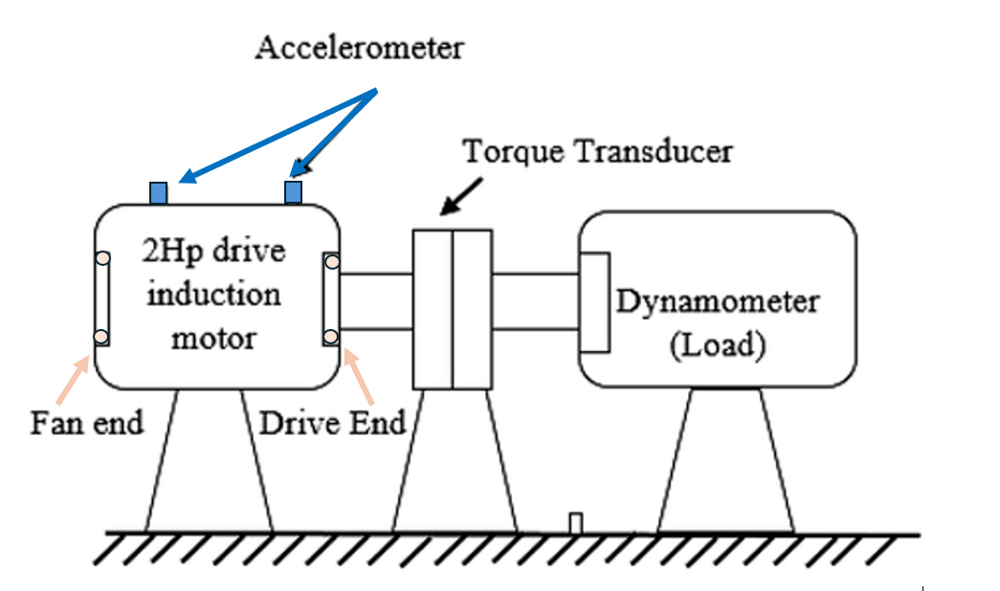
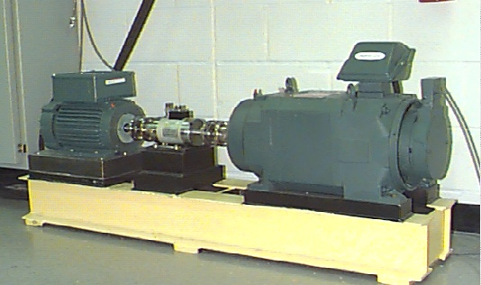

# Présentation du projet

## Le projet :

Sur les lignes de production, les machines tournantes (moteurs, pompes, ventilateurs, broyeurs) sont équipées d'accéléromètres qui enregistrent leurs vibrations. Un défaut de roulement (bague intérieure, bague extérieure, élément roulant) ou un déséquilibre mécanique laisse une signature caractéristique dans ce signal, souvent bien avant la panne.

Le but du projet est de construire une chaîne complète d'analyse capable de détecter l'apparition d'un défaut.

Selon les résultats obtenus, le modèle pourra éventuellement classer la sévérité du défaut et estimer la durée de vie résiduelle (RUL – Remaining Useful Life) des roulements.

## Contexte et Enjeux :

En milieu industriel, la maintenance des équipements est un enjeu fort à cause des coûts d’intervention et  des temps d’indisponibilité des machines (pertes de CA).

### Aspect Financier

La règle courante de dépenses en maintenance est de 2 à 4 % par an de la valeur de remplacement des équipements.

Par exemple, pour un équipement de  1 000 000 € (valeur à neuf) : le budget annuel de maintenance est de 20 000 à 40 000 €.

« Trop d’opérations de maintenance préventives » réduit le risque de casses imprévues mais maximise les coûts de maintenance »

« Pas assez de maintenance préventive augmente le risque de casses imprévues et génère des pertes de production, voir des urgences avec des pièces à livrer en express »

### Planification des opérations de maintenance.

Les arrêts d’équipements pour maintenance, ne sont pas toujours compatibles avec les délais de clients.

La possibilité d’estimer si une maintenance préventive peut être reportée par l’absence de détection de signaux d’usures éviterait des prises de risque de la part des entreprises.

## Les signaux de dégradations d’éléments de machines

La dégradation d’équipements peut s’identifier généralement par :

·       des bruits « anormaux »

·       des températures qui augmentent

·       des vibrations des équipements

Dans ce projet, nous étudions les signaux vibratoires.

Les datas utilisées sont issues d’une étude menée en 2000 par la CWRU ([Case Western Reserve University](https://case.edu/)) ,  Cleveland, Ohio, USA

### Présentation du banc de test (CWRU)

**Schémas de principe banc de test :**

{fig-align="center"}

**Photo banc de test :**

{fig-align="center"}

Le banc d'essai est composé d'un moteur de 2 chevaux, d'un capteur de couple et d'un dynamomètre imposant une **charge réglable**. La charge, exprimée en **HP (horsepower, cheval-vapeur)**, correspond au couple de freinage imposé à l'arbre : 0 HP = arbre quasi libre, 3 HP = arbre fortement freiné. Elle modifie progressivement la vitesse réelle de l'axe (1797 tr/min à 0 HP, 1730 tr/min à 3 HP) et influence ainsi les vibrations captées.

### Les défauts sur les roulements (banc de test)  

Les défauts de surface ont étés par électro érosion en différents points des roulements :

·       Bague intérieure

·       Bille

·       Bague extérieure « fixe » en trois positions ( 12 :00, 3 :00 et 6 :00)
et avec des profondeurs différentes :

    ·       0,007''      (=  0, 178 mm)       (1''  équivalent  25,4 mm)
    ·       0,014''       (=  0, 356 mm) 
    ·       0,021''       (=  0, 533 mm) 
    ·       0,028''      (=  0, 711 mm)   

Représentation des 5 points de défauts :

{fig-align="center"}

::: {.content-hidden when-format="pdf"}
Exemple de décomposition d’un signal vibratoire en plusieurs signaux simples

{fig-align="center"}
:::

### Données :

Données publiques issues de CWRU

[Download a Data File \| Case School of Engineering](https://engineering.case.edu/bearingdatacenter/download-data-file)

Les données proviennent des quatre pages de téléchargement du *Bearing Data
Center* de la Case Western Reserve University : enregistrements de référence
sur roulement sain, défauts sur le roulement côté entraînement échantillonnés
à 12 kHz et à 48 kHz, et défauts sur le roulement côté ventilateur à 12 kHz.
L'ensemble de ces fichiers a été rassemblé dans un catalogue unique, où chaque
enregistrement reçoit un nom lisible résumant ses caractéristiques : source,
localisation et diamètre du défaut, position éventuelle sur la bague
extérieure et charge du moteur (par exemple `12kDE_IR007_L0` pour un défaut de
bague intérieure de 0,007", enregistré à 12 kHz côté entraînement à 0 HP).

Le catalogue compte 161 fichiers, répartis comme indiqué
dans le @tbl-catalogue. Les défauts de bague extérieure sont plus nombreux,
car ils ont été étudiés à trois positions par rapport à la zone de charge
(3 h, 6 h et 12 h). Le plan n'est cependant pas complet : certaines
combinaisons de diamètre, de position et de charge n'ont pas été enregistrées,
en particulier pour le roulement côté ventilateur, et le diamètre de 0,028"
n'existe qu'à 12 kHz côté entraînement, pour la bague intérieure et la bille.

```{python}
#| tbl-cap: "Nombre de fichiers du catalogue CWRU par source et type de défaut."
#| label: tbl-catalogue
#Bloc 1 : remplace les deux anciens blocs de chargement
#Ce que fait chaque partie
#1.1 recopie les tableaux des quatre pages du site. Les numéros ont été vérifiés aujourd’hui sur les pages elles-mêmes, et None correspond aux astérisques (données non disponibles).
#1.2 transforme ces tableaux en une table, le catalogue, avec une ligne par fichier et un nom qui résume tout. Par exemple, 12kDE_OR021at3_L2 se lit : 12 kHz, défaut côté entraînement, bague extérieure, 0,021", position 3 h, charge 2 HP.
#1.3 définit charger(nom). Elle télécharge le fichier la première fois, puis le relit en local. Elle choisit la bonne variable quand un fichier en contient deux, et prend la vitesse nominale si la vitesse mesurée manque. Ce sont les deux défauts du code précédent.

#Résultat attendu : 161 fichiers au catalogue, puis un tableau de synthèse :
import io
import urllib.request
from pathlib import Path

import numpy as np
import pandas as pd
import matplotlib.pyplot as plt
import scipy.signal as sci
from scipy.io import loadmat
from scipy.signal import hilbert
from scipy.stats import kurtosis
from scipy.fftpack import fft, fftfreq

# ------------------------------------------------------------------
# 1.1 Les numéros de fichiers du site, page par page
#     clé = (défaut, diamètre en millièmes de pouce)
#     valeur = numéros pour les charges 0, 1, 2, 3 HP (None = absent)
# ------------------------------------------------------------------
NORMAL = [97, 98, 99, 100]

PAGES = {
    "12kDE": (12000, {
        ("IR", 7): [105, 106, 107, 108],      ("B", 7): [118, 119, 120, 121],
        ("OR@6", 7): [130, 131, 132, 133],    ("OR@3", 7): [144, 145, 146, 147],
        ("OR@12", 7): [156, 158, 159, 160],
        ("IR", 14): [169, 170, 171, 172],     ("B", 14): [185, 186, 187, 188],
        ("OR@6", 14): [197, 198, 199, 200],
        ("IR", 21): [209, 210, 211, 212],     ("B", 21): [222, 223, 224, 225],
        ("OR@6", 21): [234, 235, 236, 237],   ("OR@3", 21): [246, 247, 248, 249],
        ("OR@12", 21): [258, 259, 260, 261],
        ("IR", 28): [3001, 3002, 3003, 3004], ("B", 28): [3005, 3006, 3007, 3008],
    }),
    "48kDE": (48000, {
        ("IR", 7): [109, 110, 111, 112],      ("B", 7): [122, 123, 124, 125],
        ("OR@6", 7): [135, 136, 137, 138],    ("OR@3", 7): [148, 149, 150, 151],
        ("OR@12", 7): [161, 162, 163, 164],
        ("IR", 14): [174, 175, 176, 177],     ("B", 14): [189, 190, 191, 192],
        ("OR@6", 14): [201, 202, 203, 204],
        ("IR", 21): [213, 214, 215, 217],     ("B", 21): [226, 227, 228, 229],
        ("OR@6", 21): [238, 239, 240, 241],   ("OR@3", 21): [250, 251, 252, 253],
        ("OR@12", 21): [262, 263, 264, 265],
    }),
    "12kFE": (12000, {
        ("IR", 7): [278, 279, 280, 281],      ("B", 7): [282, 283, 284, 285],
        ("OR@6", 7): [294, 295, 296, 297],    ("OR@3", 7): [298, 299, 300, 301],
        ("OR@12", 7): [302, 305, 306, 307],
        ("IR", 14): [274, 275, 276, 277],     ("B", 14): [286, 287, 288, 289],
        ("OR@6", 14): [313, None, None, None], ("OR@3", 14): [310, 309, 311, 312],
        ("IR", 21): [270, 271, 272, 273],     ("B", 21): [290, 291, 292, 293],
        ("OR@6", 21): [315, None, None, None], ("OR@3", 21): [None, 316, 317, 318],
    }),
}

RPM_NOMINAL = {0: 1797, 1: 1772, 2: 1750, 3: 1730}

# ------------------------------------------------------------------
# 1.2 Le catalogue : une ligne par fichier, avec un nom lisible
#     ex. 'Normal_L0', '12kDE_IR007_L0', '12kDE_OR021at3_L2', '48kDE_B014_L1'
# ------------------------------------------------------------------
lignes = []
for charge, num in enumerate(NORMAL):
    lignes.append({"nom": f"Normal_L{charge}", "numero": num, "source": "Normal",
                   "fs": 12000, "defaut": "Sain", "position_OR": None,
                   "diametre_mils": 0, "charge_hp": charge})

for source, (fs, table) in PAGES.items():
    for (defaut, diametre), numeros in table.items():
        localisation, _, position = defaut.partition("@")
        for charge, num in enumerate(numeros):
            if num is None:
                continue
            nom = f"{source}_{localisation}{diametre:03d}" + (f"at{position}" if position else "") + f"_L{charge}"
            lignes.append({"nom": nom, "numero": num, "source": source, "fs": fs,
                           "defaut": localisation, "position_OR": position or None,
                           "diametre_mils": diametre, "charge_hp": charge})

catalogue = pd.DataFrame(lignes).set_index("nom")
catalogue["rpm_nominal"] = catalogue["charge_hp"].map(RPM_NOMINAL)

# ------------------------------------------------------------------
# 1.3 Lecture d'un fichier depuis le site (copie locale sous un nom lisible)
# ------------------------------------------------------------------
URL_CWRU = "https://engineering.case.edu/sites/default/files/"
CACHE = Path("../data/cwru_cache")

def charger(nom):
    """Renvoie {'DE', 'FE', 'BA', 'fs', 'rpm'} pour un fichier du catalogue
    (ex. '12kDE_IR007_L0')."""
    info = catalogue.loc[nom]
    numero = int(info["numero"])
    chemin = CACHE / f"{nom}__{numero}.mat"            # ex. 12kDE_IR007_L0__105.mat

    if not chemin.exists():                            # 1re fois : téléchargement depuis le site
        CACHE.mkdir(parents=True, exist_ok=True)
        with urllib.request.urlopen(URL_CWRU + f"{numero}.mat") as reponse:
            chemin.write_bytes(reponse.read())
    mat = loadmat(chemin)

    def choisir(suffixe):                              # privilégie la variable du bon numéro
        cles = [k for k in mat if k.endswith(suffixe)]
        bonne = [k for k in cles if k.startswith(f"X{numero:03d}")]
        return (bonne or cles or [None])[0]

    signaux = {"fs": int(info["fs"])}
    for canal in ["DE", "FE", "BA"]:
        cle = choisir(f"_{canal}_time")
        signaux[canal] = None if cle is None else np.ravel(mat[cle])
    cle_rpm = choisir("RPM")
    signaux["rpm"] = float(np.squeeze(mat[cle_rpm])) if cle_rpm else float(info["rpm_nominal"])
    return signaux

from IPython.display import Markdown

tab = catalogue.groupby(["source", "defaut"]).size().unstack(fill_value=0)
tab = tab[["Sain", "IR", "B", "OR"]].reindex(["Normal", "12kDE", "48kDE", "12kFE"])
tab = tab.reset_index().rename(columns={"source": "Source", "IR": "Bague int. (IR)",
                                        "B": "Bille (B)", "OR": "Bague ext. (OR)"})
Markdown(tab.to_markdown(index=False))
```

Chaque fichier `.mat` contient plusieurs canaux : `*_DE_time` (accéléromètre côté moteur, *Drive End*), `*_FE_time` (côté ventilateur, *Fan End*), `*_BA_time` (base) et `*RPM` (vitesse mesurée au démarrage). Un même défaut est vu différemment par chaque accéléromètre selon son chemin de mesure (distance, contacts mécaniques), d'où l'intérêt de les comparer.

```{python}
#| include: false
#| label: tbl-controle
#| tbl-cap: "Contrôle de la lecture sur deux fichiers de référence (capteur DE, 12 kHz)."
#| tbl-colwidths: [30, 17, 15, 13, 25]
# Bloc 2 : contrôle de la lecture sur deux fichiers
lignes = []
for nom in ["Normal_L0", "12kDE_IR007_L0"]:
    s = charger(nom)
    canaux = [c for c in ["DE", "FE", "BA"] if s[c] is not None]
    lignes.append({"Fichier": nom,
                   "Points": f"{len(s['DE']):,}".replace(",", " "),
                   "Durée (s)": f"{len(s['DE']) / s['fs']:.1f}".replace(".", ","),
                   "tr/min": round(s["rpm"]),
                   "Canaux": ", ".join(canaux)})

Markdown(pd.DataFrame(lignes).to_markdown(
    index=False, colalign=("left", "right", "right", "right", "left")))
```


# Analyse exploratoire : indicateurs

## Objectif

Cette section décrit le comportement de quatre indicateurs statistiques
(RMS, valeur crête, facteur de crête, kurtosis) selon l'état du roulement,
afin de :

- repérer les indicateurs qui distinguent un roulement sain d'un roulement défectueux ;
- voir s'ils distinguent aussi les types de défauts entre eux ;
- évaluer l'influence de la charge du moteur.

## Sélection des fichiers

L'analyse porte sur la configuration de référence de la littérature :
**40 fichiers** échantillonnés à 12 kHz côté entraînement, formant un plan
factoriel complet et équilibré :

- **localisation du défaut** : bague intérieure (IR), bille (B), bague extérieure à 6 h (OR) ;
- **diamètre** : 0,007", 0,014", 0,021" ;
- **charge** : 0, 1, 2, 3 HP ;
- plus les 4 enregistrements sains, soit **10 classes**.

Sont écartés : le diamètre 0,028" (pas de défaut de bague extérieure, autre
fabricant), les positions 3 h et 12 h (incomplètes), les données à 48 kHz et
côté ventilateur (autres conditions d'acquisition).

```{python}
#| label: selection
#| code-summary: "Sélection des 40 fichiers"
#| tbl-cap: "Nombre de fichiers sélectionnés par localisation et diamètre du défaut."
est_sain   = catalogue["source"] == "Normal"
est_12kDE  = catalogue["source"] == "12kDE"
bon_defaut = catalogue["defaut"].isin(["IR", "B"]) | (catalogue["position_OR"] == "6")
bon_diam   = catalogue["diametre_mils"].isin([7, 14, 21])

selection = catalogue[est_sain | (est_12kDE & bon_defaut & bon_diam)]
selection.groupby(["defaut", "diametre_mils"]).size().unstack(fill_value=0)
```

## Construction de la table des indicateurs

Chaque signal (capteur côté entraînement) est découpé en **fenêtres de 0,2 s**
sans recouvrement, soit environ 6 tours d'arbre par fenêtre. Chaque fenêtre
devient une observation, sur laquelle on calcule les quatre indicateurs :

| Indicateur | Définition | Ce qu'il mesure |
|---|---|---|
| RMS | $\sqrt{\frac{1}{n}\sum x_i^2}$ | Niveau d'énergie global de la vibration |
| Pic | $\max \lvert x_i \rvert$ | Amplitude maximale atteinte |
| Facteur de crête | Pic / RMS | Importance des chocs par rapport au niveau moyen |
| Kurtosis | $\frac{1}{n}\sum (x_i-\bar{x})^4 / \sigma^4$ | Présence de valeurs extrêmes (3 pour une loi normale) |

Les indicateurs temporels classiques en surveillance vibratoire sont :

- **RMS** : niveau global d'énergie vibratoire ;
- **Pic** : amplitude maximale atteinte ;
- **Crête** (= Pic / RMS) : caractère impulsif du signal ;
- **Kurtosis** : queues de distribution — proche de **3** pour un bruit normal, il dépasse 3 en présence de chocs.

```{python}
#| label: table-indicateurs
#| code-summary: "Calcul des indicateurs par fenêtre"
#| tbl-cap: "Nombre de fenêtres de 0.2s après découpage du signal"
def indicateurs(x):
    rms = np.sqrt(np.mean(x**2))
    pic = np.max(np.abs(x))
    return {"RMS": rms, "Pic": pic, "Crete": pic / rms,
            "Kurtosis": kurtosis(x, fisher=False)}

DUREE_FENETRE = 0.2      # secondes

lignes = []
for nom, info in selection.iterrows():
    s = charger(nom)                                   # téléchargement la 1re fois
    x, fs = s["DE"], s["fs"]
    taille = int(DUREE_FENETRE * fs)
    for i in range(len(x) // taille):
        res = {"fichier": nom, "fenetre": i, "rpm": s["rpm"], **info.to_dict()}
        res.update(indicateurs(x[i*taille:(i+1)*taille]))
        lignes.append(res)

table = pd.DataFrame(lignes)
table["classe"] = np.where(table["defaut"] == "Sain", "Sain",
                           table["defaut"] + table["diametre_mils"].astype(str).str.zfill(3))

Path("../data/features").mkdir(parents=True, exist_ok=True)
table.to_csv("../data/features/table_indicateurs.csv", index=False)

#print(f"{len(table)} fenêtres issues de {table['fichier'].nunique()} fichiers")
table.groupby(["classe", "charge_hp"]).size().unstack()
```

### Structure de la table des indicateurs

La table obtenue compte `{python} len(table)` lignes et
`{python} table.shape[1]` colonnes. Chaque **ligne** correspond à une
**fenêtre de 0,2 s** d'un enregistrement : un même fichier fournit donc
plusieurs dizaines de lignes (environ 50 pour un fichier de défaut,
100 à 200 pour un fichier sain, plus long).

Les **colonnes** se répartissent en quatre groupes, décrits dans le
@tbl-dictionnaire.

| Groupe | Colonne | Contenu |
|:--|:--|:--|
| Identification | `fichier` | Nom lisible du fichier (ex. `12kDE_IR007_L0`) |
| | `numero` | Numéro du fichier sur le site CWRU |
| | `fenetre` | Rang de la fenêtre dans le fichier (0, 1, 2…) |
| Conditions d'essai | `source` | Page d'origine (`Normal` ou `12kDE`) |
| | `fs` | Fréquence d'échantillonnage (Hz) |
| | `charge_hp` | Charge du moteur (0 à 3 HP) |
| | `rpm_nominal` | Vitesse annoncée par le site (tr/min) |
| | `rpm` | Vitesse mesurée dans le fichier (tr/min) |
| Étiquettes | `defaut` | Localisation : Sain, IR, B ou OR |
| | `diametre_mils` | Diamètre du défaut, en millièmes de pouce |
| | `position_OR` | Position du défaut de bague extérieure (6 h) |
| | `classe` | Étiquette des 10 classes (ex. `IR007`, `Sain`) |
| Indicateurs | `RMS` | Valeur efficace : énergie de la vibration |
| | `Pic` | Amplitude maximale en valeur absolue |
| | `Crete` | Facteur de crête : Pic / RMS |
| | `Kurtosis` | Aplatissement (3 pour une loi normale) |

: Description des colonnes de la table des indicateurs. {#tbl-dictionnaire}

Les colonnes d'identification et de conditions d'essai sont recopiées du
catalogue pour chaque fenêtre : la table est ainsi autonome, et chaque
observation peut être regroupée par fichier, par charge ou par classe sans
recourir à une autre source. La colonne `classe` constitue la variable
à prédire pour la classification ; les quatre indicateurs en sont les
variables explicatives. La colonne `fichier` servira à séparer les données
d'apprentissage et de test, afin que les fenêtres d'un même enregistrement
ne se retrouvent pas des deux côtés.

Le @tbl-extrait en donne un extrait.

```{python}
#| label: tbl-extrait
#| tbl-cap: "Extrait de la table des indicateurs (trois premières fenêtres de deux fichiers)."
extrait = (table[table["fichier"].isin(["Normal_L0", "12kDE_IR007_L0"])]
           .groupby("fichier").head(3)
           [["fichier", "fenetre", "charge_hp", "classe",
             "RMS", "Pic", "Crete", "Kurtosis"]]
           .round(3))
Markdown(extrait.to_markdown(index=False))
```

<!--
Ce que fait ce bloc
La boucle parcourt les 40 fichiers de selection. Pour chacun, elle lit le signal avec charger, puis le découpe en enêtres de 0,2 s.
haque ligne de la table contient le nom du fichier, le numéro de la fenêtre, la vitesse, toutes les informations du catalogue (grâce à info.to_dict()) et les 4 indicateurs.
La colonne classe crée l’étiquette des 10 classes : Sain, IR007, B014, OR021…
Le CSV garde la table pour la réutiliser ailleurs, par exemple pour les modèles, sans tout recalculer.

La table compte environ 2 500 fenêtres. Chaque fichier de défaut fournit
50 à 51 fenêtres (enregistrements d'environ 10 s). Les fichiers sains sont
plus longs (environ 20 s à 0 HP et 40 s aux autres charges) et fournissent
101 à 202 fenêtres. Le plan est donc équilibré en fichiers (4 par classe),
mais pas en fenêtres : la classe « Sain » représente environ 28 % des
observations. Ce déséquilibre est sans effet sur l'exploration (médianes,
boxplots), mais devra être pris en compte lors de la modélisation.
-->

## Statistiques descriptives

```{python}
#| label: parametres-explo
#| include: false
INDICATEURS = ["RMS", "Pic", "Crete", "Kurtosis"]
ORDRE = ["Sain", "IR007", "IR014", "IR021", "B007", "B014", "B021",
         "OR007", "OR014", "OR021"]
```

```{python}
#| label: tbl-descriptives
#| tbl-cap: "Moyenne et écart-type des indicateurs par classe (toutes charges confondues)."
table.groupby("classe")[INDICATEURS].agg(["mean", "std"]).round(3).reindex(ORDRE)
```

Le RMS distingue en moyenne toutes les classes de défaut du roulement sain
(0,067) ; les écarts les plus faibles concernent OR014 (0,096) et B021 (0,120).
Le kurtosis, en revanche, ne détecte pas certains défauts : B007 (2,91) est
indiscernable du sain (2,90), et OR014 (3,11) et B021 (3,73) restent proches
de la valeur gaussienne de 3. Les défauts les plus impulsifs sont IR014 et
OR021 (kurtosis supérieur à 20).

La sévérité ne suit pas le diamètre du défaut : les défauts de 0,014" sont
souvent moins énergétiques que ceux de 0,007". Chaque diamètre correspondant
à un roulement et à un essai différents, l'effet du diamètre est confondu avec
celui de l'essai. L'amplitude vibratoire ne permet donc pas d'estimer la taille
du défaut.

Enfin, la variabilité est très différente selon les classes : faible pour
Sain, IR007 et OR007, très élevée pour les défauts de bille de 0,014" et
0,021", dont le comportement varie fortement d'une charge à l'autre.

## Distribution par classe

```{python}
#| label: fig-boxplots
#| fig-cap: "Distribution des indicateurs par classe (fenêtres de 0,2 s, toutes charges)."
fig, axes = plt.subplots(2, 2, figsize=(14, 9))
for ax, ind in zip(axes.ravel(), INDICATEURS):
    donnees = [table.loc[table["classe"] == c, ind] for c in ORDRE]
    ax.boxplot(donnees, tick_labels=ORDRE, showfliers=False)
    ax.set_title(ind)
    ax.tick_params(axis="x", rotation=45)
plt.tight_layout()
plt.show()
```

Le RMS isole complètement le roulement sain : sa
distribution ne recouvre celle d'aucune classe de défaut, y compris les plus
discrètes (OR014, B021). En revanche, aucun indicateur ne sépare à lui seul
les dix classes. Sur le RMS, plusieurs défauts se recouvrent (B007, B014, B021,
IR014 ; OR007 et OR021). Le kurtosis ne distingue pas B007 et OR014 du roulement
sain, et confond IR014 et OR021. Le facteur de crête est l'indicateur le moins
discriminant.

Les indicateurs apparaissent complémentaires : des classes confondues sur l'un
sont séparées sur l'autre (B007 et OR014, confondus sur le kurtosis, sont
distincts sur le RMS). Le défaut B014 présente une dispersion particulièrement
forte sur tous les indicateurs.

Ces séparations sont observées entre fenêtres issues des mêmes enregistrements
et ne préjugent pas de la capacité à classer un nouveau roulement.

## Effet de la charge

```{python}
#| label: fig-charge
#| fig-cap: "Médiane du RMS et du kurtosis selon la charge, pour chaque classe."
fig, axes = plt.subplots(1, 2, figsize=(14, 4.5))
for ax, ind in zip(axes, ["RMS", "Kurtosis"]):
    med = table.groupby(["charge_hp", "classe"])[ind].median().unstack()[ORDRE]
    med.plot(ax=ax, marker="o", legend=False)
    ax.set_title(f"{ind} médian selon la charge")
    ax.set_xlabel("Charge (HP)")
    ax.set_xticks(range(4))
axes[1].legend(bbox_to_anchor=(1.02, 1), loc="upper left", fontsize=8)
plt.tight_layout()
plt.show()
```

L'effet de la charge est faible au regard des différences entre classes : les
profils sont globalement plats et parallèles, et le roulement sain reste le
moins énergétique à toutes les charges. Quelques croisements apparaissent entre
classes proches (B007 et B014 sur le RMS ; IR021, OR007 et B014 sur le
kurtosis), sans modifier la structure générale des groupes. Le kurtosis est
l'indicateur le plus stable ; seul IR014 diminue nettement à 3 HP.

La forte dispersion du défaut B014 observée précédemment ne provient pas d'une
charge particulière, ses médianes étant stables : elle traduit une variabilité
importante à l'intérieur de chaque enregistrement, cohérente avec le caractère
intermittent des chocs d'un défaut de bille.

Ces conclusions valent pour la plage de vitesse étudiée (1730 à 1797 tr/min).

## Combinaison de deux indicateurs

```{python}
#| label: fig-nuage
#| fig-cap: "RMS et kurtosis de chaque fenêtre, par classe."
fig, ax = plt.subplots(figsize=(10, 7))
for c in ORDRE:
    g = table[table["classe"] == c]
    ax.scatter(g["RMS"], g["Kurtosis"], s=8, alpha=0.5, label=c)
ax.set_xscale("log")
ax.set_yscale("log")
ax.set_xlabel("RMS (échelle log)")
ax.set_ylabel("Kurtosis (échelle log)")
ax.legend(bbox_to_anchor=(1.02, 1), loc="upper left", markerscale=2)
plt.tight_layout()
plt.show()
```

La combinaison du RMS et du kurtosis sépare la quasi-totalité des classes.
Les classes confondues sur le kurtosis (Sain, B007, OR014, B021) sont
distinguées par le RMS, et inversement IR014 et OR021, de kurtosis comparable,
diffèrent nettement par leur RMS. Seul le défaut B014 forme un nuage diffus
qui recouvre plusieurs autres classes.

On observe que certaines classes (Sain, OR007) se divisent en sous-groupes
correspondant aux différentes charges : chaque enregistrement forme un amas
compact. La séparation observée reflète donc en partie l'identité des
enregistrements, et pas seulement la nature du défaut, ce qui devra être pris
en compte dans la validation des modèles.

## Variabilité entre fichiers

Les fenêtres d'un même fichier proviennent du même enregistrement : elles ne
sont pas indépendantes. On décompose la variabilité de chaque indicateur comme
dans une analyse de variance à un facteur (le fichier) : la part expliquée par
les différences entre fichiers correspond au rapport $\eta^2$ entre la somme des
carrés inter-fichiers et la somme des carrés totale.

```{python}
#| label: tbl-variance
#| tbl-cap: 'Part de la variabilité expliquée par les différences entre fichiers ($\eta^2$).'
var = []
for ind in INDICATEURS:
    x = table[ind]
    moyenne_fichier = table.groupby("fichier")[ind].transform("mean")
    sc_totale = ((x - x.mean()) ** 2).sum()
    sc_intra  = ((x - moyenne_fichier) ** 2).sum()
    var.append({"Indicateur": ind,
                "Part entre fichiers (%)": round(100 * (1 - sc_intra / sc_totale), 1)})
pd.DataFrame(var)
```

La quasi-totalité de la variabilité des indicateurs s'explique par les
différences entre fichiers : 98,9 % pour le RMS, 96,4 % pour la valeur crête,
et environ 90 % pour le kurtosis et le facteur de crête, plus sensibles au
caractère intermittent des chocs. Les fenêtres d'un même enregistrement sont
donc très semblables et ne constituent pas des observations indépendantes :
la taille d'échantillon effective est proche du nombre de fichiers (40)
plutôt que du nombre de fenêtres (environ 2 500).

Une validation qui répartirait aléatoirement les fenêtres entre apprentissage
et test surestimerait fortement les performances. La validation des modèles
devra séparer les données par fichier ou par charge.

## Conclusion

### Principaux enseignements

- **Détection d'un défaut.** Le RMS isole complètement le
  roulement sain de toutes les classes de défaut, à toutes les charges. Un
  indicateur d'énergie suffit, sur ces données, à distinguer un roulement sain
  d'un roulement défectueux.

- **Identification du type de défaut.** Aucun indicateur ne sépare à lui seul
  les dix classes. Le kurtosis ne détecte pas certains défauts (B007, OR014),
  et plusieurs défauts se recouvrent sur le RMS. La combinaison du RMS et du
  kurtosis sépare en revanche la quasi-totalité des classes.

- **Défauts de bille.** Ce sont les plus difficiles : B007 a un kurtosis
  identique au sain, et B014 présente une forte variabilité au sein de chaque
  enregistrement, qui le fait recouvrir plusieurs autres classes.

- **Sévérité.** L'amplitude vibratoire n'augmente pas avec le diamètre du
  défaut. Chaque diamètre correspondant à un roulement et à un essai
  différents, ces données ne permettent pas d'estimer la taille d'un défaut.

- **Charge.** Son effet est faible au regard des différences entre classes,
  dans la plage de vitesse étudiée (1730 à 1797 tr/min).

### Limites

- Une seule expérience par combinaison de facteurs : les fenêtres d'un fichier
  sont des pseudo-réplicats (plus de 90 % de la variabilité est inter-fichiers).
- Défauts artificiels (électro-érosion), réalisés sur un seul banc d'essai.
- Déséquilibre en nombre de fenêtres : la classe « Sain » représente environ
  28 % des observations.
- Seuls des indicateurs temporels ont été étudiés.


# Analyse exploratoire : spectres

## Prologue

L'analyse qui suit explore un seul cas de notre dataset.
Chaque étape vise à améliorer la caractérisation du défaut dans le signal.
L'objectif est de traduire un signal brut en indicateurs fiables permettant de caractériser le défaut.
Ces traitements seront ensuite appliqués sur le plan factoriel de 40 fichiers définit dans la précédente analyse.

## Objectif

L'objectif est ici de faire une analyse fréquentielle de signal, de façon à localiser précisément et avec certitude l'emplacement du défaut.
Le cas étudié à titre d'exemple concerne un **défaut de bague intérieure de 0,007"** (0,178 mm) sur le roulement **côté moteur (Drive End)** à une charge de **0 HP (≈1797 tr/min)**.
Nous utiliserons les données des accéléromètres **côté moteur (Drive End)** et **côté ventilateur (Fan End)**

Pour une meilleure lisibilité, nous avons attribué un style fixe à chaque données.
- **Chaque état du roulement** a une couleur (vert = sain, rouge = défaut) 
- **Chaque roulement** a un style de trait (plein = Drive End, tirets = Fan End)
On peut ainsi identifier état et roulement sur n'importe quel graphique sans lire la légende.

```{python}
# --- Fichiers étudiés : baseline saine et défaut bague intérieure, 0 HP ---
NOM_SAIN   = "Normal_L0"
NOM_DEFAUT = "12kDE_IR007_L0"

sain   = charger(NOM_SAIN)
defaut = charger(NOM_DEFAUT)

STYLES = {
    "condition": {"Sain": "#149C07", "Défaut": "#C82909"},
    "canal":     {"DE": "-",        "FE": "--"},
}
STYLES_RAIES = {  # fréquences caractéristiques
    "BPFI": ("purple", "-"),
    "BPFO": ("blue",   "--"),
    "BSF":  ("orange", "-."),
    "FTF":  ("green",  ":"),
}
```

## Présentations des signaux et des fréquences caractéristiques

### Signaux

On vérifie la cohérence des signaux chargés : nombre de points, durée (calculée avec la fréquence annoncée par le catalogue), valeurs manquantes et plage d'amplitude.

```{python}
#  tbl-cap: "Résumé des signaux, durées calculées avec le fs annoncé par le catalogue."

SIGNAUX = {  # nom: (signaux, canal, condition)
    "Sain — moteur (DE)":        (sain,   "DE", "Sain"),
    "Sain — ventilateur (FE)":   (sain,   "FE", "Sain"),
    "Défaut — moteur (DE)":      (defaut, "DE", "Défaut"),
    "Défaut — ventilateur (FE)": (defaut, "FE", "Défaut"),
}

resume = pd.DataFrame([
    {"Condition": nom,
     "Nombre de points": len(s[canal]),
     "fs (Hz)": s["fs"],
     #"Durée (s)": round(len(s[canal]) / s["fs"], 2),
     #"NaN": int(np.sum(~np.isfinite(s[canal])))}
     "NaN": int(np.sum(pd.isna(s[canal])))}
    for nom, (s, canal, _) in SIGNAUX.items()
])
resume
```

Aucune valeur manquante. A noter que le sain a environ deux fois plus de points que le défaut (environ 244000 contre 121000).

::: {.content-hidden when-format="pdf"}
Les signaux devraient avoir la même fréquence d'échantillonnage selon les indications du site CWRU (12 kHz), cependant on constate un rapport de 2 sur le nombre de point entre le sain et le défaut.
On soupçonne ici une fréquence d'échantillonage à **24KHz** sur le sain, ce qui serait plus cohérent.
Gardons **12KHz** comme indiqué pour le moment, mais ce point devra néanmoins être confirmé sur le signal lui-même dans la suite du projet.
La fréquence d'échantillonnage n'est pas stockée dans les fichiers `.mat`, et notre catalogue repose sur les données textuelles du site CWRU. Si une incohérence apparaît lors des analyses spectrales, une des pistes pourrait être un problème de fréquence d'échantillonnage.
:::

### Fréquences caractéristiques des défauts

La géométrie de chaque roulement (SKF 6205-RS côté moteur, 6203-RS côté ventilateur) fixe des fréquences caractéristiques (Hz) proportionnelles à la fréquence de rotation (≈1797 tr/min), qui indiquent où chercher la signature de chaque type de défaut :

- **BPFI** (*Ball Pass Frequency Inner*) : passage des billes sur la piste intérieure ;
- **BPFO** (*Ball Pass Frequency Outer*) : piste extérieure ;
- **BSF** (*Ball Spin Frequency*) : rotation d'une bille sur elle-même ;
- **FTF** (*Fundamental Train Frequency*) : rotation de la cage.

Ces valeurs servent de référence pour **toutes** les analyses ci-dessous. Le défaut étant sur le roulement **côté moteur**, ce sont les caractéristiques du roulement **DE** qui nous intéressent.

```{python}
COEFF_FREQ = {  # coefficients × fréquence de rotation, source CWRU
    "DE": {"BPFI": 5.4152, "BPFO": 3.5848, "BSF": 4.7135, "FTF": 0.39828},
    "FE": {"BPFI": 4.9469, "BPFO": 3.0530, "BSF": 3.9874, "FTF": 0.3817},
}

RPM = defaut["rpm"]  # vitesse du fichier si présente, sinon nominale du catalogue

def freqs_caracteristiques(roulement, rpm=RPM):
    """Fréquences caractéristiques (Hz) du roulement 'DE' ou 'FE'."""
    f_rot = rpm / 60
    return {nom: coef * f_rot for nom, coef in COEFF_FREQ[roulement].items()}

pd.DataFrame({roulement: freqs_caracteristiques(roulement)
              for roulement in ("DE", "FE")}).round(1).astype(str) + " Hz"
```

## Signaux temporels brutes

On visualise 0,1 seconde de signal, **en secondes** plutôt qu'en points, à échelle d'amplitude commune. Le défaut étant côté moteur, c'est le canal DE qui porte la signature ; le canal FE sert de comparaison.

```{python}
#| fig-cap: "0,1 seconde de signal ; vert = sain, rouge = défaut ; trait plein = Drive End, tirets = Fan End."

def tracer_temps(x, fs, ax, condition, canal, titre):
    n = int(0.1 * fs)
    ax.plot(np.arange(n) / fs, x[:n],
            color=STYLES["condition"][condition],
            ls=STYLES["canal"][canal], lw=0.7)
    ax.set_title(titre, loc="left")
    ax.set_xlabel("Temps (s)")
    ax.set_ylabel("Accélération (g)")
    ax.grid(alpha=0.3)

fig, axes = plt.subplots(2, 2, figsize=(12, 5), sharex=True, sharey=True)
for ax, (nom, (s, canal, cond)) in zip(axes.flat, SIGNAUX.items()):
    tracer_temps(s[canal], s["fs"], ax, cond, canal, nom)
plt.tight_layout(); plt.show()
```

Le signal sain a une faible amplitude, les valeurs se concentrent autour de zéro, sans pics ni structure périodique ; c'est le comportement attendu d'un roulement en bon état. 
Sur le canal moteur défectueux, l'amplitude est plus élevée, et on voit des pics et une structure périodique. Ces structures correspondent aux **chocs** du passage d'une bille sur le défaut de la piste intérieure. Le défaut étant sur le roulement moteur, c'est la **BPFI du roulement DE** qui est attendue. 

```{python}
#| fig-cap: "Zoom sur 30 ms du signal défectueux ; les repères sont espacés de la période BPFI théorique."

BPFI_DE = freqs_caracteristiques("DE")["BPFI"]
fs = defaut["fs"]

x = defaut["DE"]
n = int(0.03 * fs)
t = np.arange(n) / fs
fig, ax = plt.subplots(figsize=(10, 3))
ax.plot(t, x[:n], color="red", ls="-", lw=0.8, label="Signal")
ax.vlines(np.arange(0, t[-1], 1 / BPFI_DE), *ax.get_ylim(),
          colors="crimson", ls=":", lw=1,
          label=f"Période BPFI ≈ {BPFI_DE:.0f} Hz")
ax.set_title("Défaut bague intérieure — repérage des chocs", loc="left")
ax.set_xlabel("Temps (s)"); ax.set_ylabel("Accélération (g)")
ax.legend(loc="upper right", fontsize=8); ax.grid(alpha=0.3)
plt.tight_layout(); plt.show()
```

On constate qu'avec ce simple tracé temporel, les chocs semlblent être cycliques, mais sont en même temps très différents : l'analyse doit être poussée.

## Analyse spectrale 

### Tranformation de Fourier (FFT)

Pour analyser chaque signal, nous utilisons la transformée de Fourier (FFT), ce qui nous donne une visualisation du spectre de fréquence de chaque signal.
L'analyse du spectre d'un signal permet de visualiser l'amplitude du signal pour chaque fréquence.
Ainsi, on voit clairement quelles fréquences sont excitées, et celles qui ne le sont pas :

```{python}
#| fig-cap: "Spectres d'amplitude FFT : le défaut ajoute de l'énergie haute fréquence."

def spectre_fft(x, fs):
    """Spectre d'amplitude : renvoie (fréquences, amplitudes)."""
    n = len(x)
    freqs = fftfreq(n, d=1 / fs)[: n // 2]
    # amp = np.abs(fft(x))[: n // 2] * 2 / n
    # ajout de "- np.mean(x)" pour supprimer la composante continue du signal
    amp = np.abs(fft(x - np.mean(x)))[: n // 2] * 2 / n
    return freqs, amp

def tracer_fft(ax, x, fs, condition, canal, titre,
               roulement=None, x_max=None):
    freqs, amp = spectre_fft(x, fs)
    ax.plot(freqs, amp, color=STYLES["condition"][condition],
            ls=STYLES["canal"][canal], lw=0.5)
    ax.set_title(titre, loc="left")
    ax.set_xlim(0, x_max if x_max else fs / 2)
    ax.set_xlabel("Fréquence (Hz)")
    ax.grid(alpha=0.3)
    if roulement:  # raies caractéristiques + harmoniques 2x, 3x
        for nom, val in freqs_caracteristiques(roulement).items():
            couleur, ls = STYLES_RAIES[nom]
            ax.axvline(val, color=couleur, ls=ls, lw=1.8, alpha=0.4,
                       label=f"{nom} = {val:.1f} Hz")
            for k in range(2, 4):
                if k * val < (x_max or fs / 2):
                    ax.axvline(k * val, color=couleur, ls=ls,
                               lw=0.8, alpha=0.2)
        ax.legend(loc="upper right", fontsize=8, framealpha=0.7)

fig, axes = plt.subplots(2, 2, figsize=(12, 6), sharey=True)
for colonne, canal in enumerate(("DE", "FE")):
    for ligne, condition in enumerate(("Sain", "Défaut")):
        nom = [n for n in SIGNAUX
               if n.endswith(f"({canal})") and n.startswith(condition)][0]
        s, can, cond = SIGNAUX[nom][0], canal, condition
        tracer_fft(axes[ligne, colonne], s[canal], s["fs"], cond, can, nom)
        if colonne == 0:
            axes[ligne, colonne].set_ylabel("Amplitude")
plt.tight_layout(); plt.show()
```

### Les raies de fréquences caractéristiques

La FFT brute mélange bruit de fond, raies de rotation et signature du défaut. Pour identifier l'emplacement du défaut, on zoome sur les basses fréquences et on superpose les fréquences caractéristiques définies plus haut (BPFI, BPFO, BSF, FTF — fondamentales en trait épais, harmoniques 2x et 3x en trait fin). Le défaut étant sur le roulement moteur, c'est la BPFI du roulement DE qui doit dominer sur le canal moteur.

```{python}
#| fig-cap: "FFT basse fréquence du signal défectueux avec raies caractéristiques (fondamentales et harmoniques)."

fs = defaut["fs"]

# Fenêtre d'affichage : jusqu'à 3,5 × la raie BPFI la plus haute
X_MAX = max(freqs_caracteristiques(r)["BPFI"] for r in ("DE", "FE")) * 3.5

# Chaque spectre n'est calculé qu'une seule fois
SPECTRES_DEFAUT = {canal: spectre_fft(defaut[canal], fs)
                   for canal in ("DE", "FE")}
Y_MAX = max(amp[(freqs >= 0) & (freqs <= X_MAX)].max()
            for freqs, amp in SPECTRES_DEFAUT.values())

fig, axes = plt.subplots(2, 1, figsize=(12, 7), sharey=True)
for ax, (canal, (freqs, amp)) in zip(axes, SPECTRES_DEFAUT.items()):
    tracer_fft(ax, defaut[canal], fs, "Défaut", canal, f"Défaut — {canal}",
               roulement=canal, x_max=X_MAX)
    ax.set_ylim(0, Y_MAX * 1.05)
    ax.set_ylabel("Amplitude")
plt.tight_layout(); plt.show()
```

Sur la FFT brute, on voit une correspondance sur la raie **BPFI** côté moteur (roulement défectueux), mais le pic dominant (≈450Hz) n'est associé à aucune raie caractéristique : difficulté à conclure avec certitude. Une analyse spectrale de l'enveloppe du signal (pluôt que du signal lui-même), devrait améliorer l'identification.

## Analyse d'enveloppe

### Traitement du signal

L'objectif global est de **rendre le rythme des chocs mesurable** : les chocs sont périodiques, mais leur périodicité n'est pas clair dans le spectre brut car chaque choc excite en réalité une résonance structurelle haute fréquence, amortie en quelques millisecondes. Les quatre étapes visent à isoler, puis compter, ce rythme :

1.  **Filtre passe-bande** (1–4 kHz) : *ne garder que la bande de résonance* excitée par les chocs. Objectif : supprimer les basses fréquences (raies de rotation, bruit du banc) et le bruit hors bande qui masquent les chocs.
2.  **Démodulation de Hilbert** : *extraire l'amplitude instantanée du signal filtré*. Objectif : passer du signal oscillant (la résonance qui « sonne » à chaque choc) à son enveloppe — un train d'impulsions dont un pic = un choc.
3.  **FFT de l'enveloppe** : *révéler la périodicité des chocs*. Objectif : un train d'impulsions de période T se décompose en raies à 1/T, 2/T, 3/T… — la fondamentale tombe exactement sur la fréquence caractéristique du défaut, et ses harmoniques la confirment.
4.  **Superposition des raies caractéristiques** (définies plus haut) : *identifier le type de défaut*. Objectif : associer les raies observées aux valeurs théoriques BPFI / BPFO / BSF / FTF — la raie dominante désigne le défaut présent.

```{python}
#| fig-cap: "Les étapes de l'analyse d'enveloppe sur le signal défectueux (côté moteur)."

BANDE_RESONANCE = (1000, 4000)  # bande de résonance isolée (Hz)
N_FFT = 2 ** 14

def filtrer_passe_bande(x, fs, bande=BANDE_RESONANCE):
    sos = sci.butter(4, [bande[0] / (fs / 2), bande[1] / (fs / 2)],
                     btype="bandpass", output="sos")
    return sci.sosfiltfilt(sos, x)     # zero-phase : chocs non décalés

def extraire_enveloppe(x):
    env = np.abs(hilbert(x))
    return env - np.mean(env)          # retire le pic à 0 Hz

def spectre_enveloppe(x, fs, bande=BANDE_RESONANCE, n_fft=N_FFT):
    """Chaîne complète : passe-bande + Hilbert + FFT."""
    env = extraire_enveloppe(filtrer_passe_bande(x, fs, bande))
    fenetre = np.hanning(len(env))
    freqs = np.fft.rfftfreq(n_fft, d=1 / fs)
    amp = np.abs(np.fft.rfft(env * fenetre, n=n_fft)) / np.sum(fenetre) * 2
    return freqs, amp

fs = defaut["fs"]
x = defaut["DE"]
x_filtre = filtrer_passe_bande(x, fs)
enveloppe = extraire_enveloppe(x_filtre)
t = np.arange(len(x)) / fs

fig, axes = plt.subplots(4, 1, figsize=(12, 11))
vues = [
    (f"1. Signal brut — chocs noyés dans les résonances (Défaut — DE)", x, "red", "-"),
    (f"2. Après filtre passe-bande {BANDE_RESONANCE[0]}–{BANDE_RESONANCE[1]} Hz",
     x_filtre, "tab:blue", "-"),
    ("3. Enveloppe (Hilbert) — le rythme des chocs apparaît",
     enveloppe, "tab:green", "-"),
]
for ax, (titre, sig, couleur, ls) in zip(axes, vues):
    n = int(0.05 * fs)
    ax.plot(t[:n], sig[:n], color=couleur, ls=ls, lw=0.8)
    ax.set_title(titre, loc="left")
    ax.set_ylabel("Amplitude")
    ax.grid(alpha=0.3)

freqs_env, amp_env = spectre_enveloppe(x, fs)
ax = axes[3]
ax.plot(freqs_env, amp_env, color="tab:red", lw=0.8)
ax.set_title("4. FFT de l'enveloppe — raies caractéristiques nettes", loc="left")
ax.set_ylabel("Amplitude d'enveloppe")
ax.set_xlabel("Fréquence (Hz)")
ax.set_xlim(0, X_MAX)
for nom, val in freqs_caracteristiques("DE").items():
    if nom != "BPFI":
        continue
    couleur, ls = STYLES_RAIES[nom]
    ax.axvline(val, color=couleur, ls=ls, lw=1.5, alpha=0.5,
               label=f"{nom} = {val:.1f} Hz")

    for k in range(2, 4):              # harmoniques 2x et 3x
        if k * val < X_MAX:
            ax.axvline(k * val, color=couleur, ls=ls, lw=0.8, alpha=0.2)


ax.legend(loc="upper right", fontsize=8, framealpha=0.7)
ax.grid(alpha=0.3)
plt.tight_layout(); plt.show()
```

Le pic à **BPFI** domine désormais le spectre d'enveloppe côté moteur, confirmé par ses harmoniques : signature d'un défaut de bague intérieure. 
Appliquons maintenant cette analyse aux deux signaux moteur et ventilateur :

```{python}
#| fig-cap: "Spectres d'enveloppe avec raies caractéristiques, pour les canaux moteur et ventilateur."

fs = defaut["fs"]

# Chaque spectre d'enveloppe n'est calculé qu'une seule fois
ENVELOPPES_DEFAUT = {canal: spectre_enveloppe(defaut[canal], fs)
                     for canal in ("DE", "FE")}
Y_MAX = max(amp[(freqs >= 0) & (freqs <= X_MAX)].max()
            for freqs, amp in ENVELOPPES_DEFAUT.values())

fig, axes = plt.subplots(2, 1, figsize=(12, 7), sharey=True)
for ax, (canal, (freqs_env, amp_env)) in zip(axes, ENVELOPPES_DEFAUT.items()):
    ax.plot(freqs_env, amp_env, color="red",
            ls=STYLES["canal"][canal], lw=0.5)
    ax.set_title(f"Défaut — {canal}  (filtre "
                 f"{BANDE_RESONANCE[0]}–{BANDE_RESONANCE[1]} Hz)", loc="left")
    ax.set_xlim(0, X_MAX)
    ax.set_ylim(0, Y_MAX * 1.05)
    for nom, val in freqs_caracteristiques(canal).items():
        couleur, ls = STYLES_RAIES[nom]
        ax.axvline(val, color=couleur, ls=ls, lw=1.8, alpha=0.5,
                   label=f"{nom} = {val:.1f} Hz")
        for k in range(2, 4):
            if k * val < X_MAX:
                ax.axvline(k * val, color=couleur, ls=ls, lw=0.8, alpha=0.2)
    ax.legend(loc="upper right", fontsize=8, framealpha=0.7)
    ax.set_ylabel("Amplitude d'enveloppe")
    ax.grid(alpha=0.3)
axes[-1].set_xlabel("Fréquence (Hz)")
plt.tight_layout(); plt.show()
```


Dans le spectre d'enveloppe moteur (en haut) :

- Un pic se dégage clairement et correspond à la raie de fréquence caractéristique **BPFI** du roulement moteur (162Hz)
- On confirme que ce n'est pas une coïncidence avec les 2 et 3ème harmoniques (traits de même couleur plus fin), où on voit également des pics.

Dans le spectre d'enveloppe ventilateur (en bas) :

- On "entend" le même pic que le moteur, mais de manière atténuée, puisque le capteur est sur le ventilateur.
- Les raies caractéristiques tracées sont différentes, car elles correspondent au roulement ventilateur.
- Aucun pic (ni harmonique) ne correspond aux raies de fréquences sur ce graphique.

On peut désormais conclure avec certitude que **le défaut est bien sur la piste intérieure du roulement moteur**.

## Conclusion

Le défaut de bague intérieure se manifeste par des **chocs périodiques** à BPFI, invisibles sur la FFT brute mais nets sur le **spectre d'enveloppe** après traitement.

# Points d'attentions

- La fréquence d'échantillonnage des fichiers CWRU n'est pas documentée de façon fiable dans les fichiers eux-mêmes : le catalogue repose sur les données textuelles du site.
La **vérification de la fréquence d'échantillonnage** de chaque signal pourrait permettre d'analyser d'autres données sans avoir cette information.
- La fréquence de rotation est elle aussi peu fiable car dans certains cas, le RPM affiché sur le site est différent de celui des fichiers `.mat`. Une extraction directement sur base du signal permettrait également de généraliser à d'autres signaux. 
À noter que cette fréquence de rotation pourrait varier au cours d'un même échantillon, ce qui fausserait l'analyse spectrale.

# Conclusion globale

- **Détection et caractérisation d'un défaut :** Les analyses permettent d'identifier clairement l'emplacement et le type de défaut.

- **Sévérité.** Ni l'analyse d'indicateur ni l'analyse spectrale ne nous permettent d'estimer la sévérité d'un défaut pour le moment.

- **Durée de vie résiduelle.** Aucune de nos analyses ne nous permet d'estimer cette durée. Le dataset disponible n'ayant pas d'évolution dans le temps, il semble difficile d'avancer sur la question.

# Suite proposée

1.  Avancer sur les questions relatives à la fréquence d'échantillonnage et la vitesse de rotation des échantillons
2.  Créer des indicateurs sur base de l'analyse spectrale
3.  Ajouter ces indicateurs dans le jeu de données d'apprentissage.
4.  Définir les règles et seuils puis construire un premier modèle de référence
5.  Améliorer le feature engineering et tester d'autres modèles plus complexes

# Indicateurs fréquentiels

## Principe

Les indicateurs temporels mesurent l'énergie et l'impulsivité du signal,
mais pas l'**origine** des chocs. Or chaque type de défaut produit des chocs
à un rythme qui lui est propre, multiple de la vitesse de rotation :

| Défaut | Fréquence | Multiplicateur | À 1797 tr/min |
|:--|:--|--:|--:|
| Bague intérieure | BPFI | 5,4152 | 162 Hz |
| Bague extérieure | BPFO | 3,5848 | 107 Hz |
| Bille | BSF | 4,7135 | 141 Hz |

Pour retrouver ce rythme, on calcule le **spectre d'enveloppe** de chaque
fenêtre : le signal est filtré dans la bande de résonance (2 à 5 kHz),
on en extrait l'enveloppe, puis on mesure l'amplitude de son spectre aux
trois premières harmoniques de chaque fréquence caractéristique. Cette
amplitude est rapportée au niveau de bruit du spectre (rapport signal sur
bruit), afin d'être comparable d'un enregistrement à l'autre.

Le RMS_bande est la valeur efficace du signal filtré entre 2 et 5 kHz, bande où résonne la structure sous l’effet des chocs : il mesure l’énergie apportée par les impacts, indépendamment des vibrations de fonctionnement normal du moteur.

```{python}
#| label: fonctions-spectrales
from scipy.signal import butter, sosfiltfilt, hilbert

COEF_DE = {"BPFI": 5.4152, "BPFO": 3.5848, "BSF": 4.7135}   # roulement SKF 6205
BANDE = (2000, 5000)                                         # bande de résonance (Hz)

def enveloppe(x, fs, bande=BANDE):
    """Filtre passe-bande, puis enveloppe (module du signal analytique)."""
    sos = butter(4, bande, btype="bandpass", fs=fs, output="sos")
    x_filt = sosfiltfilt(sos, x)
    env = np.abs(hilbert(x_filt))
    return x_filt, env

def indicateurs_spectraux(x_filt, env, fs, rpm, coefs=COEF_DE):
    """Indicateurs d'une fenêtre : énergie de la bande et rapports signal/bruit
    du spectre d'enveloppe aux fréquences BPFI, BPFO et BSF."""
    n = len(env)
    amp = np.abs(np.fft.rfft(env - env.mean())) * 2 / n
    freqs = np.fft.rfftfreq(n, d=1 / fs)
    fond = np.median(amp[(freqs >= 10) & (freqs <= 1000)])   # niveau de bruit
    f_rot = rpm / 60
    res = {"RMS_bande": np.sqrt(np.mean(x_filt ** 2))}
    for nom, coef in coefs.items():
        total = 0.0
        for k in (1, 2, 3):                                   # 3 premières harmoniques
            f = k * coef * f_rot
            tol = max(0.02 * f, 1.5 * freqs[1])               # tolérance de ±2 %
            total += amp[(freqs >= f - tol) & (freqs <= f + tol)].max()
        res[f"Env_{nom}"] = total / fond
    return res
```

## Calcul des indicateurs fréquentiels

```{python}
#| label: calcul-spectral
lignes = []
for nom in selection.index:
    s = charger(nom)
    x, fs, rpm = s["DE"], s["fs"], s["rpm"]
    x_filt, env = enveloppe(x, fs)                     # une fois par fichier
    taille = int(DUREE_FENETRE * fs)
    for i in range(len(x) // taille):
        sl = slice(i * taille, (i + 1) * taille)
        res = {"fichier": nom, "fenetre": i}
        res.update(indicateurs_spectraux(x_filt[sl], env[sl], fs, rpm))
        lignes.append(res)

spectre = pd.DataFrame(lignes)
table = table.merge(spectre, on=["fichier", "fenetre"], how="left",
                    validate="one_to_one")
table.to_csv("../data/features/table_indicateurs.csv", index=False)
```

```{python}
#| label: tbl-spectral
#| tbl-cap: "Médiane des indicateurs fréquentiels par classe."
med = table.groupby("classe")[["RMS_bande", "Env_BPFI", "Env_BPFO", "Env_BSF"]] \
           .median().round(2).reindex(ORDRE)
Markdown(med.reset_index().rename(columns={"classe": "Classe"})
            .to_markdown(index=False))
```

L'énergie dans la bande de résonance (RMS_bande) distingue nettement tous
les défauts du roulement sain, y compris le plus discret (OR014, quatre
fois supérieur au sain, contre 1,4 fois pour le RMS global).

Le spectre d'enveloppe identifie la localisation des défauts les plus
marqués : la composante BPFI domine pour IR007 et IR021, la composante BPFO
pour OR007 et OR021. Il ne fait en revanche pas ressortir les défauts
faibles (OR014, IR014) ni les défauts de bille, dont aucun ne présente de
signature à la fréquence BSF.

Indicateurs temporels et fréquentiels apparaissent donc complémentaires.

# Premier modèle de classification

## Méthode

On cherche à prédire la **localisation du défaut** (Sain, IR, B, OR) à partir
des huit indicateurs temporels et fréquentiels. Le modèle est une forêt
aléatoire, avec des poids de classes équilibrés pour compenser le nombre plus
élevé de fenêtres saines.

Pour éviter que le modèle reconnaisse simplement les enregistrements, la
validation se fait **par charge** : le modèle est entraîné sur trois charges
et évalué sur la quatrième, qu'il n'a jamais vue. L'opération est répétée
pour chacune des quatre charges.


```{python}
#| label: tbl-validation-charge
#| tbl-cap: "Exactitude du modèle pour chaque charge laissée de côté."
from sklearn.ensemble import RandomForestClassifier
from sklearn.metrics import accuracy_score, confusion_matrix

VARIABLES = ["RMS", "Pic", "Crete", "Kurtosis",
             "RMS_bande", "Env_BPFI", "Env_BPFO", "Env_BSF"]
CIBLE = "defaut"
ORDRE_LOC = ["Sain", "IR", "B", "OR"]

scores, predictions = [], []
for charge_test in range(4):
    app  = table[table["charge_hp"] != charge_test]     # apprentissage : 3 charges
    test = table[table["charge_hp"] == charge_test]     # test : la 4e charge
    modele = RandomForestClassifier(n_estimators=300, class_weight="balanced",
                                    random_state=0)
    modele.fit(app[VARIABLES], app[CIBLE])
    pred = modele.predict(test[VARIABLES])
    scores.append({"Charge testée (HP)": charge_test,
                   "Fenêtres testées": len(test),
                   "Exactitude (%)": round(100 * accuracy_score(test[CIBLE], pred), 1)})
    predictions.append(test.assign(prediction=pred))

predictions = pd.concat(predictions)
Markdown(pd.DataFrame(scores).to_markdown(index=False))
```

Le modèle classe correctement 97 à 99,8 % des fenêtres de la charge laissée
de côté. Il est donc robuste à la charge, ce qui est cohérent avec le faible
effet de la charge observé sur les indicateurs. Ce résultat doit cependant
être interprété avec prudence : pour une classe donnée, les quatre charges
ont été enregistrées sur le même roulement. Le modèle est donc testé sur un
roulement qu'il a déjà vu, dans des conditions légèrement différentes, et
non sur un roulement nouveau.

```{python}
#| label: tbl-confusion
#| tbl-cap: "Matrice de confusion, toutes charges de test confondues (nombre de fenêtres)."
mc = pd.DataFrame(confusion_matrix(predictions[CIBLE], predictions["prediction"],
                                   labels=ORDRE_LOC),
                  index=ORDRE_LOC, columns=ORDRE_LOC)
mc.index.name = "Réel \\ Prédit"
Markdown(mc.reset_index().to_markdown(index=False))
```


Le roulement sain est parfaitement reconnu (aucune fausse alarme ni aucun
défaut manqué), de même que les défauts de bague intérieure (99,7 %). Les
erreurs se concentrent sur la confusion entre défauts de bille et de bague
extérieure (42 des 45 fenêtres mal classées), cohérente avec les
observations précédentes : le fichier B021 présente une signature BPFO, et
le défaut OR014, sans signature ni énergie marquée, ressemble aux défauts
de bille.

# Prédiction de la dimension du défaut

## Méthode

On cherche à prédire le diamètre du défaut (0,007", 0,014" ou 0,021") à partir
des huit indicateurs, sur les seules fenêtres défectueuses. Chaque diamètre
correspondant, pour une localisation donnée, à un seul roulement, deux
validations sont comparées :

- **par charge** : le modèle est testé sur une charge qu'il n'a pas vue, mais
  sur des roulements déjà vus à d'autres charges ;
- **par localisation** : le modèle apprend les tailles sur deux localisations
  et les prédit sur la troisième, c'est-à-dire sur des roulements qu'il n'a
  jamais vus. Seule une signature de la taille commune aux différents types de
  défaut permet de réussir ce test.


```{python}
#| label: fonction-diametre
defauts = table[table["defaut"] != "Sain"]
CIBLE_D = "diametre_mils"
ORDRE_D = [7, 14, 21]

def evaluer_diametre(groupe_test, nom_groupe):
    """Validation croisée : chaque valeur de `groupe_test` est mise de côté à tour de rôle."""
    scores, preds = [], []
    for g in sorted(defauts[groupe_test].unique(), key=str):
        app  = defauts[defauts[groupe_test] != g]
        test = defauts[defauts[groupe_test] == g]
        modele = RandomForestClassifier(n_estimators=300, random_state=0)
        modele.fit(app[VARIABLES], app[CIBLE_D])
        test = test.assign(prediction=modele.predict(test[VARIABLES]))
        juste = test[CIBLE_D] == test["prediction"]
        rappel = 100 * juste.groupby(test[CIBLE_D]).mean()
        ligne = {nom_groupe: g, "Exactitude (%)": round(100 * juste.mean(), 1)}
        ligne.update({f'0,{d:03d}"': round(rappel[d], 1) for d in ORDRE_D})
        scores.append(ligne)
        preds.append(test)
    return pd.DataFrame(scores), pd.concat(preds)
```

## Résultats

```{python}
#| label: tbl-diametre-charge
#| tbl-cap: "Prédiction du diamètre, validation par charge : exactitude globale et, pour chaque diamètre réel, pourcentage de fenêtres correctement reconnues."
scores_dc, _ = evaluer_diametre("charge_hp", "Charge (HP)")
Markdown(scores_dc.to_markdown(index=False))
```

En validation par charge, le diamètre est correctement prédit pour 96 à
98,5 % des fenêtres. Les colonnes par diamètre donnent, pour chaque taille
réelle, le pourcentage de fenêtres correctement reconnues : le diamètre de
0,007" l'est presque systématiquement (98,7 à 100 %), et les rares erreurs
portent sur les diamètres de 0,014" et 0,021" (au minimum 92 %). Ce test
porte cependant sur des roulements déjà vus à d'autres charges : chaque
diamètre correspondant à un seul roulement par localisation, le modèle
peut identifier le roulement plutôt que la taille du défaut.

```{python}
#| label: tbl-diametre-localisation
#| tbl-cap: "Prédiction du diamètre, validation par localisation (roulements jamais vus) : exactitude globale et par diamètre (%)."
scores_dl, preds_dl = evaluer_diametre("defaut", "Localisation")
Markdown(scores_dl.to_markdown(index=False))
```

Sur des roulements jamais vus, l'exactitude chute à 33 % pour les défauts
de bille (niveau du hasard : toutes les fenêtres sont prédites 0,014"),
59 % pour la bague intérieure et 50 % pour la bague extérieure. Le diamètre
de 0,007" n'est jamais reconnu, alors qu'il l'était dans 98,7 à 100 % des
cas en validation par charge : le modèle identifiait les roulements, et non
la taille de leur défaut. Les quelques réussites s'expliquent par une
coïncidence de niveaux d'énergie (défauts de 0,021" très énergétiques et de
0,014" très faibles pour les bagues), qui ne constitue pas une signature
physique de la taille.

Avec un seul roulement par combinaison de localisation et de taille, les
données CWRU ne permettent pas d'apprendre une relation généralisable entre
le signal vibratoire et la dimension du défaut.

```{python}
#| label: tbl-diametre-confusion
#| tbl-cap: "Matrice de confusion du diamètre, validation par localisation (nombre de fenêtres)."
noms_d = [f'0,{d:03d}"' for d in ORDRE_D]
mc_dl = pd.DataFrame(confusion_matrix(preds_dl[CIBLE_D], preds_dl["prediction"],
                                      labels=ORDRE_D),
                     index=noms_d, columns=noms_d)
mc_dl.index.name = "Réel \\ Prédit"
Markdown(mc_dl.reset_index().to_markdown(index=False))
```

La matrice de confusion confirme l'absence de signature de la taille.
Aucune fenêtre de 0,007" n'est correctement classée : les deux tiers sont
prédites 0,021" (défauts de bague, très énergétiques), le tiers restant
0,014" (défauts de bille). Le modèle ne prédit d'ailleurs presque jamais
0,007". Les bons classements apparents de 0,014" et 0,021" résultent de deux
règles propres aux roulements de ce banc (forte énergie associée à 0,021",
faible énergie ou défaut de bille associés à 0,014"), et non d'une relation
physique entre le signal et la dimension du défaut.

## Conclusion sur la dimension du défaut

La dimension du défaut est prédite avec 96 à 98,5 % d'exactitude lorsque le
modèle est évalué sur des roulements déjà vus, mais avec 47,5 % seulement sur
des roulements nouveaux, pour un niveau de hasard de 33 %, et sans qu'aucune
fenêtre de 0,007" ne soit reconnue. L'écart entre ces deux résultats mesure
ce que le modèle avait appris par cœur.

Dans le jeu CWRU, chaque combinaison de localisation et de diamètre
correspond à un seul roulement : l'effet de la taille est confondu avec
celui du roulement et de son montage. Ces données ne permettent donc pas
d'estimer la dimension d'un défaut sur un roulement inconnu. Les modèles
développés dans la suite du projet se limiteront à la détection et à la
localisation du défaut ; l'estimation de la sévérité nécessitera des
données comportant plusieurs roulements par taille, ou des essais de
dégradation progressive.


# Prédiction du diamètre sur un second roulement

## Principe

Les défauts ont aussi été créés sur le roulement côté ventilateur, un SKF 6203,
avec les mêmes localisations et les mêmes diamètres. On dispose ainsi de deux
roulements par combinaison de localisation et de diamètre. Le modèle apprend
les diamètres sur le roulement côté entraînement, puis doit les retrouver sur
le roulement côté ventilateur, qu'il n'a jamais vu, pour un même type de défaut.
Chaque défaut est mesuré par l'accéléromètre le plus proche. L'analyse porte sur
les défauts de bague intérieure et de bille, le plan étant incomplet pour la
bague extérieure côté ventilateur.

```{python}
#| label: tables-de-fe
COEF_FE = {"BPFI": 4.9469, "BPFO": 3.0530, "BSF": 3.9874}   # roulement SKF 6203

def construire_table(sel, canal, coefs):
    """Indicateurs temporels et fréquentiels par fenêtre, pour un canal donné."""
    lignes = []
    for nom, info in sel.iterrows():
        s = charger(nom)
        x, fs, rpm = s[canal], s["fs"], s["rpm"]
        x_filt, env = enveloppe(x, fs)
        taille = int(DUREE_FENETRE * fs)
        for i in range(len(x) // taille):
            sl = slice(i * taille, (i + 1) * taille)
            res = {"fichier": nom, "fenetre": i, "canal": canal, **info.to_dict()}
            res.update(indicateurs(x[sl]))
            res.update(indicateurs_spectraux(x_filt[sl], env[sl], fs, rpm, coefs))
            lignes.append(res)
    return pd.DataFrame(lignes)

base = catalogue["defaut"].isin(["IR", "B"]) & catalogue["diametre_mils"].isin([7, 14, 21])
table_de = construire_table(catalogue[base & (catalogue["source"] == "12kDE")], "DE", COEF_DE)
table_fe = construire_table(catalogue[base & (catalogue["source"] == "12kFE")], "FE", COEF_FE)
```


## Résultats

```{python}
#| label: tbl-diametre-fe
#| tbl-cap: "Diamètre appris sur le roulement côté entraînement et prédit sur le roulement côté ventilateur : exactitude globale et, pour chaque diamètre réel, % de fenêtres bien reconnues."
JEUX = {"Tous": ["RMS", "Pic", "Crete", "Kurtosis",
                 "RMS_bande", "Env_BPFI", "Env_BPFO", "Env_BSF"],
        "Sans unité": ["Crete", "Kurtosis", "Env_BPFI", "Env_BPFO", "Env_BSF"]}

lignes = []
for nom_jeu, var in JEUX.items():
    for loc in ["IR", "B"]:
        app  = table_de[table_de["defaut"] == loc]      # roulement côté entraînement
        test = table_fe[table_fe["defaut"] == loc]      # roulement côté ventilateur
        modele = RandomForestClassifier(n_estimators=300, random_state=0)
        modele.fit(app[var], app["diametre_mils"])
        test = test.assign(prediction=modele.predict(test[var]))
        juste = test["diametre_mils"] == test["prediction"]
        rappel = 100 * juste.groupby(test["diametre_mils"]).mean()
        ligne = {"Indicateurs": nom_jeu, "Localisation": loc,
                 "Exactitude (%)": round(100 * juste.mean(), 1)}
        ligne.update({f'0,{d:03d}"': round(rappel[d], 1) for d in ORDRE_D})
        lignes.append(ligne)

Markdown(pd.DataFrame(lignes).to_markdown(index=False))
```

## Conclusion générale

Sur les données CWRU, les indicateurs vibratoires distinguent sans erreur
un roulement défectueux d'un roulement sain, grâce à l'énergie des chocs
dans la bande de résonance de la structure. Ce résultat repose cependant
sur un seul roulement sain : le principe de détection est établi, mais les
seuils de décision sont propres à ce banc d'essai.

La dimension du défaut, en revanche, ne peut pas être estimée sur un
roulement inconnu : chaque taille correspondant à un seul roulement par
localisation, son effet est confondu avec celui du roulement. Il s'agit
d'une limite du plan d'expérience, et non d'une impossibilité physique.

En pratique, ces résultats orientent vers une surveillance fondée sur
l'évolution de chaque roulement par rapport à son propre état initial
(détection d'écart à une ligne de base, à la manière d'une carte de
contrôle), qui ne nécessite pas d'exemples de défauts. L'estimation de la
sévérité ou de la durée de vie résiduelle nécessitera en revanche des
essais de dégradation progressive sur plusieurs roulements, dans des
conditions variées, afin d'apprendre une loi de dégradation commune que
l'on ajustera ensuite à chaque nouveau roulement.